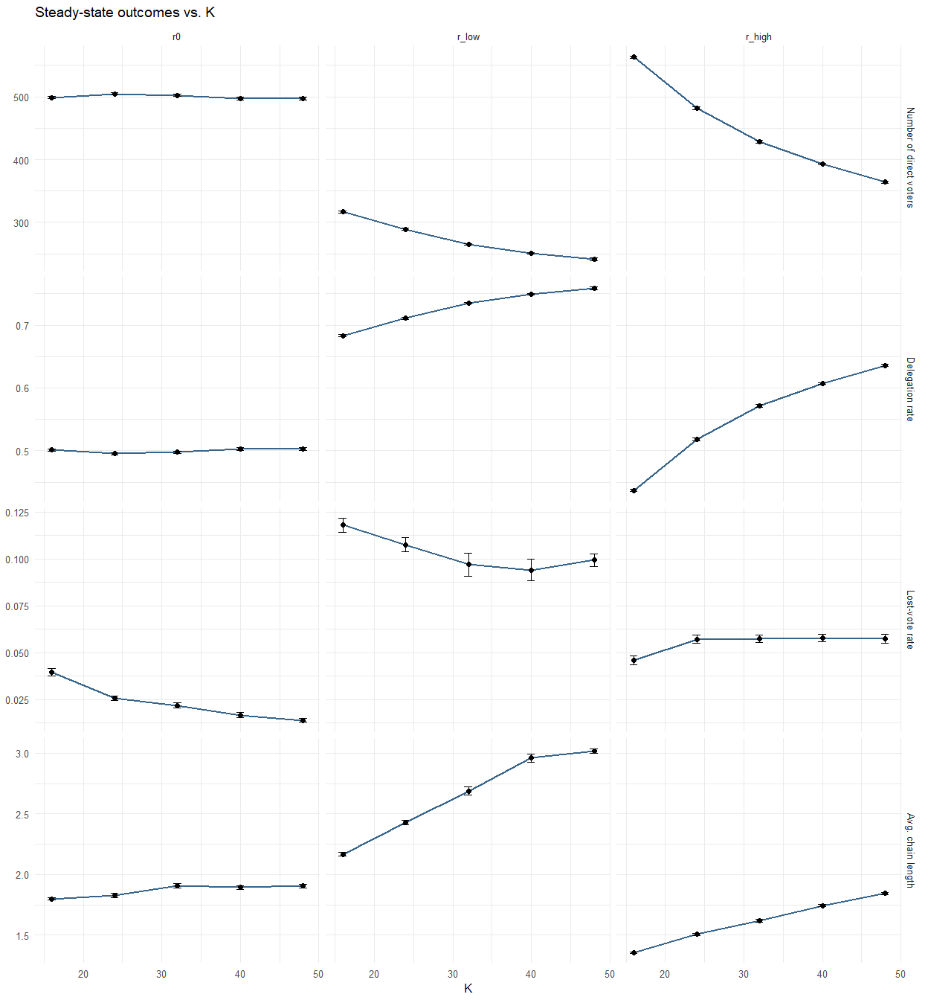
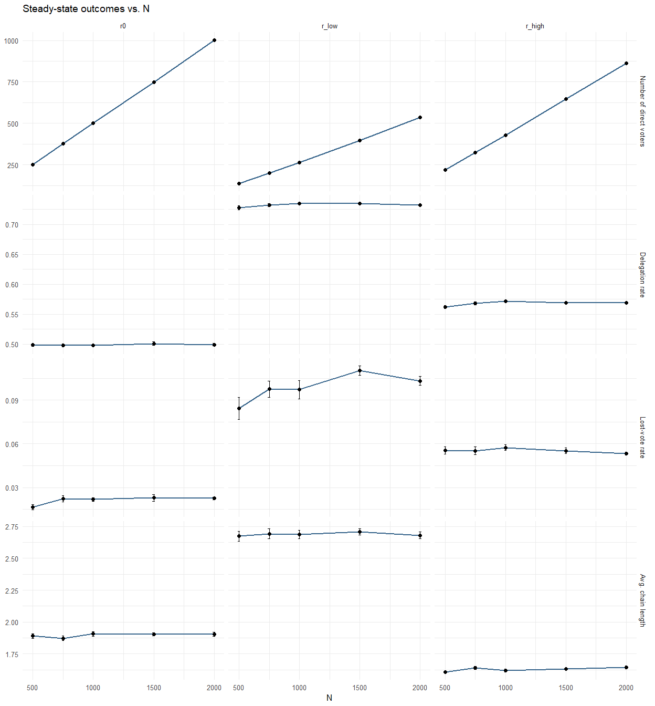

Report 21 – Calibration: K then N
================
2026-08-28

# Model

$$A_{ij}=a^{tr}_{ij}\,a^{pw}_{ij}\,a^{op}_{ij}\quad(a^{ig}=1,\ r_{ig}=0\text{ -- Part I only})$$
$$a^{op}_{ij}=\exp(-r_{op}|o_i-o_j|)\in(0,1],\qquad a^{pw}_{ij}=2\mathcal L\!\left(r_{pw}\log\tfrac{p_j}{p_i}\right)\in(0,2),\qquad a^{tr}_{ij}=2\mathcal L\!\left(r_{tr}(\tau_{ij}-1)\right)\in(0,2)$$
$$\tau_{ij}(t)=(1-\lambda)\,\tau_{ij}(t-1)+\lambda\big(1+s_{ij}(t-1)\big),\quad \tau_{ij}(0)=1,\qquad s_{ij}(t-1)=\begin{cases}k_1\big(1-2|o_i-v_j(t-1)|\big) & j\text{ delivered}\\ -k_2 & j\text{'s vote lost to a cycle}\end{cases}$$
$$P_{\text{self}}(A_k)=\frac{M-A_k}{M+A_k\left(\frac{M-1}{c}-M\right)},\qquad M=4,\quad k_1=k_2=1$$

------------------------------------------------------------------------

# Part 1: Choosing K at N = 1000

## Theoretical corridor

$N \gg K \gg \ln(N) \gg 1$; margin $K > 2\ln N$, $N > 10K$, $N=1000$:

$K \in [14, 99]$. Dunbar’s social-layer framework provides a qualitative
reference point for a locally accessible neighbourhood (sympathy group
$\approx 15$), not a quantitative degree estimate . Candidate set,
chosen inside the corridor and around this reference:

$K \in \{16, 24, 32, 40, 48\}$.

## Small-world validation

| K | ws_clustering | ws_path | ws_components_max | lattice_clustering | lattice_path | er_clustering | er_path |
|---:|---:|---:|---:|---:|---:|---:|---:|
| 16 | 0.602 | 3.993 | 1 | 0.700 | 31.721 | 0.016 | 2.775 |
| 24 | 0.616 | 3.294 | 1 | 0.717 | 21.315 | 0.024 | 2.525 |
| 32 | 0.624 | 2.945 | 1 | 0.726 | 16.112 | 0.032 | 2.314 |
| 40 | 0.629 | 2.764 | 1 | 0.731 | 12.988 | 0.041 | 2.154 |
| 48 | 0.632 | 2.667 | 1 | 0.734 | 10.910 | 0.048 | 2.047 |

WS vs. lattice (p_rewire=0) vs. Erdos-Renyi. Small-world = clustering
near lattice, path length near ER.

## Model outcome stability across K

<!-- -->

## Decision: K

$K^*$ = smallest $K$ for which a further increase changes each metric by
less than $0.5\times\text{SEM}$, at every $r$-setting.

|   K | r_label | metric          | mean_val |    sem |   delta | stable |
|----:|:--------|:----------------|---------:|-------:|--------:|:-------|
|  24 | r0      | chain_length    |   1.8271 | 0.0192 |  0.0275 | FALSE  |
|  32 | r0      | chain_length    |   1.9064 | 0.0174 |  0.0793 | FALSE  |
|  40 | r0      | chain_length    |   1.8926 | 0.0144 |  0.0137 | FALSE  |
|  48 | r0      | chain_length    |   1.9056 | 0.0143 |  0.0130 | FALSE  |
|  24 | r_high  | chain_length    |   1.5065 | 0.0077 |  0.1487 | FALSE  |
|  32 | r_high  | chain_length    |   1.6201 | 0.0132 |  0.1136 | FALSE  |
|  40 | r_high  | chain_length    |   1.7439 | 0.0099 |  0.1238 | FALSE  |
|  48 | r_high  | chain_length    |   1.8454 | 0.0090 |  0.1015 | FALSE  |
|  24 | r_low   | chain_length    |   2.4275 | 0.0177 |  0.2601 | FALSE  |
|  32 | r_low   | chain_length    |   2.6873 | 0.0325 |  0.2599 | FALSE  |
|  40 | r_low   | chain_length    |   2.9608 | 0.0333 |  0.2735 | FALSE  |
|  48 | r_low   | chain_length    |   3.0166 | 0.0202 |  0.0558 | FALSE  |
|  24 | r0      | delegation_rate |   0.4955 | 0.0018 |  0.0058 | FALSE  |
|  32 | r0      | delegation_rate |   0.4979 | 0.0020 |  0.0024 | FALSE  |
|  40 | r0      | delegation_rate |   0.5024 | 0.0024 |  0.0046 | FALSE  |
|  48 | r0      | delegation_rate |   0.5029 | 0.0025 |  0.0004 | TRUE   |
|  24 | r_high  | delegation_rate |   0.5182 | 0.0018 |  0.0814 | FALSE  |
|  32 | r_high  | delegation_rate |   0.5716 | 0.0020 |  0.0534 | FALSE  |
|  40 | r_high  | delegation_rate |   0.6074 | 0.0015 |  0.0357 | FALSE  |
|  48 | r_high  | delegation_rate |   0.6361 | 0.0015 |  0.0287 | FALSE  |
|  24 | r_low   | delegation_rate |   0.7110 | 0.0020 |  0.0276 | FALSE  |
|  32 | r_low   | delegation_rate |   0.7349 | 0.0016 |  0.0239 | FALSE  |
|  40 | r_low   | delegation_rate |   0.7495 | 0.0012 |  0.0145 | FALSE  |
|  48 | r_low   | delegation_rate |   0.7585 | 0.0022 |  0.0091 | FALSE  |
|  24 | r0      | lost_vote_rate  |   0.0257 | 0.0011 |  0.0139 | FALSE  |
|  32 | r0      | lost_vote_rate  |   0.0219 | 0.0013 |  0.0038 | FALSE  |
|  40 | r0      | lost_vote_rate  |   0.0167 | 0.0013 |  0.0051 | FALSE  |
|  48 | r0      | lost_vote_rate  |   0.0140 | 0.0011 |  0.0028 | FALSE  |
|  24 | r_high  | lost_vote_rate  |   0.0572 | 0.0023 |  0.0113 | FALSE  |
|  32 | r_high  | lost_vote_rate  |   0.0575 | 0.0021 |  0.0002 | TRUE   |
|  40 | r_high  | lost_vote_rate  |   0.0578 | 0.0020 |  0.0003 | TRUE   |
|  48 | r_high  | lost_vote_rate  |   0.0575 | 0.0025 |  0.0002 | TRUE   |
|  24 | r_low   | lost_vote_rate  |   0.1077 | 0.0038 |  0.0105 | FALSE  |
|  32 | r_low   | lost_vote_rate  |   0.0971 | 0.0061 |  0.0106 | FALSE  |
|  40 | r_low   | lost_vote_rate  |   0.0941 | 0.0057 |  0.0030 | FALSE  |
|  48 | r_low   | lost_vote_rate  |   0.0994 | 0.0035 |  0.0052 | FALSE  |
|  24 | r0      | n_direct_voters | 504.5200 | 1.7784 |  5.7600 | FALSE  |
|  32 | r0      | n_direct_voters | 502.1400 | 1.9763 |  2.3800 | FALSE  |
|  40 | r0      | n_direct_voters | 497.5600 | 2.4465 |  4.5800 | FALSE  |
|  48 | r0      | n_direct_voters | 497.1400 | 2.5419 |  0.4200 | TRUE   |
|  24 | r_high  | n_direct_voters | 481.7600 | 1.8376 | 81.4000 | FALSE  |
|  32 | r_high  | n_direct_voters | 428.3600 | 2.0057 | 53.4000 | FALSE  |
|  40 | r_high  | n_direct_voters | 392.6400 | 1.4517 | 35.7200 | FALSE  |
|  48 | r_high  | n_direct_voters | 363.9400 | 1.5435 | 28.7000 | FALSE  |
|  24 | r_low   | n_direct_voters | 289.0200 | 1.9577 | 27.5800 | FALSE  |
|  32 | r_low   | n_direct_voters | 265.0800 | 1.5638 | 23.9400 | FALSE  |
|  40 | r_low   | n_direct_voters | 250.5400 | 1.2008 | 14.5400 | FALSE  |
|  48 | r_low   | n_direct_voters | 241.4800 | 2.2391 |  9.0600 | FALSE  |

Step-to-step change vs. SEM-based tolerance, per metric x r-setting

**Chosen: K = 32.**

------------------------------------------------------------------------

# Part 2: Confirming N = 1000 at K = 32

$N=1000$ was fixed pragmatically before Part 1. This checks it is large
enough that outcomes no longer depend on further increases in $N$,
holding $K=32$ fixed.

|    N | K_over_lnN | N_over_K |
|-----:|-----------:|---------:|
|  500 |       5.15 |    15.62 |
|  750 |       4.83 |    23.44 |
| 1000 |       4.63 |    31.25 |
| 1500 |       4.38 |    46.88 |
| 2000 |       4.21 |    62.50 |

K=32 relative to each candidate N – confirms all pairs stay inside the
small-world margin

<!-- -->

## Decision: N

|    N | r_label | metric          |  mean_val |    sem |    delta | stable |
|-----:|:--------|:----------------|----------:|-------:|---------:|:-------|
|  750 | r0      | chain_length    |    1.8730 | 0.0205 |   0.0166 | FALSE  |
| 1000 | r0      | chain_length    |    1.9064 | 0.0174 |   0.0333 | FALSE  |
| 1500 | r0      | chain_length    |    1.9044 | 0.0109 |   0.0020 | TRUE   |
| 2000 | r0      | chain_length    |    1.9032 | 0.0163 |   0.0012 | TRUE   |
|  750 | r_high  | chain_length    |    1.6420 | 0.0126 |   0.0340 | FALSE  |
| 1000 | r_high  | chain_length    |    1.6201 | 0.0132 |   0.0219 | FALSE  |
| 1500 | r_high  | chain_length    |    1.6309 | 0.0061 |   0.0108 | FALSE  |
| 2000 | r_high  | chain_length    |    1.6456 | 0.0115 |   0.0147 | FALSE  |
|  750 | r_low   | chain_length    |    2.6923 | 0.0392 |   0.0192 | TRUE   |
| 1000 | r_low   | chain_length    |    2.6873 | 0.0325 |   0.0050 | TRUE   |
| 1500 | r_low   | chain_length    |    2.7089 | 0.0242 |   0.0216 | FALSE  |
| 2000 | r_low   | chain_length    |    2.6798 | 0.0271 |   0.0291 | FALSE  |
|  750 | r0      | delegation_rate |    0.4982 | 0.0028 |   0.0005 | TRUE   |
| 1000 | r0      | delegation_rate |    0.4979 | 0.0020 |   0.0003 | TRUE   |
| 1500 | r0      | delegation_rate |    0.5011 | 0.0028 |   0.0032 | FALSE  |
| 2000 | r0      | delegation_rate |    0.4994 | 0.0019 |   0.0017 | FALSE  |
|  750 | r_high  | delegation_rate |    0.5683 | 0.0026 |   0.0061 | FALSE  |
| 1000 | r_high  | delegation_rate |    0.5716 | 0.0020 |   0.0033 | FALSE  |
| 1500 | r_high  | delegation_rate |    0.5691 | 0.0016 |   0.0026 | FALSE  |
| 2000 | r_high  | delegation_rate |    0.5689 | 0.0017 |   0.0001 | TRUE   |
|  750 | r_low   | delegation_rate |    0.7326 | 0.0025 |   0.0046 | FALSE  |
| 1000 | r_low   | delegation_rate |    0.7349 | 0.0016 |   0.0024 | FALSE  |
| 1500 | r_low   | delegation_rate |    0.7346 | 0.0011 |   0.0003 | TRUE   |
| 2000 | r_low   | delegation_rate |    0.7327 | 0.0013 |   0.0019 | FALSE  |
|  750 | r0      | lost_vote_rate  |    0.0222 | 0.0022 |   0.0057 | FALSE  |
| 1000 | r0      | lost_vote_rate  |    0.0219 | 0.0013 |   0.0004 | TRUE   |
| 1500 | r0      | lost_vote_rate  |    0.0229 | 0.0022 |   0.0010 | TRUE   |
| 2000 | r0      | lost_vote_rate  |    0.0225 | 0.0009 |   0.0004 | TRUE   |
|  750 | r_high  | lost_vote_rate  |    0.0553 | 0.0026 |   0.0002 | TRUE   |
| 1000 | r_high  | lost_vote_rate  |    0.0575 | 0.0021 |   0.0022 | FALSE  |
| 1500 | r_high  | lost_vote_rate  |    0.0552 | 0.0020 |   0.0023 | FALSE  |
| 2000 | r_high  | lost_vote_rate  |    0.0532 | 0.0010 |   0.0019 | FALSE  |
|  750 | r_low   | lost_vote_rate  |    0.0976 | 0.0056 |   0.0134 | FALSE  |
| 1000 | r_low   | lost_vote_rate  |    0.0971 | 0.0061 |   0.0005 | TRUE   |
| 1500 | r_low   | lost_vote_rate  |    0.1104 | 0.0033 |   0.0133 | FALSE  |
| 2000 | r_low   | lost_vote_rate  |    0.1032 | 0.0031 |   0.0072 | FALSE  |
|  750 | r0      | n_direct_voters |  376.3800 | 2.0811 | 125.7000 | FALSE  |
| 1000 | r0      | n_direct_voters |  502.1400 | 1.9763 | 125.7600 | FALSE  |
| 1500 | r0      | n_direct_voters |  748.4200 | 4.1954 | 246.2800 | FALSE  |
| 2000 | r0      | n_direct_voters | 1001.2600 | 3.7360 | 252.8400 | FALSE  |
|  750 | r_high  | n_direct_voters |  323.7400 | 1.9313 | 104.8800 | FALSE  |
| 1000 | r_high  | n_direct_voters |  428.3600 | 2.0057 | 104.6200 | FALSE  |
| 1500 | r_high  | n_direct_voters |  646.4200 | 2.4720 | 218.0600 | FALSE  |
| 2000 | r_high  | n_direct_voters |  862.1600 | 3.4847 | 215.7400 | FALSE  |
|  750 | r_low   | n_direct_voters |  200.5800 | 1.8599 |  64.5600 | FALSE  |
| 1000 | r_low   | n_direct_voters |  265.0800 | 1.5638 |  64.5000 | FALSE  |
| 1500 | r_low   | n_direct_voters |  398.1400 | 1.6834 | 133.0600 | FALSE  |
| 2000 | r_low   | n_direct_voters |  534.5600 | 2.6430 | 136.4200 | FALSE  |

Step-to-step change vs. SEM-based tolerance, per metric x r-setting

**Chosen: N = 1000, K = 32.**
