Report 22 – K, T, and r calibration (relaxed qualifying-neighbour
tolerance)
================
2026-09-10

# 2. Attractiveness-threshold validation (the K decision)

## 2.1 Definition

For agent $i$ and neighbour $j$, $j$ qualifies as a usable delegation
target if j is at least `tolerance` as attractive as i is to itself:
$A_{ij} \geq \text{tolerance} \cdot A_{ii}$. Since
`attractiveness_expose()` gives $A_{ii} \equiv 1$ always (opinion
distance 0, power ratio 1), this is equivalent to
$A_{ij} \geq \text{tolerance}$ directly. Report 22 used tolerance = 1 (j
must be at least as attractive as i itself) – here three looser
tolerance levels are compared instead: 20%, 50%, 80%.

## 2.2 Independent effect-percentage r-triples

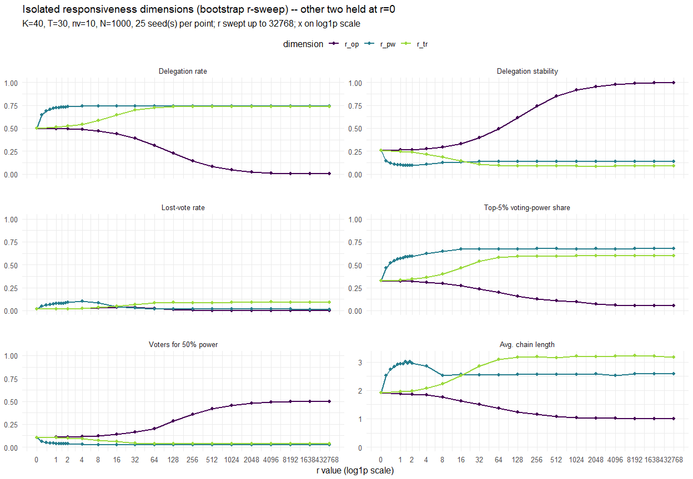<!-- -->

“Delta %” columns = step-to-step change as a % of that metric’s own
observed range (max-min across all r_val), not an absolute difference –
comparable across metrics regardless of their scale (replaces the former
separate step-to-step-delta section).

| r_val | Del. Rate | Delta % | Del. Stab. | Delta % | Lost Votes | Delta % | Top 5% | Delta % | Voters 50% | Delta % | Chain Len. | Delta % |
|---:|---:|---:|---:|---:|---:|---:|---:|---:|---:|---:|---:|---:|
| 0 | 0.4999 | NA | 0.2576 | NA | 0.0180 | NA | 0.3232 | NA | 0.1056 | NA | 1.9151 | NA |
| 1 | 0.4957 | -0.8 | 0.2612 | 0.5 | 0.0195 | 4.4 | 0.3212 | -0.7 | 0.1072 | 0.4 | 1.8857 | -3.2 |
| 2 | 0.4917 | -0.8 | 0.2666 | 0.7 | 0.0173 | -6.3 | 0.3170 | -1.5 | 0.1092 | 0.5 | 1.8645 | -2.3 |
| 4 | 0.4852 | -1.3 | 0.2746 | 1.1 | 0.0236 | 18.5 | 0.3096 | -2.7 | 0.1129 | 1.0 | 1.8384 | -2.8 |
| 8 | 0.4690 | -3.3 | 0.2945 | 2.7 | 0.0279 | 13.0 | 0.2934 | -6.0 | 0.1230 | 2.6 | 1.7539 | -9.2 |
| 16 | 0.4380 | -6.2 | 0.3330 | 5.2 | 0.0337 | 17.0 | 0.2694 | -8.8 | 0.1395 | 4.2 | 1.6345 | -13.0 |
| 32 | 0.3890 | -9.8 | 0.3946 | 8.3 | 0.0332 | -1.4 | 0.2335 | -13.2 | 0.1626 | 5.9 | 1.5014 | -14.5 |
| 64 | 0.3137 | -15.1 | 0.4911 | 13.1 | 0.0250 | -24.4 | 0.1972 | -13.3 | 0.2000 | 9.5 | 1.3718 | -14.2 |
| 128 | 0.2247 | -17.9 | 0.6154 | 16.8 | 0.0138 | -33.1 | 0.1593 | -14.0 | 0.2825 | 21.0 | 1.2404 | -14.4 |
| 256 | 0.1423 | -16.5 | 0.7436 | 17.3 | 0.0056 | -24.5 | 0.1260 | -12.3 | 0.3606 | 19.9 | 1.1470 | -10.2 |
| 512 | 0.0812 | -12.3 | 0.8481 | 14.1 | 0.0018 | -11.3 | 0.1086 | -6.4 | 0.4197 | 15.0 | 1.0794 | -7.4 |
| 1024 | 0.0438 | -7.5 | 0.9151 | 9.1 | 0.0007 | -3.4 | 0.0930 | -5.8 | 0.4566 | 9.4 | 1.0375 | -4.6 |
| 2048 | 0.0224 | -4.3 | 0.9558 | 5.5 | 0.0002 | -1.3 | 0.0723 | -7.6 | 0.4777 | 5.4 | 1.0233 | -1.6 |
| 4096 | 0.0110 | -2.3 | 0.9780 | 3.0 | 0.0001 | -0.3 | 0.0609 | -4.2 | 0.4890 | 2.9 | 1.0099 | -1.5 |
| 8192 | 0.0059 | -1.0 | 0.9884 | 1.4 | 0.0000 | -0.1 | 0.0558 | -1.9 | 0.4941 | 1.3 | 1.0028 | -0.8 |
| 16384 | 0.0028 | -0.6 | 0.9943 | 0.8 | 0.0000 | -0.1 | 0.0528 | -1.1 | 0.4972 | 0.8 | 1.0000 | -0.3 |
| 32768 | 0.0017 | -0.2 | 0.9966 | 0.3 | 0.0000 | 0.0 | 0.0517 | -0.4 | 0.4983 | 0.3 | 1.0025 | 0.3 |

r_op, bootstrap r-sweep – read off by eye where the slowest metric stops
changing further; use this to set R_SAT_ANCHOR_BOOTSTRAP below

| r_val | Del. Rate | Delta % | Del. Stab. | Delta % | Lost Votes | Delta % | Top 5% | Delta % | Voters 50% | Delta % | Chain Len. | Delta % |
|---:|---:|---:|---:|---:|---:|---:|---:|---:|---:|---:|---:|---:|
| 0.0 | 0.4999 | NA | 0.2576 | NA | 0.0180 | NA | 0.3232 | NA | 0.1056 | NA | 1.9151 | NA |
| 0.2 | 0.6434 | 59.5 | 0.1401 | -72.4 | 0.0450 | 29.8 | 0.4639 | 39.8 | 0.0584 | -56.6 | 2.5164 | 54.5 |
| 0.4 | 0.6873 | 18.2 | 0.1163 | -14.7 | 0.0606 | 17.2 | 0.5187 | 15.5 | 0.0471 | -13.6 | 2.7349 | 19.8 |
| 0.6 | 0.7065 | 8.0 | 0.1038 | -7.7 | 0.0670 | 7.0 | 0.5453 | 7.5 | 0.0426 | -5.5 | 2.8391 | 9.5 |
| 0.8 | 0.7166 | 4.2 | 0.0993 | -2.8 | 0.0705 | 3.9 | 0.5596 | 4.1 | 0.0403 | -2.7 | 2.9104 | 6.5 |
| 1.0 | 0.7212 | 1.9 | 0.0999 | 0.3 | 0.0786 | 8.9 | 0.5677 | 2.3 | 0.0391 | -1.5 | 2.9319 | 1.9 |
| 1.2 | 0.7254 | 1.8 | 0.0962 | -2.2 | 0.0769 | -1.9 | 0.5727 | 1.4 | 0.0385 | -0.7 | 2.9433 | 1.0 |
| 1.4 | 0.7282 | 1.1 | 0.0965 | 0.2 | 0.0770 | 0.1 | 0.5856 | 3.7 | 0.0366 | -2.4 | 3.0179 | 6.8 |
| 1.6 | 0.7304 | 0.9 | 0.0952 | -0.8 | 0.0775 | 0.6 | 0.5867 | 0.3 | 0.0366 | 0.1 | 2.9589 | -5.4 |
| 1.8 | 0.7311 | 0.3 | 0.0968 | 0.9 | 0.0823 | 5.3 | 0.5902 | 1.0 | 0.0359 | -0.8 | 3.0110 | 4.7 |
| 2.0 | 0.7329 | 0.8 | 0.0965 | -0.2 | 0.0899 | 8.4 | 0.5935 | 1.0 | 0.0354 | -0.6 | 2.9596 | -4.7 |
| 4.0 | 0.7410 | 3.3 | 0.1044 | 4.9 | 0.1040 | 15.6 | 0.6225 | 8.2 | 0.0311 | -5.2 | 2.8510 | -9.8 |
| 8.0 | 0.7406 | -0.1 | 0.1245 | 12.4 | 0.0858 | -20.0 | 0.6492 | 7.5 | 0.0264 | -5.7 | 2.5190 | -30.1 |
| 16.0 | 0.7405 | 0.0 | 0.1327 | 5.1 | 0.0436 | -46.5 | 0.6688 | 5.5 | 0.0232 | -3.9 | 2.5551 | 3.3 |
| 32.0 | 0.7397 | -0.3 | 0.1358 | 1.9 | 0.0284 | -16.9 | 0.6710 | 0.6 | 0.0232 | 0.1 | 2.5430 | -1.1 |
| 64.0 | 0.7395 | -0.1 | 0.1369 | 0.7 | 0.0184 | -11.0 | 0.6736 | 0.7 | 0.0229 | -0.4 | 2.5463 | 0.3 |
| 128.0 | 0.7394 | -0.1 | 0.1368 | -0.1 | 0.0144 | -4.5 | 0.6738 | 0.1 | 0.0228 | -0.2 | 2.5643 | 1.6 |
| 256.0 | 0.7395 | 0.1 | 0.1369 | 0.1 | 0.0162 | 2.0 | 0.6743 | 0.2 | 0.0227 | -0.1 | 2.5738 | 0.9 |
| 512.0 | 0.7394 | -0.1 | 0.1363 | -0.4 | 0.0173 | 1.2 | 0.6746 | 0.1 | 0.0226 | -0.1 | 2.5616 | -1.1 |
| 1024.0 | 0.7398 | 0.2 | 0.1357 | -0.3 | 0.0182 | 1.1 | 0.6737 | -0.3 | 0.0226 | 0.0 | 2.5625 | 0.1 |
| 2048.0 | 0.7402 | 0.2 | 0.1370 | 0.8 | 0.0158 | -2.7 | 0.6761 | 0.7 | 0.0225 | -0.1 | 2.5744 | 1.1 |
| 4096.0 | 0.7391 | -0.4 | 0.1387 | 1.1 | 0.0183 | 2.8 | 0.6706 | -1.6 | 0.0235 | 1.1 | 2.5286 | -4.2 |
| 8192.0 | 0.7396 | 0.2 | 0.1357 | -1.9 | 0.0166 | -1.9 | 0.6765 | 1.7 | 0.0223 | -1.4 | 2.5885 | 5.4 |
| 16384.0 | 0.7396 | 0.0 | 0.1378 | 1.3 | 0.0140 | -2.9 | 0.6766 | 0.0 | 0.0225 | 0.2 | 2.5896 | 0.1 |
| 32768.0 | 0.7394 | -0.1 | 0.1378 | 0.0 | 0.0133 | -0.7 | 0.6766 | 0.0 | 0.0225 | 0.1 | 2.5820 | -0.7 |

r_pw, bootstrap r-sweep

| r_val | Del. Rate | Delta % | Del. Stab. | Delta % | Lost Votes | Delta % | Top 5% | Delta % | Voters 50% | Delta % | Chain Len. | Delta % |
|---:|---:|---:|---:|---:|---:|---:|---:|---:|---:|---:|---:|---:|
| 0 | 0.4999 | NA | 0.2576 | NA | 0.0180 | NA | 0.3232 | NA | 0.1056 | NA | 1.9151 | NA |
| 1 | 0.5108 | 4.6 | 0.2471 | -6.1 | 0.0186 | 0.9 | 0.3342 | 4.0 | 0.1011 | -6.2 | 1.9531 | 2.9 |
| 2 | 0.5213 | 4.4 | 0.2365 | -6.1 | 0.0200 | 1.8 | 0.3416 | 2.6 | 0.0974 | -5.2 | 1.9748 | 1.7 |
| 4 | 0.5441 | 9.5 | 0.2167 | -11.5 | 0.0246 | 6.1 | 0.3637 | 8.0 | 0.0891 | -11.7 | 2.0727 | 7.4 |
| 8 | 0.5839 | 16.7 | 0.1840 | -19.0 | 0.0352 | 14.2 | 0.4008 | 13.4 | 0.0757 | -18.7 | 2.2315 | 12.1 |
| 16 | 0.6422 | 24.4 | 0.1408 | -25.0 | 0.0456 | 13.8 | 0.4632 | 22.5 | 0.0586 | -24.0 | 2.5318 | 22.8 |
| 32 | 0.6976 | 23.2 | 0.1066 | -19.8 | 0.0682 | 30.0 | 0.5349 | 25.8 | 0.0443 | -20.2 | 2.8578 | 24.8 |
| 64 | 0.7265 | 12.1 | 0.0912 | -8.9 | 0.0833 | 20.0 | 0.5810 | 16.6 | 0.0372 | -9.9 | 3.0918 | 17.8 |
| 128 | 0.7346 | 3.4 | 0.0876 | -2.1 | 0.0890 | 7.6 | 0.5939 | 4.6 | 0.0355 | -2.3 | 3.1778 | 6.5 |
| 256 | 0.7371 | 1.0 | 0.0860 | -0.9 | 0.0857 | -4.4 | 0.5942 | 0.1 | 0.0355 | -0.1 | 3.1805 | 0.2 |
| 512 | 0.7372 | 0.1 | 0.0876 | 0.9 | 0.0855 | -0.2 | 0.5944 | 0.1 | 0.0354 | -0.1 | 3.1487 | -2.4 |
| 1024 | 0.7382 | 0.4 | 0.0864 | -0.6 | 0.0885 | 3.9 | 0.5963 | 0.7 | 0.0351 | -0.4 | 3.2060 | 4.4 |
| 2048 | 0.7384 | 0.1 | 0.0849 | -0.9 | 0.0926 | 5.5 | 0.5986 | 0.8 | 0.0348 | -0.5 | 3.1994 | -0.5 |
| 4096 | 0.7387 | 0.2 | 0.0867 | 1.0 | 0.0933 | 0.8 | 0.6010 | 0.9 | 0.0345 | -0.4 | 3.2139 | 1.1 |
| 8192 | 0.7384 | -0.1 | 0.0864 | -0.2 | 0.0919 | -1.8 | 0.6006 | -0.2 | 0.0343 | -0.3 | 3.2310 | 1.3 |
| 16384 | 0.7387 | 0.1 | 0.0861 | -0.1 | 0.0914 | -0.7 | 0.5987 | -0.6 | 0.0348 | 0.6 | 3.2178 | -1.0 |
| 32768 | 0.7386 | 0.0 | 0.0854 | -0.4 | 0.0905 | -1.2 | 0.5963 | -0.9 | 0.0351 | 0.5 | 3.1739 | -3.3 |

r_tr, bootstrap r-sweep

| pct |     r_op |  r_pw |   r_tr |
|----:|---------:|------:|-------:|
|   0 |     0.00 |  0.00 |   0.00 |
|  10 |    12.85 |  0.05 |   2.18 |
|  20 |    28.26 |  0.10 |   4.28 |
|  30 |    48.25 |  0.15 |   6.64 |
|  40 |    73.09 |  0.20 |   9.36 |
|  50 |   108.82 |  0.33 |  12.58 |
|  60 |   163.79 |  0.51 |  15.80 |
|  70 |   241.03 |  1.03 |  22.36 |
|  80 |   423.88 |  2.69 |  29.15 |
|  90 |   904.15 |  6.41 |  47.01 |
| 100 | 16384.00 | 64.00 | 128.00 |

r needed to reach a given % of each dimension’s own saturated effect
(bootstrap r-sweep) – percentages are of the anchor metric’s own value
range (R_SAT_ANCHOR_BOOTSTRAP), not a linear split of r

| triple_id | pct_op | pct_pw | pct_tr |     r_op |  r_pw |   r_tr |
|----------:|-------:|-------:|-------:|---------:|------:|-------:|
|         1 |     50 |     50 |     50 |   108.82 |  0.33 |  12.58 |
|         2 |    100 |    100 |    100 | 16384.00 | 64.00 | 128.00 |
|         3 |      0 |      0 |     50 |     0.00 |  0.00 |  12.58 |
|         4 |      0 |      0 |    100 |     0.00 |  0.00 | 128.00 |
|         5 |      0 |     50 |      0 |     0.00 |  0.33 |   0.00 |
|         6 |      0 |     50 |     50 |     0.00 |  0.33 |  12.58 |
|         7 |      0 |     50 |    100 |     0.00 |  0.33 | 128.00 |
|         8 |      0 |    100 |      0 |     0.00 | 64.00 |   0.00 |
|         9 |      0 |    100 |     50 |     0.00 | 64.00 |  12.58 |
|        10 |      0 |    100 |    100 |     0.00 | 64.00 | 128.00 |
|        11 |     50 |      0 |      0 |   108.82 |  0.00 |   0.00 |
|        12 |     50 |      0 |     50 |   108.82 |  0.00 |  12.58 |
|        13 |     50 |      0 |    100 |   108.82 |  0.00 | 128.00 |
|        14 |     50 |     50 |      0 |   108.82 |  0.33 |   0.00 |
|        15 |     50 |     50 |    100 |   108.82 |  0.33 | 128.00 |
|        16 |     50 |    100 |      0 |   108.82 | 64.00 |   0.00 |
|        17 |     50 |    100 |     50 |   108.82 | 64.00 |  12.58 |
|        18 |     50 |    100 |    100 |   108.82 | 64.00 | 128.00 |
|        19 |    100 |      0 |      0 | 16384.00 |  0.00 |   0.00 |
|        20 |    100 |      0 |     50 | 16384.00 |  0.00 |  12.58 |
|        21 |    100 |      0 |    100 | 16384.00 |  0.00 | 128.00 |
|        22 |    100 |     50 |      0 | 16384.00 |  0.33 |   0.00 |
|        23 |    100 |     50 |     50 | 16384.00 |  0.33 |  12.58 |
|        24 |    100 |     50 |    100 | 16384.00 |  0.33 | 128.00 |
|        25 |    100 |    100 |      0 | 16384.00 | 64.00 |   0.00 |
|        26 |    100 |    100 |     50 | 16384.00 | 64.00 |  12.58 |

The 26 fixed effect-percentage combinations used below, translated to r
via the bootstrap r-sweep (same per-dimension metric as the table above)

Each row is one $(pct_{op}, pct_{pw}, pct_{tr})$ combination from the
full factorial over $\{0, 50, 100\}$% (3^3 = 27 combinations), minus
$(0,0,0)$ – that baseline is added separately wherever needed as its own
row. Report 22 used only 10 hand-picked combinations from a finer
$\{0,33,66,100\}$% cube; here all 26 remaining combinations of the
coarser $\{0,50,100\}$% grid are swept instead, so the K-decision
envelope (min/max across triples, Sec 2.3/2.5) reflects the true worst
case across the full percentage space rather than a hand-picked subset
of it, at a lower combinatorial cost than the finer grid.

## 2.3 First calibration of K

| warmup_label | T_warmup | nv_warmup |
|:-------------|---------:|----------:|
| T=80, nv=40  |       80 |        40 |

## 2.4 Neighbour attractiveness distribution (diagnostic)

Distribution of $A_{ij} \times \text{trust\_mod}$ across a random sample
of agents’ out-neighbours, for two of the effect-percentage triples from
2.2 – this is what `tolerance` actually cuts against in 2.5/2.6.

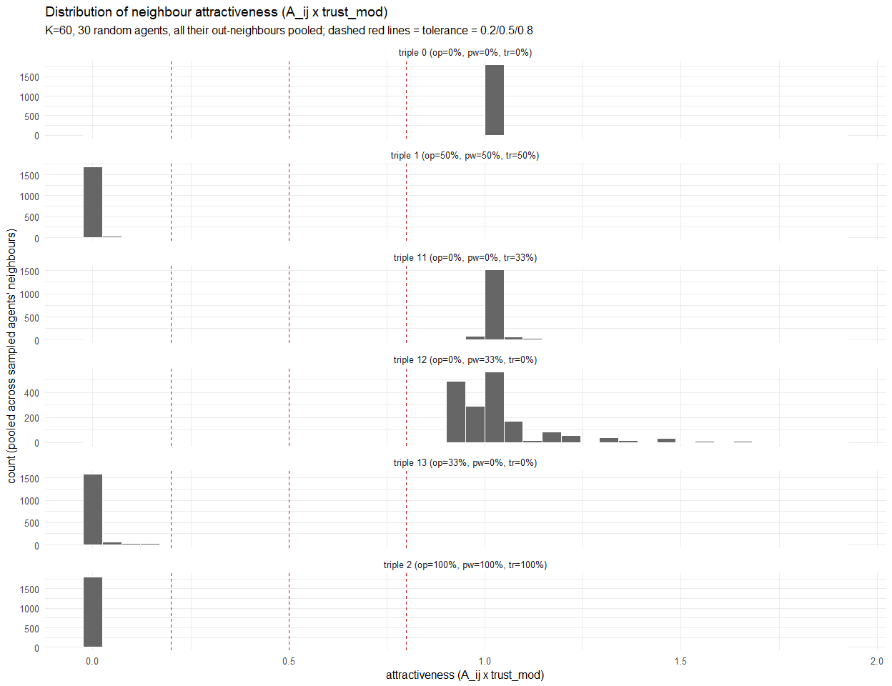<!-- -->

## 2.5 Plot

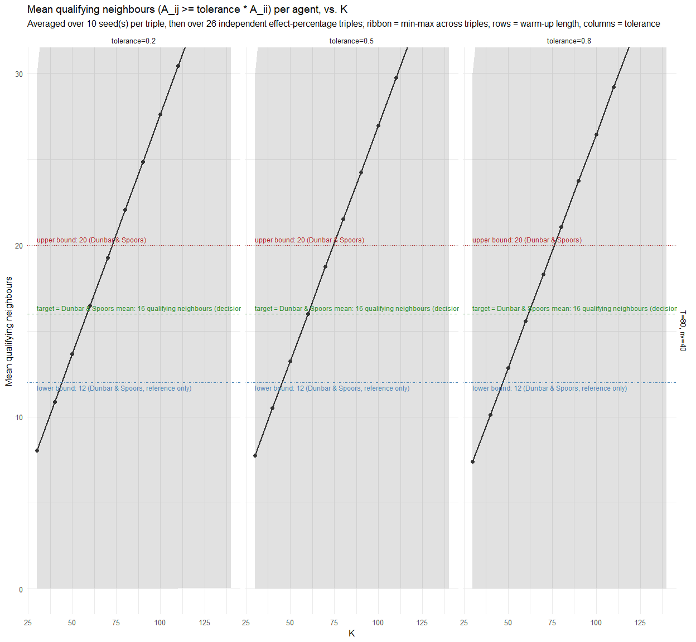<!-- -->

## 2.6 Read-off and decision

| warmup_label | tolerance | target_reached | chosen_k | max_qualifying |
|:-------------|----------:|:---------------|---------:|---------------:|
| T=80, nv=40  |       0.2 | TRUE           |       60 |          38.79 |
| T=80, nv=40  |       0.5 | TRUE           |       60 |          37.94 |
| T=80, nv=40  |       0.8 | TRUE           |       70 |          37.33 |

K read-off (first run), all tolerances – CHOSEN_TOLERANCE = 0.5 is what
actually feeds K forward below

# 3. T/n_voting_rounds sweep (manual read-off, not auto-picked)

Report 22 auto-picked (T, nv, Δt) from the saturation sweep below. Here
the sweep is only for visual inspection – nv/Δt are chosen by eye
afterwards (Sec 3.2) and may be adjusted by hand again later.

## 3.1 Plot

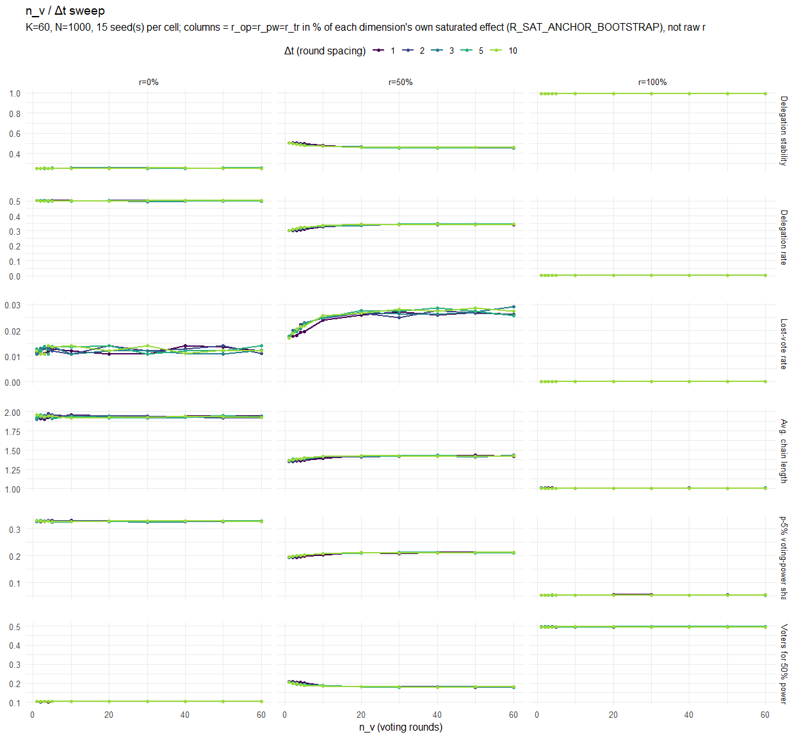<!-- -->

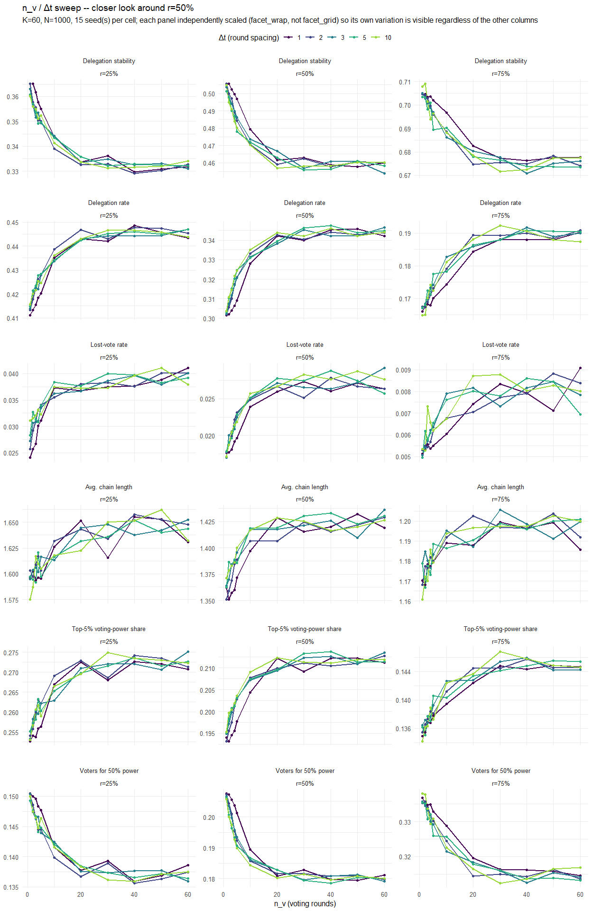<!-- -->

## 3.2 Manual choice

**Chosen: T=80, n_v=40, Δt=2.**

# 4. Responsiveness-range saturation ($r_{op}, r_{pw}, r_{tr}$)

K is fixed at 60 (Sec 2, provisional first guess – refined in Sec 5);
T=80, nv=40, Δt=2 (fixed above, Sec 3.2).

## 4.1 Grid and computation

## 4.2 Isolated dimensions ($r_{op}$, $r_{pw}$, $r_{tr}$ swept alone)

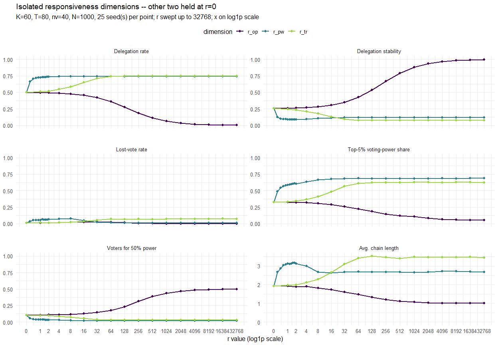<!-- -->

“Delta %” columns = step-to-step change as a % of that metric’s own
observed range (max-min across all r_val), not an absolute difference.

| r_val | Del. Rate | Delta % | Del. Stab. | Delta % | Lost Votes | Delta % | Top 5% | Delta % | Voters 50% | Delta % | Chain Len. | Delta % |
|---:|---:|---:|---:|---:|---:|---:|---:|---:|---:|---:|---:|---:|
| 0 | 0.4993 | NA | 0.2549 | NA | 0.0124 | NA | 0.3266 | NA | 0.1046 | NA | 1.9221 | NA |
| 1 | 0.4953 | -0.8 | 0.2594 | 0.6 | 0.0126 | 0.7 | 0.3253 | -0.5 | 0.1059 | 0.3 | 1.9309 | 1.0 |
| 2 | 0.4927 | -0.5 | 0.2625 | 0.4 | 0.0122 | -1.4 | 0.3199 | -2.0 | 0.1084 | 0.6 | 1.8881 | -4.6 |
| 4 | 0.4876 | -1.0 | 0.2699 | 1.0 | 0.0158 | 12.8 | 0.3186 | -0.5 | 0.1099 | 0.4 | 1.8926 | 0.5 |
| 8 | 0.4771 | -2.1 | 0.2827 | 1.7 | 0.0225 | 23.2 | 0.3066 | -4.4 | 0.1164 | 1.7 | 1.8157 | -8.3 |
| 16 | 0.4576 | -3.9 | 0.3077 | 3.4 | 0.0262 | 13.0 | 0.2868 | -7.2 | 0.1281 | 3.0 | 1.7277 | -9.4 |
| 32 | 0.4226 | -7.0 | 0.3501 | 5.7 | 0.0287 | 8.5 | 0.2599 | -9.8 | 0.1466 | 4.7 | 1.6059 | -13.1 |
| 64 | 0.3585 | -12.9 | 0.4283 | 10.6 | 0.0230 | -19.7 | 0.2205 | -14.3 | 0.1736 | 6.9 | 1.4684 | -14.8 |
| 128 | 0.2761 | -16.6 | 0.5368 | 14.6 | 0.0149 | -28.3 | 0.1843 | -13.2 | 0.2316 | 14.7 | 1.3187 | -16.1 |
| 256 | 0.1862 | -18.1 | 0.6701 | 18.0 | 0.0067 | -28.6 | 0.1433 | -15.0 | 0.3173 | 21.8 | 1.1984 | -12.9 |
| 512 | 0.1128 | -14.8 | 0.7906 | 16.3 | 0.0027 | -14.0 | 0.1173 | -9.5 | 0.3886 | 18.1 | 1.1181 | -8.6 |
| 1024 | 0.0625 | -10.1 | 0.8804 | 12.1 | 0.0010 | -5.9 | 0.1050 | -4.5 | 0.4380 | 12.6 | 1.0618 | -6.0 |
| 2048 | 0.0325 | -6.0 | 0.9364 | 7.6 | 0.0003 | -2.6 | 0.0823 | -8.3 | 0.4676 | 7.5 | 1.0299 | -3.4 |
| 4096 | 0.0168 | -3.2 | 0.9669 | 4.1 | 0.0001 | -0.6 | 0.0668 | -5.7 | 0.4832 | 4.0 | 1.0137 | -1.7 |
| 8192 | 0.0087 | -1.6 | 0.9825 | 2.1 | 0.0000 | -0.3 | 0.0587 | -2.9 | 0.4913 | 2.1 | 1.0085 | -0.6 |
| 16384 | 0.0045 | -0.8 | 0.9910 | 1.1 | 0.0000 | 0.0 | 0.0545 | -1.5 | 0.4955 | 1.1 | 1.0022 | -0.7 |
| 32768 | 0.0021 | -0.5 | 0.9957 | 0.6 | 0.0000 | 0.0 | 0.0521 | -0.9 | 0.4979 | 0.6 | 1.0000 | -0.2 |

r_op, final K/T config – read off by eye where the slowest metric stops
changing further; use this to set R_SAT_ANCHOR_FINAL below

| r_val | Del. Rate | Delta % | Del. Stab. | Delta % | Lost Votes | Delta % | Top 5% | Delta % | Voters 50% | Delta % | Chain Len. | Delta % |
|---:|---:|---:|---:|---:|---:|---:|---:|---:|---:|---:|---:|---:|
| 0.0 | 0.4993 | NA | 0.2549 | NA | 0.0124 | NA | 0.3266 | NA | 0.1046 | NA | 1.9221 | NA |
| 0.2 | 0.6605 | 66.8 | 0.1248 | -77.8 | 0.0379 | 38.0 | 0.4897 | 45.2 | 0.0529 | -60.7 | 2.6612 | 59.3 |
| 0.4 | 0.7034 | 17.8 | 0.1008 | -14.3 | 0.0510 | 19.6 | 0.5437 | 15.0 | 0.0428 | -11.8 | 2.8710 | 16.8 |
| 0.6 | 0.7147 | 4.7 | 0.0929 | -4.7 | 0.0540 | 4.5 | 0.5683 | 6.8 | 0.0388 | -4.8 | 3.0265 | 12.5 |
| 0.8 | 0.7215 | 2.8 | 0.0914 | -0.9 | 0.0551 | 1.7 | 0.5785 | 2.9 | 0.0373 | -1.7 | 3.0663 | 3.2 |
| 1.0 | 0.7253 | 1.6 | 0.0892 | -1.3 | 0.0560 | 1.4 | 0.5878 | 2.6 | 0.0361 | -1.4 | 3.1072 | 3.3 |
| 1.2 | 0.7285 | 1.3 | 0.0876 | -0.9 | 0.0649 | 13.2 | 0.5931 | 1.5 | 0.0353 | -0.9 | 3.1001 | -0.6 |
| 1.4 | 0.7295 | 0.4 | 0.0882 | 0.3 | 0.0592 | -8.5 | 0.5953 | 0.6 | 0.0351 | -0.3 | 3.1266 | 2.1 |
| 1.6 | 0.7315 | 0.8 | 0.0885 | 0.2 | 0.0584 | -1.2 | 0.6045 | 2.6 | 0.0338 | -1.5 | 3.1620 | 2.8 |
| 1.8 | 0.7330 | 0.6 | 0.0878 | -0.4 | 0.0605 | 3.1 | 0.6085 | 1.1 | 0.0332 | -0.7 | 3.1691 | 0.6 |
| 2.0 | 0.7339 | 0.4 | 0.0876 | -0.1 | 0.0639 | 5.0 | 0.6070 | -0.4 | 0.0333 | 0.1 | 3.1118 | -4.6 |
| 4.0 | 0.7401 | 2.6 | 0.0936 | 3.6 | 0.0731 | 13.8 | 0.6371 | 8.4 | 0.0286 | -5.4 | 2.9980 | -9.1 |
| 8.0 | 0.7406 | 0.2 | 0.1072 | 8.1 | 0.0771 | 5.9 | 0.6643 | 7.5 | 0.0231 | -6.5 | 2.6796 | -25.5 |
| 16.0 | 0.7405 | 0.0 | 0.1136 | 3.8 | 0.0446 | -48.4 | 0.6773 | 3.6 | 0.0212 | -2.2 | 2.6307 | -3.9 |
| 32.0 | 0.7404 | 0.0 | 0.1174 | 2.3 | 0.0206 | -35.8 | 0.6847 | 2.1 | 0.0200 | -1.5 | 2.6668 | 2.9 |
| 64.0 | 0.7404 | 0.0 | 0.1175 | 0.0 | 0.0170 | -5.3 | 0.6863 | 0.4 | 0.0196 | -0.4 | 2.6867 | 1.6 |
| 128.0 | 0.7397 | -0.3 | 0.1167 | -0.5 | 0.0100 | -10.5 | 0.6859 | -0.1 | 0.0201 | 0.6 | 2.6796 | -0.6 |
| 256.0 | 0.7402 | 0.2 | 0.1167 | 0.0 | 0.0113 | 1.9 | 0.6821 | -1.1 | 0.0206 | 0.6 | 2.6603 | -1.5 |
| 512.0 | 0.7399 | -0.1 | 0.1156 | -0.7 | 0.0124 | 1.7 | 0.6853 | 0.9 | 0.0201 | -0.6 | 2.6769 | 1.3 |
| 1024.0 | 0.7397 | -0.1 | 0.1155 | -0.1 | 0.0119 | -0.8 | 0.6838 | -0.4 | 0.0205 | 0.5 | 2.6481 | -2.3 |
| 2048.0 | 0.7402 | 0.2 | 0.1163 | 0.5 | 0.0134 | 2.2 | 0.6855 | 0.5 | 0.0200 | -0.6 | 2.6634 | 1.2 |
| 4096.0 | 0.7403 | 0.0 | 0.1165 | 0.1 | 0.0103 | -4.6 | 0.6865 | 0.3 | 0.0195 | -0.6 | 2.7174 | 4.3 |
| 8192.0 | 0.7402 | 0.0 | 0.1182 | 1.0 | 0.0128 | 3.6 | 0.6859 | -0.2 | 0.0198 | 0.4 | 2.7058 | -0.9 |
| 16384.0 | 0.7401 | 0.0 | 0.1170 | -0.7 | 0.0109 | -2.8 | 0.6872 | 0.4 | 0.0196 | -0.2 | 2.6965 | -0.8 |
| 32768.0 | 0.7399 | -0.1 | 0.1168 | -0.1 | 0.0113 | 0.7 | 0.6866 | -0.2 | 0.0199 | 0.3 | 2.6685 | -2.2 |

r_pw, final K/T config

| r_val | Del. Rate | Delta % | Del. Stab. | Delta % | Lost Votes | Delta % | Top 5% | Delta % | Voters 50% | Delta % | Chain Len. | Delta % |
|---:|---:|---:|---:|---:|---:|---:|---:|---:|---:|---:|---:|---:|
| 0 | 0.4993 | NA | 0.2549 | NA | 0.0124 | NA | 0.3266 | NA | 0.1046 | NA | 1.9221 | NA |
| 1 | 0.5112 | 4.8 | 0.2454 | -5.3 | 0.0143 | 3.1 | 0.3348 | 2.7 | 0.1005 | -5.5 | 1.9716 | 3.1 |
| 2 | 0.5192 | 3.2 | 0.2349 | -5.8 | 0.0139 | -0.7 | 0.3440 | 3.1 | 0.0969 | -4.9 | 1.9963 | 1.5 |
| 4 | 0.5480 | 11.6 | 0.2090 | -14.4 | 0.0182 | 6.9 | 0.3705 | 8.8 | 0.0869 | -13.6 | 2.1174 | 7.6 |
| 8 | 0.5864 | 15.5 | 0.1774 | -17.6 | 0.0219 | 5.9 | 0.4084 | 12.6 | 0.0734 | -18.2 | 2.2884 | 10.7 |
| 16 | 0.6494 | 25.3 | 0.1322 | -25.1 | 0.0351 | 21.2 | 0.4823 | 24.6 | 0.0544 | -25.8 | 2.6423 | 22.1 |
| 32 | 0.7128 | 25.5 | 0.0928 | -21.9 | 0.0505 | 24.6 | 0.5654 | 27.7 | 0.0393 | -20.4 | 3.1041 | 28.8 |
| 64 | 0.7400 | 11.0 | 0.0787 | -7.8 | 0.0687 | 28.9 | 0.6125 | 15.7 | 0.0326 | -9.1 | 3.4076 | 18.9 |
| 128 | 0.7456 | 2.2 | 0.0749 | -2.1 | 0.0675 | -1.9 | 0.6246 | 4.0 | 0.0310 | -2.2 | 3.5252 | 7.3 |
| 256 | 0.7469 | 0.5 | 0.0762 | 0.7 | 0.0705 | 4.9 | 0.6221 | -0.8 | 0.0316 | 0.8 | 3.4609 | -4.0 |
| 512 | 0.7474 | 0.2 | 0.0754 | -0.4 | 0.0685 | -3.3 | 0.6242 | 0.7 | 0.0315 | -0.1 | 3.4049 | -3.5 |
| 1024 | 0.7472 | -0.1 | 0.0752 | -0.1 | 0.0723 | 6.0 | 0.6272 | 1.0 | 0.0307 | -1.1 | 3.4736 | 4.3 |
| 2048 | 0.7480 | 0.3 | 0.0754 | 0.1 | 0.0701 | -3.5 | 0.6256 | -0.5 | 0.0308 | 0.2 | 3.4685 | -0.3 |
| 4096 | 0.7477 | -0.1 | 0.0749 | -0.3 | 0.0696 | -0.7 | 0.6252 | -0.1 | 0.0312 | 0.4 | 3.4599 | -0.5 |
| 8192 | 0.7474 | -0.1 | 0.0762 | 0.7 | 0.0690 | -1.1 | 0.6263 | 0.4 | 0.0310 | -0.2 | 3.4605 | 0.0 |
| 16384 | 0.7474 | 0.0 | 0.0767 | 0.3 | 0.0751 | 9.7 | 0.6262 | 0.0 | 0.0308 | -0.3 | 3.4747 | 0.9 |
| 32768 | 0.7478 | 0.1 | 0.0760 | -0.4 | 0.0742 | -1.4 | 0.6253 | -0.3 | 0.0313 | 0.7 | 3.4293 | -2.8 |

r_tr, final K/T config

# 5. K/T/r first values (first run)

| iter |   K |   T |  NV |  DT | tolerance | r_sat_op | r_sat_pw | r_sat_tr |
|-----:|----:|----:|----:|----:|----------:|---------:|---------:|---------:|
|    0 |  60 |  80 |  40 |   2 |       0.5 |    32768 |    32768 |    32768 |

K/T/r across loop iterations

**K did NOT converge within 1 iterations** (K sequence: 60) – the
iteration-0 values below are reported as provisional, not converged.
Raise MAX_ITER (and the seed counts, currently 1 for a fast first pass)
to close the loop properly.

# 6. Final calibrated values

- **K = 60** – smallest K clearing 16 qualifying neighbours (tolerance =
  0.5) across 26 independent effect-percentage triples, warm-up-length
  check as in Sec 2, converged at iteration 0.
- **T = 80, n_voting_rounds = 40, Δt = 2** – chosen by eye from the Sec
  3 sweep, not auto-derived; may still be adjusted by hand.
- **r ceilings** – r_op=32768.00, r_pw=32768.00, r_tr=32768.00 – r_sat
  read off by eye from the Sec 4.2 diagnostic table
  (R_SAT_ANCHOR_FINAL), the r_val at which each dimension’s own
  slowest-to-settle tracked metric stops changing further.

Small-world corridor ($N > 10K$) at K = 60: N \> 600.

# 7. N sensitivity check

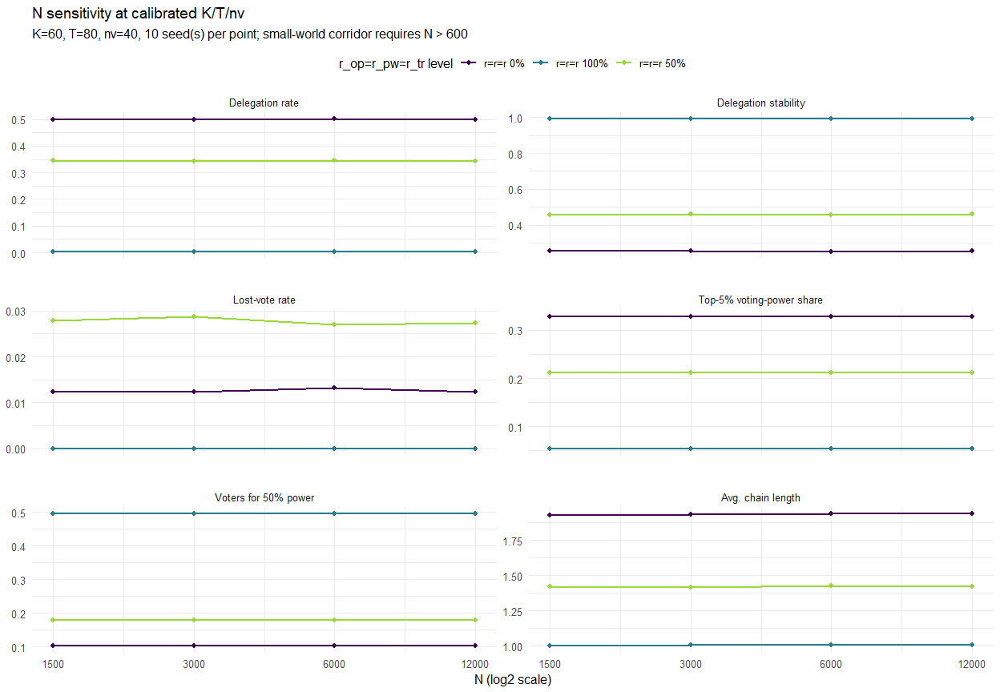<!-- -->

# 8. Δt x λ (trust forget-rate) interaction

For reference: the report’s own default `LAMBDA_CONTEXT = 0.1294`
corresponds to **50.0% forgotten after 5 voting rounds**, which matches
the `forget50` column below exactly.

**Warning: 111 (nv, dt, lambda) combinations have fewer than 3 voting
rounds in the last-5-calendar-round steady-state window**
(e.g. nv=1,dt=1,forget10; nv=1,dt=1,forget50; nv=1,dt=1,forget90;
nv=1,dt=2,forget10; nv=1,dt=2,forget50) – their steady-state values may
look unsaturated simply because trust had too few updates in that
window, not because of dt or lambda itself. Read these cells with
caution.

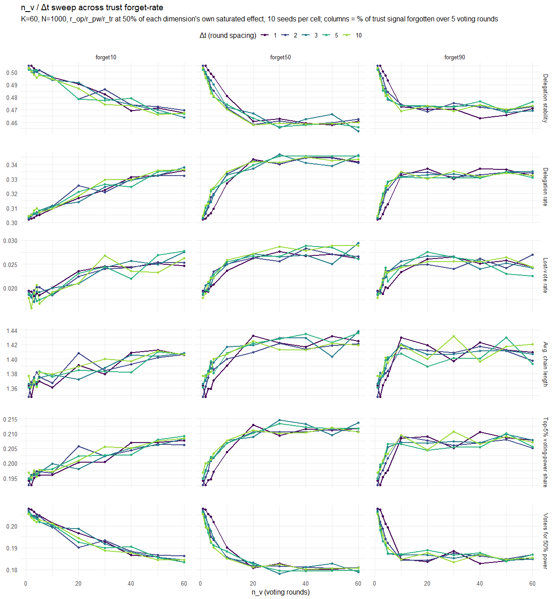<!-- -->

# 9. Self-reliance c sensitivity

`self_reliance_c` (the c in the Möbius self-vote curve
`p_self_mobius_M`, Sec 1.4.1) swept across its full \[0, 1\] range, over
all six tracked metrics, at three r_op=r_pw=r_tr levels (0%, 50%, 100%
of each dimension’s own saturated effect, single shared dial like Sec
7/10) shown as separate coloured lines per facet. Note: c=0 is a genuine
division-by-zero in `p_self_mobius_M` (`(M-1)/c` blows up), so the sweep
uses c=0.01 as the practical lower bound instead of the literal 0.

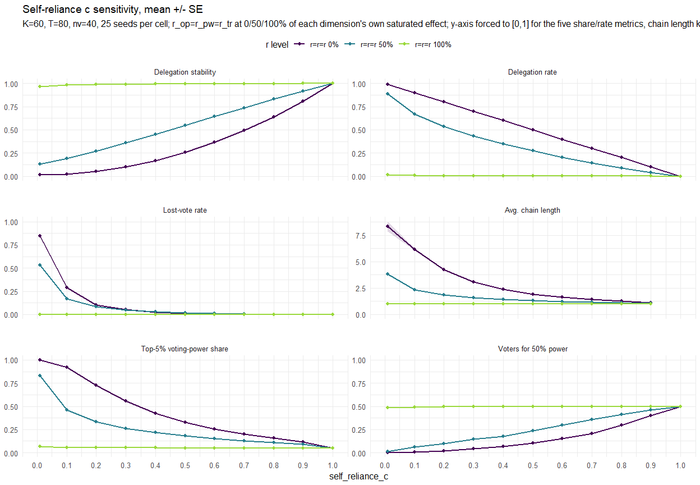<!-- -->

# 10. Watts-Strogatz vs. Barabasi-Albert

Fixing N=1000, K=60, T=80, nv=40 (the calibrated values from Sec. 6, not
Report_20’s anchor N=1000/K=16): does the network generator itself
matter? WS (small-world, the default used everywhere else in this
report) vs. BA (Barabasi-Albert preferential attachment – hub-like
degree heterogeneity that WS cannot produce). Everything from here on is
expressed in r-percentages (% of each dimension’s own saturated effect,
read off by hand into `R_SAT_ANCHOR_FINAL`, Sec 4.2), not raw r-values –
consistent with Sec 7/9. Each pair of responsiveness dimensions is
varied *together* across 10%-100% (in 10-point steps) of their own
saturated effect, while the third is held fixed at one of three levels
(0%/50%/100%), shown as differently coloured lines, network type
distinguished by line style on top of that (WS solid, BA dashed). All
three possible pairings are covered:

- $r_{op}=r_{pw}$ varied, $r_{tr}$ fixed
- $r_{op}=r_{tr}$ varied, $r_{pw}$ fixed
- $r_{pw}=r_{tr}$ varied, $r_{op}$ fixed

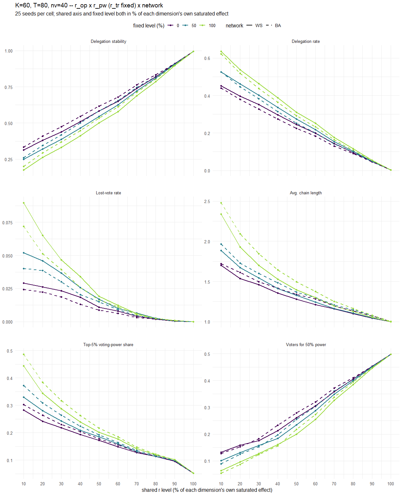<!-- -->

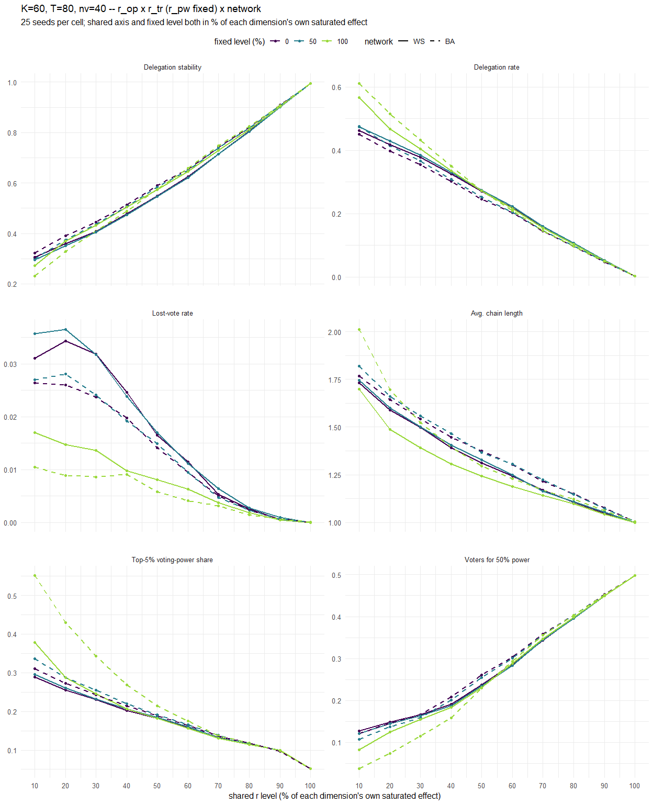<!-- -->

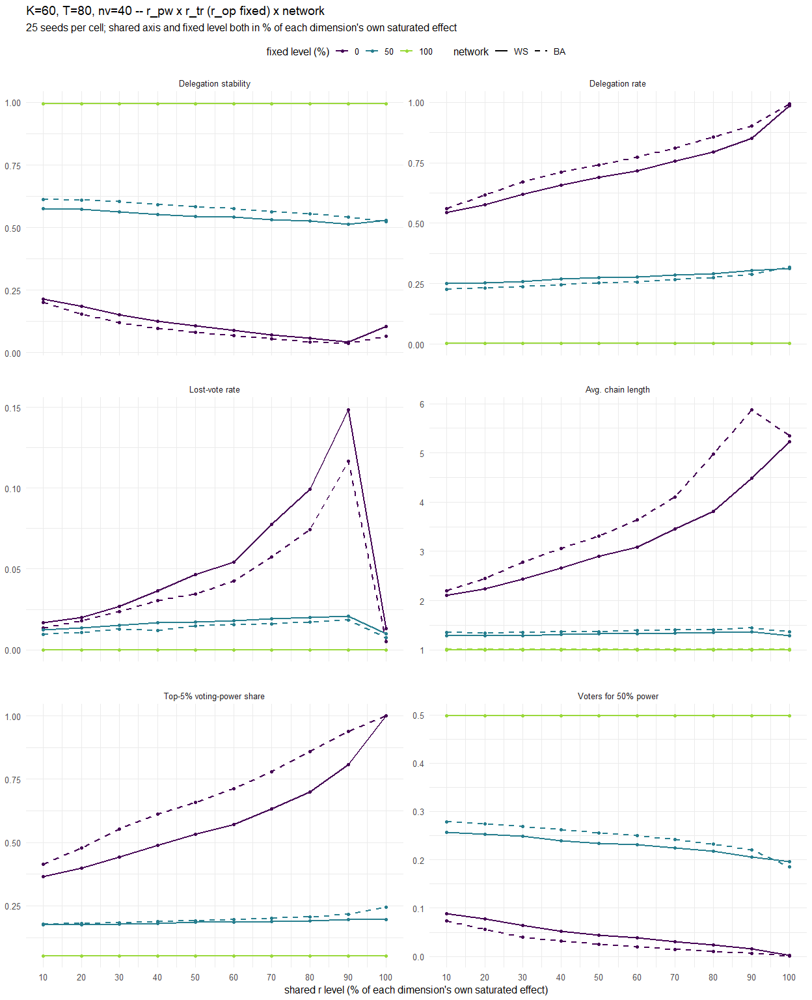<!-- -->

# 11. Actual runtime

Runtime for a single simulation at the final calibrated config (K=60,
T=80, nv=40, N=1000): **3.04 seconds**.

| Sweep | Status | Seeds | Runs | Seconds | Minutes |
|:---|:---|---:|---:|---:|---:|
| r-sweep bootstrap, coarse grid (K=40, T=30, nv=10) | cached | 25 | 7375 | 0 | 0 |
| K-sweep (K=30-140, T=80, nv=40, 26 r-triples x 3 tolerances) | cached | 10 | 9360 | 0 | 0 |
| T/nv sweep (K=60, nv up to 60, dt up to 10) | cached | 15 | 2475 | 0 | 0 |
| T/nv sweep (K=60, nv up to 60, dt up to 10) | cached | 15 | 2475 | 0 | 0 |
| r-sweep at chosen K, coarse grid (K=60, T=80, nv=40) | cached | 25 | 7375 | 0 | 0 |
| K-sweep (K=30-140, T=80, nv=40, 26 r-triples x 3 tolerances) | cached | 10 | 9360 | 0 | 0 |
| r-sweep at chosen K, coarse grid (K=60, T=80, nv=40) | cached | 25 | 7375 | 0 | 0 |
| N sensitivity (K=60, T=80, nv=40, N up to 12000) | cached | 10 | 120 | 0 | 0 |
| dt x lambda (K=60, nv up to 60, dt up to 10) | cached | 10 | 1650 | 0 | 0 |
| Self-reliance c (K=60, T=80, nv=40) | cached | 25 | 825 | 0 | 0 |
| WS vs BA (K=60, T=80, nv=40) | cached | 25 | 4500 | 0 | 0 |

Actual measured wall-clock time per sweep this knit – ‘cached’ rows took
0s because they were reused from a previous run’s saved .rds, not
recomputed. Seeds = seeds per grid cell; Runs = total
simulate_liquid_democracy() calls (grid cells x seeds) that sweep
represents, whether cached or freshly computed this knit

**Total actual compute time this knit (sum of everything freshly
computed, excluding cache hits): 0.0 minutes (0.00 hours).**

# 12. RQ1-3: Effect of Responsiveness on Liquid Democracy Outcomes

Formerly its own standalone report (RQ1.Rmd), kept in sync with this
document’s K/T/n_v/λ by hand. Now appended here directly: reuses
`CHOSEN_K_FINAL`, `CHOSEN_T_FINAL`, `CHOSEN_NV_FINAL`, `LAMBDA_CONTEXT`
from Sec. 6 instead of a separate copy of the same constants.

**K = 60, T = 80 (40 voting rounds, Δt = 2), c = 0.5, forget rate = 50%
over 5 voting rounds (`LAMBDA_CONTEXT`).**

| pct |     r_op |  r_pw |   r_tr |
|----:|---------:|------:|-------:|
|   0 |     0.00 |  0.00 |   0.00 |
|  10 |    13.17 |  0.05 |   2.09 |
|  20 |    28.85 |  0.10 |   3.99 |
|  30 |    48.58 |  0.15 |   6.79 |
|  40 |    72.89 |  0.20 |   9.76 |
|  50 |   109.53 |  0.32 |  12.86 |
|  60 |   166.16 |  0.51 |  15.97 |
|  70 |   243.11 |  1.07 |  22.97 |
|  80 |   429.31 |  3.04 |  30.01 |
|  90 |   910.23 |  6.59 |  48.68 |
| 100 | 16384.00 | 64.00 | 128.00 |

r needed to reach a given % of each dimension’s own saturated effect –
everything below is expressed in these percentages, not raw r

## 12.1 Extreme behaviour: single-dial vs. isolated dimensions, 0-100%

A wide look across the full 0-100% range of each dimension’s own
saturated effect, fixed at N=1000, K=60 – showing every metric used in
RQ1-3 below at once, to see where each one saturates. Four scenarios:
**all** ($r_{op},r_{pw},r_{tr}$ all at the same %, each translated via
`RQ_PCT_LOOKUP`) and each dimension **isolated** in turn (one dimension
at that %, the other two at 0).

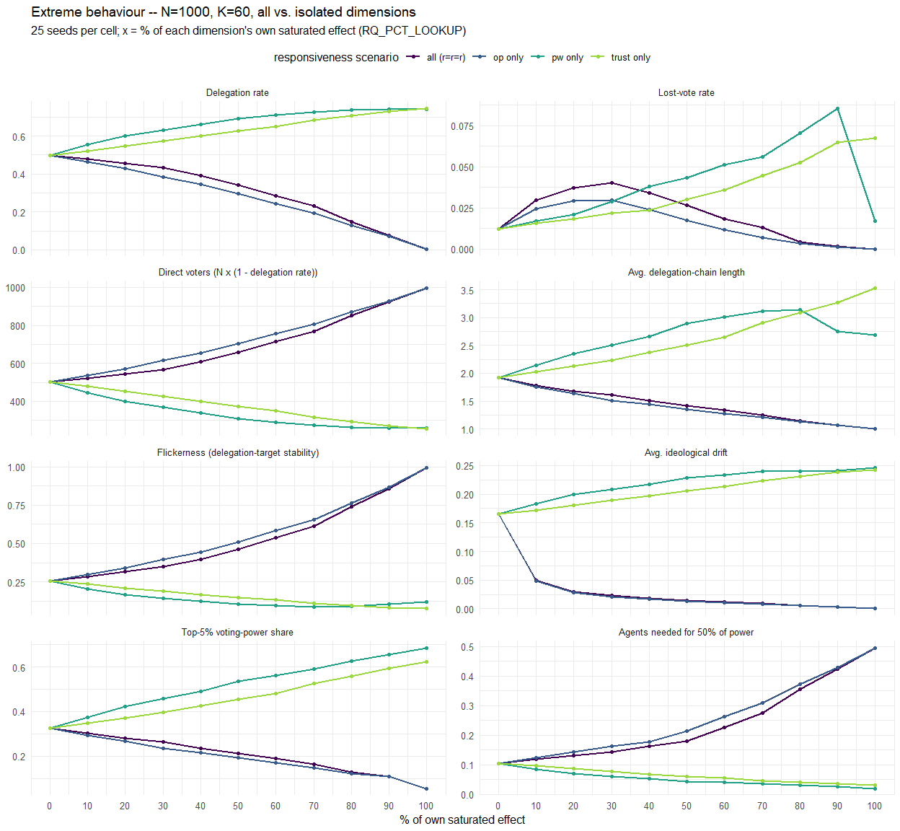<!-- -->

## 12.2 Shared design: paired sweep, third dimension held fixed

Same sweep grid for all three RQs. For each pair of responsiveness
dimensions, both are varied *together* in **percentage** terms
(translated to each dimension’s own r via `RQ_PCT_LOOKUP` – op/pw/tr
saturate at wildly different raw r, so a shared raw value wouldn’t mean
the same thing across dimensions) across $\{10,20,...,100\}\%$, while
the third dimension is held fixed at one of 3 percentage levels
($0\%, 50\%, 100\%$) – shown as 3 coloured lines in the same plot.
Repeating this for each of the 3 possible pairs gives 3 plots per RQ,
covering all three responsiveness dimensions:

- $r_{op}, r_{pw}$ varied together $\in \{10,...,100\}\%$,
  $r_{tr} \in \{0,50,100\}\%$ (fixed)
- $r_{op}, r_{tr}$ varied together $\in \{10,...,100\}\%$,
  $r_{pw} \in \{0,50,100\}\%$ (fixed)
- $r_{pw}, r_{tr}$ varied together $\in \{10,...,100\}\%$,
  $r_{op} \in \{0,50,100\}\%$ (fixed)

## 12.3 RQ1: delegation behaviour

Metrics: delegation rate, lost-vote rate, number of direct voters,
average delegation-chain length, and flickerness (share of agents
keeping the same delegation target as the previous round –
`history_flickerness` from `simulate_liquid_democracy()`, NA on round
1).

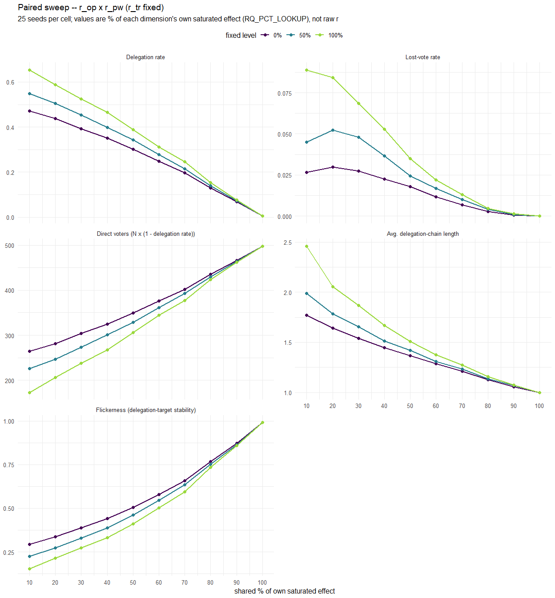<!-- -->

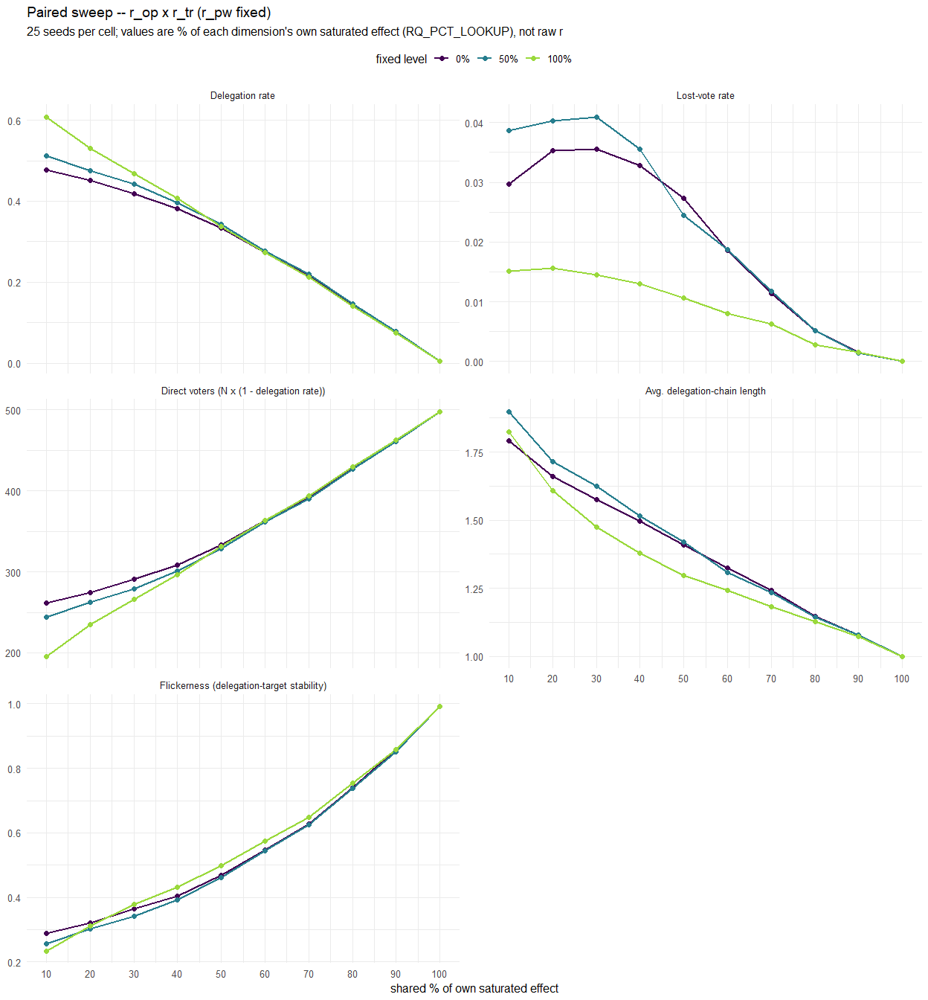<!-- -->

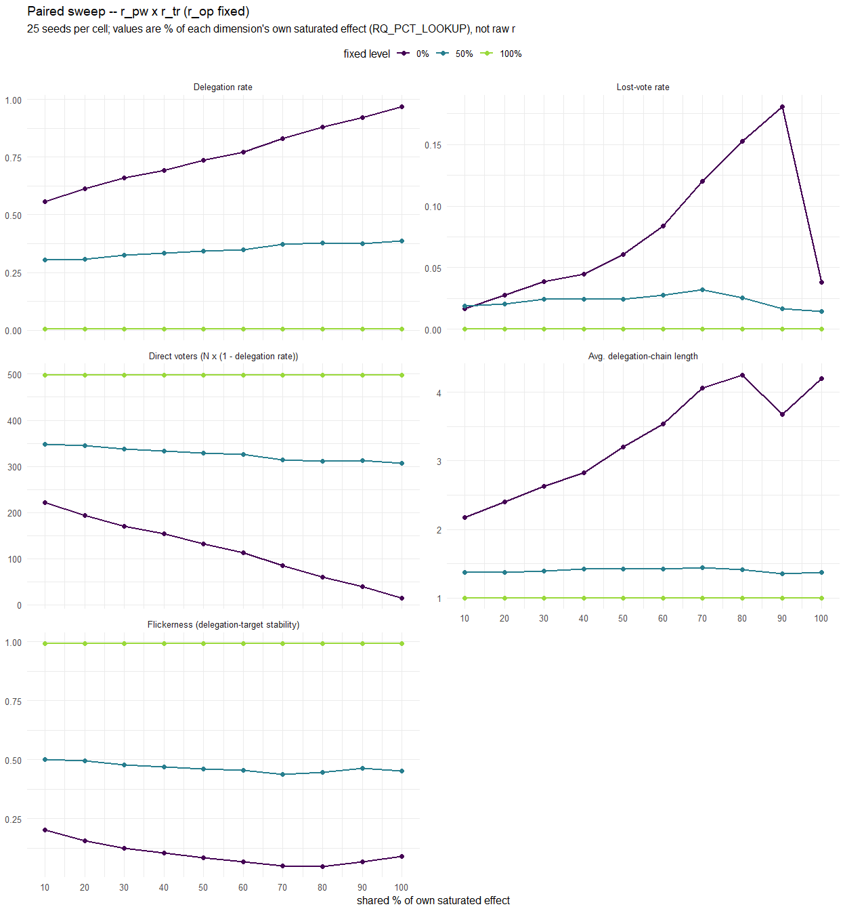<!-- -->

### Answering RQ1

*(Fill in once the plots above reflect the real simulation run – this is
a scaffold, not a pre-written conclusion.)*

- **Ideological responsiveness ($r_{op}$):** …
- **Competence/power responsiveness ($r_{pw}$):** …
- **Trust responsiveness ($r_{tr}$):** …
- **Interactions between dimensions:** …
- **Overall answer to RQ1:** …

## 12.4 RQ2: quality of political representation

Metric: average ideological drift (`avg_drift`) – the mean distance
between an agent’s own opinion and the opinion of the agent who
ultimately casts a vote on its behalf.

Expected: $r_{op}$ reduces drift; $r_{pw}$ increases drift (powerful
delegates stay attractive even when ideologically distant); $r_{tr}$
reduces drift, same mechanism as $r_{op}$.

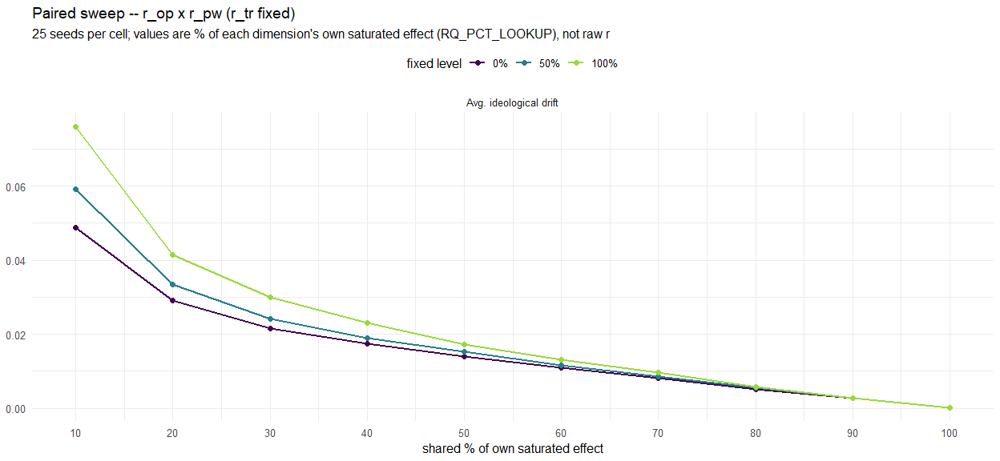<!-- -->

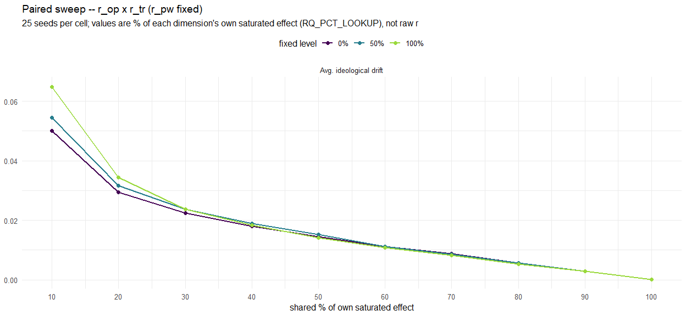<!-- -->

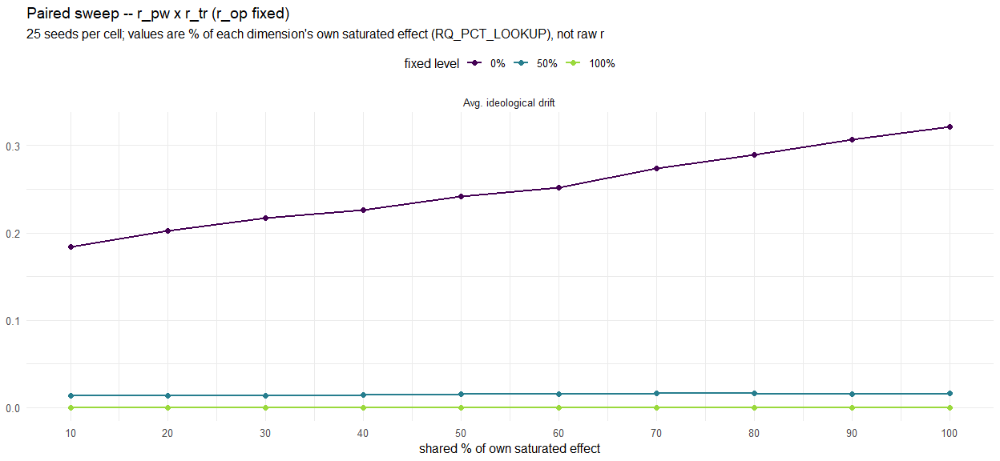<!-- -->

### Answering RQ2

*(Fill in once the plots above reflect the real simulation run – this is
a scaffold, not a pre-written conclusion.)*

- **Ideological responsiveness ($r_{op}$):** …
- **Competence/power responsiveness ($r_{pw}$):** …
- **Trust responsiveness ($r_{tr}$):** …
- **Joint $r_{op} \times r_{pw}$ effect (opinion term expected to
  dominate):** …
- **Overall answer to RQ2:** …

## 12.5 RQ3: concentration of voting power

Metrics: voting-power share held by the top 5% of agents
(`top5_power_share`) and the fraction of agents needed to collectively
hold 50% of total voting power (`share_50pct`).

Expected: $r_{op}$ lowers concentration (more agents vote directly);
$r_{pw}$ raises concentration (rich-get-richer). For the joint
$r_{op} \times r_{pw}$ effect: low opinion-based attractiveness is
expected to constrain how much high voting power can raise a neighbour’s
overall attractiveness – so increasing both together should yield
*lower* concentration than high $r_{pw}$ alone.

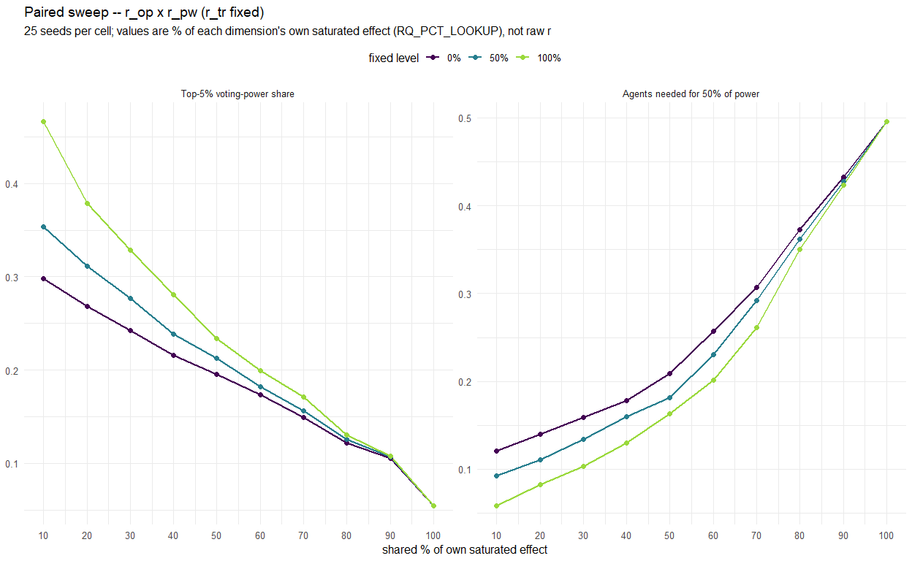<!-- -->

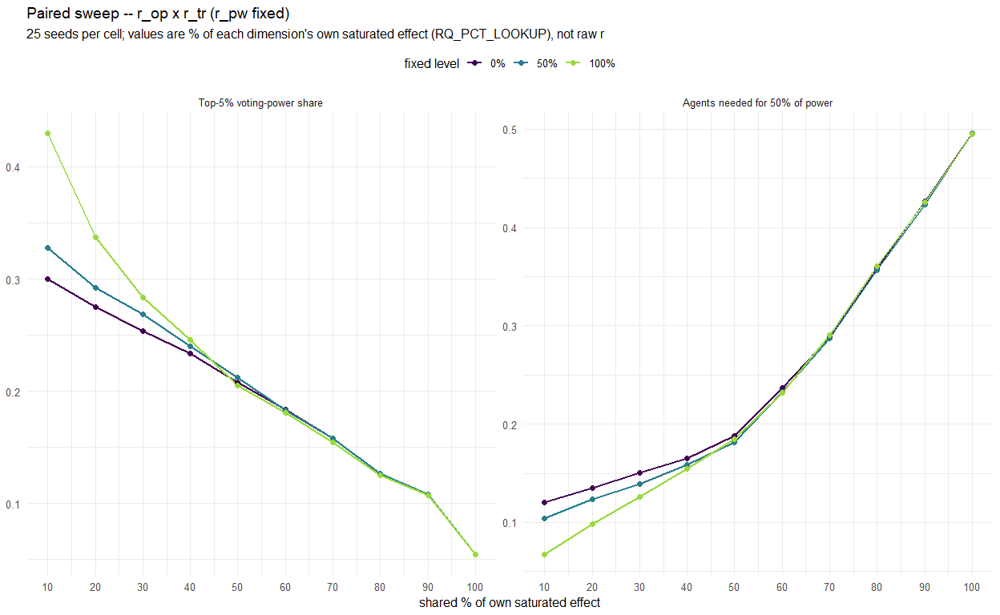<!-- -->

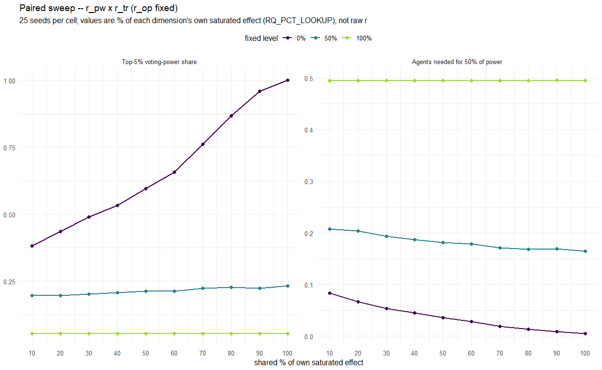<!-- -->

### Answering RQ3

*(Fill in once the plots above reflect the real simulation run – this is
a scaffold, not a pre-written conclusion.)*

- **Ideological responsiveness ($r_{op}$):** …
- **Competence/power responsiveness ($r_{pw}$):** …
- **Joint $r_{op} \times r_{pw}$ effect (opinion term expected to
  constrain concentration):** …
- **Overall answer to RQ3:** …
