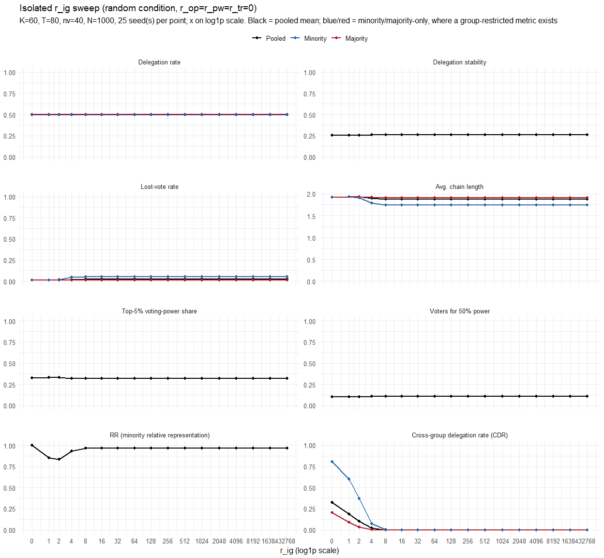
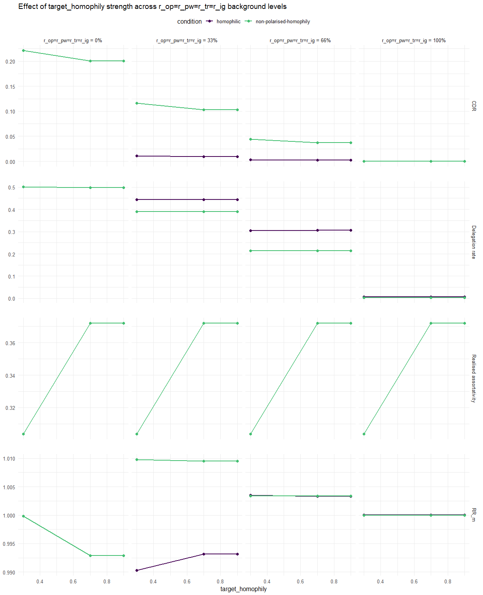
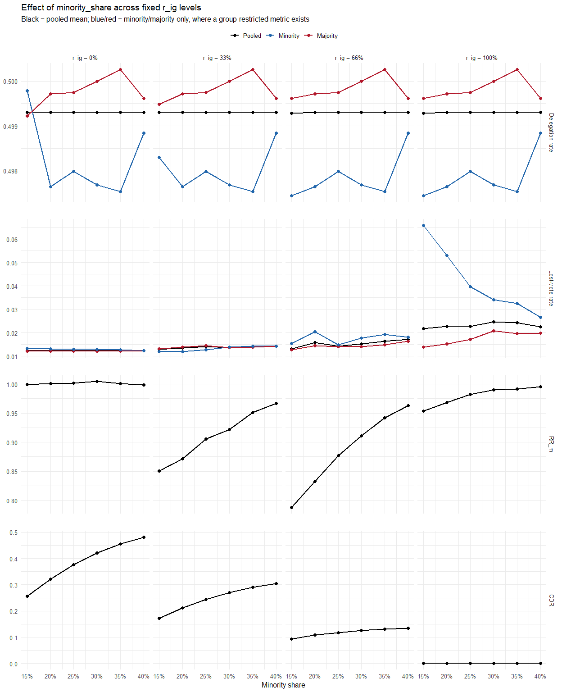
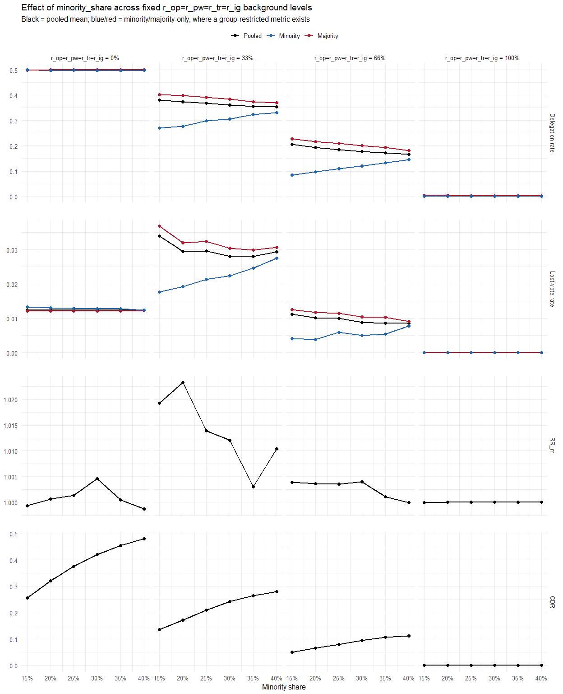

Report 23 – Part II calibration (r_ig, homophily, minority share)
================
2026-09-20

# 1. Carried-over Part I calibration

- **N = 1000** lay agents (n_per_community = 1000, n_communities = 1)
- **Network**: Watts-Strogatz small-world, node degree k = 60, rewiring
  p = 0.05
- **T = 80** rounds, of which **n_v = 40** are voting rounds (Delta t =
  2, Sec. 1.4.1 trust update)
- **lambda = 0.129** (trust-relaxation adaptation rate, derived from a
  50% forget rate over 5 voting rounds)
- **c = 0.5** (self_reliance_c, Mobius self-vote curve)
- **r_op / r_pw / r_tr ceilings (100% of saturated effect) = 16384 / 64
  / 128** – see the full pct table below

| pct |     r_op |  r_pw |   r_tr |
|----:|---------:|------:|-------:|
|   0 |     0.00 |  0.00 |   0.00 |
|  10 |    13.17 |  0.05 |   2.09 |
|  20 |    28.85 |  0.10 |   3.99 |
|  30 |    48.58 |  0.15 |   6.79 |
|  40 |    72.89 |  0.20 |   9.76 |
|  50 |   109.53 |  0.32 |  12.86 |
|  60 |   166.16 |  0.51 |  15.97 |
|  70 |   243.11 |  1.07 |  22.97 |
|  80 |   429.31 |  3.04 |  30.01 |
|  90 |   910.23 |  6.59 |  48.68 |
| 100 | 16384.00 | 64.00 | 128.00 |

Calibrated r_op/r_pw/r_tr values from Part 1

All carried over unchanged from Part 1 – adding the group-identity term
does not change the network, the temporal dynamics, or the trust
mechanism.

# 2. $r_{ig}$ calibration

$r_{ig}$ is swept in isolation under the *random* condition, holding
$r_{op}=r_{pw}=r_{tr}=0$, so the resulting saturation curve is
attributable to $r_{ig}$ alone.

<!-- -->

“Delta %” columns = step-to-step change as a % of that metric’s own
observed range (max-min across all r_val).

| r_val | Del. Rate | Delta % | Del. Stab. | Delta % | Lost Votes | Delta % | Chain Len. | Delta % | Top 5% | Delta % | Voters 50% | Delta % | RR_m | Delta % | CDR | Delta % |
|---:|---:|---:|---:|---:|---:|---:|---:|---:|---:|---:|---:|---:|---:|---:|---:|---:|
| 0 | 0.4993 | NA | 0.2549 | NA | 0.0124 | NA | 1.9221 | NA | 0.3266 | NA | 0.1046 | NA | 1.0007 | NA | 0.3219 | NA |
| 1 | 0.4993 | NA | 0.2555 | 13.2 | 0.0135 | 11.3 | 1.9381 | 26.4 | 0.3290 | 25.7 | 0.1042 | -14.8 | 0.8530 | -88.6 | 0.1890 | -41.3 |
| 2 | 0.4993 | NA | 0.2565 | 22.6 | 0.0143 | 7.0 | 1.9335 | -7.6 | 0.3288 | -2.3 | 0.1043 | 5.6 | 0.8341 | -11.4 | 0.0999 | -27.7 |
| 4 | 0.4993 | NA | 0.2586 | 48.9 | 0.0203 | 58.3 | 1.8972 | -59.9 | 0.3228 | -65.4 | 0.1062 | 60.8 | 0.9327 | 59.2 | 0.0181 | -25.4 |
| 8 | 0.4993 | NA | 0.2592 | 14.5 | 0.0227 | 23.1 | 1.8792 | -29.8 | 0.3200 | -29.9 | 0.1072 | 33.6 | 0.9683 | 21.4 | 0.0002 | -5.6 |
| 16 | 0.4993 | NA | 0.2592 | 0.7 | 0.0227 | 0.2 | 1.8775 | -2.8 | 0.3198 | -2.4 | 0.1072 | -0.8 | 0.9688 | 0.3 | 0.0000 | -0.1 |
| 32 | 0.4993 | NA | 0.2592 | 0.0 | 0.0227 | 0.0 | 1.8775 | 0.0 | 0.3198 | 0.0 | 0.1072 | 0.0 | 0.9688 | 0.0 | 0.0000 | 0.0 |
| 64 | 0.4993 | NA | 0.2592 | 0.0 | 0.0227 | 0.0 | 1.8775 | 0.0 | 0.3198 | 0.0 | 0.1072 | 0.0 | 0.9688 | 0.0 | 0.0000 | 0.0 |
| 128 | 0.4993 | NA | 0.2592 | 0.0 | 0.0227 | 0.0 | 1.8775 | 0.0 | 0.3198 | 0.0 | 0.1072 | 0.0 | 0.9688 | 0.0 | 0.0000 | 0.0 |
| 256 | 0.4993 | NA | 0.2592 | 0.0 | 0.0227 | 0.0 | 1.8775 | 0.0 | 0.3198 | 0.0 | 0.1072 | 0.0 | 0.9688 | 0.0 | 0.0000 | 0.0 |
| 512 | 0.4993 | NA | 0.2592 | 0.0 | 0.0227 | 0.0 | 1.8775 | 0.0 | 0.3198 | 0.0 | 0.1072 | 0.0 | 0.9688 | 0.0 | 0.0000 | 0.0 |
| 1024 | 0.4993 | NA | 0.2592 | 0.0 | 0.0227 | 0.0 | 1.8775 | 0.0 | 0.3198 | 0.0 | 0.1072 | 0.0 | 0.9688 | 0.0 | 0.0000 | 0.0 |
| 2048 | 0.4993 | NA | 0.2592 | 0.0 | 0.0227 | 0.0 | 1.8775 | 0.0 | 0.3198 | 0.0 | 0.1072 | 0.0 | 0.9688 | 0.0 | 0.0000 | 0.0 |
| 4096 | 0.4993 | NA | 0.2592 | 0.0 | 0.0227 | 0.0 | 1.8775 | 0.0 | 0.3198 | 0.0 | 0.1072 | 0.0 | 0.9688 | 0.0 | 0.0000 | 0.0 |
| 8192 | 0.4993 | NA | 0.2592 | 0.0 | 0.0227 | 0.0 | 1.8775 | 0.0 | 0.3198 | 0.0 | 0.1072 | 0.0 | 0.9688 | 0.0 | 0.0000 | 0.0 |
| 16384 | 0.4993 | NA | 0.2592 | 0.0 | 0.0227 | 0.0 | 1.8775 | 0.0 | 0.3198 | 0.0 | 0.1072 | 0.0 | 0.9688 | 0.0 | 0.0000 | 0.0 |
| 32768 | 0.4993 | NA | 0.2592 | 0.0 | 0.0227 | 0.0 | 1.8775 | 0.0 | 0.3198 | 0.0 | 0.1072 | 0.0 | 0.9688 | 0.0 | 0.0000 | 0.0 |

r_ig, isolated sweep – read off by eye where the slowest metric stops
changing further

**r_ig ceiling = 8.00** (read off on the Cross-group delegation rate
(CDR) curve).

RQ4/RQ5 use $r_{ig} \in \{0, 33, 66, 100\}$% throughout, translated via
this table – the same convention as Part I’s $r_{op}/r_{pw}/r_{tr}$.

# 3. Homophily effects

| Condition | opinion_dist | minority_opinion_mu | target_homophily |
|:---|:---|:---|:---|
| random | n/a | NULL (unclustered) | NULL |
| polarised | uniform | non-NULL, min in \[0,0.5) | NULL |
| homophilic | uniform | non-NULL, min in \[0,0.5) | calibrated below |
| non-polarised-homophily | n/a | NULL (unclustered) | calibrated below (same value) |

Parameter mapping for the four Part II conditions

Descriptive only – no search/iteration here, just the effect of
increasing $\text{target\_homophily}$ on the metrics that matter for
RQ4/RQ5, at three levels spanning weak to (attempted) very strong
clustering.

| condition | target_homophily | r_bg_pct | realised_assortativity | delegation_rate | RR_m | cross_group_dlg_rate |
|:---|---:|---:|---:|---:|---:|---:|
| homophilic | 0.3 | 0 | 0.304 | 0.500 | 1.000 | 0.221 |
| homophilic | 0.3 | 33 | 0.304 | 0.444 | 0.990 | 0.011 |
| homophilic | 0.3 | 66 | 0.304 | 0.304 | 1.003 | 0.003 |
| homophilic | 0.3 | 100 | 0.304 | 0.007 | 1.000 | 0.000 |
| homophilic | 0.7 | 0 | 0.372 | 0.498 | 0.993 | 0.201 |
| homophilic | 0.7 | 33 | 0.372 | 0.444 | 0.993 | 0.009 |
| homophilic | 0.7 | 66 | 0.372 | 0.307 | 1.003 | 0.002 |
| homophilic | 0.7 | 100 | 0.372 | 0.006 | 1.000 | 0.000 |
| homophilic | 0.9 | 0 | 0.372 | 0.498 | 0.993 | 0.201 |
| homophilic | 0.9 | 33 | 0.372 | 0.444 | 0.993 | 0.009 |
| homophilic | 0.9 | 66 | 0.372 | 0.307 | 1.003 | 0.002 |
| homophilic | 0.9 | 100 | 0.372 | 0.006 | 1.000 | 0.000 |
| non-polarised-homophily | 0.3 | 0 | 0.304 | 0.500 | 1.000 | 0.221 |
| non-polarised-homophily | 0.3 | 33 | 0.304 | 0.390 | 1.010 | 0.116 |
| non-polarised-homophily | 0.3 | 66 | 0.304 | 0.214 | 1.003 | 0.044 |
| non-polarised-homophily | 0.3 | 100 | 0.304 | 0.004 | 1.000 | 0.000 |
| non-polarised-homophily | 0.7 | 0 | 0.372 | 0.498 | 0.993 | 0.201 |
| non-polarised-homophily | 0.7 | 33 | 0.372 | 0.389 | 1.009 | 0.103 |
| non-polarised-homophily | 0.7 | 66 | 0.372 | 0.214 | 1.003 | 0.037 |
| non-polarised-homophily | 0.7 | 100 | 0.372 | 0.003 | 1.000 | 0.000 |
| non-polarised-homophily | 0.9 | 0 | 0.372 | 0.498 | 0.993 | 0.201 |
| non-polarised-homophily | 0.9 | 33 | 0.372 | 0.389 | 1.009 | 0.103 |
| non-polarised-homophily | 0.9 | 66 | 0.372 | 0.214 | 1.003 | 0.037 |
| non-polarised-homophily | 0.9 | 100 | 0.372 | 0.003 | 1.000 | 0.000 |

Effect of target_homophily x r_op=r_pw=r_tr=r_ig background level on
realised assortativity, delegation rate, RR_m, and CDR, per condition

<!-- -->

**Chosen: target_homophily = 0.9.**

# 4. Minority share

Across social-network and organisational-behaviour studies, minority
group sizes used for empirically motivated calibration typically fall in
roughly **15–40%** of the population, with shares below ~15% treated as
an extreme numerical imbalance rather than a representative “minority”
condition; 20% specifically is used as a minority size in network models
of homophily and minority representation . The sweep below spans the
full literature-supported range end to end, in 5-point steps
(**15/20/25/30/35/40%**), rather than just the two endpoints and the 20%
default.

Two background sweeps: (a) $r_{ig}$ alone, isolated
($r_{op}=r_{pw}=r_{tr}=0$), fixed at each of the four calibrated
percentages of its own saturated effect (Sec. 2) – same “one dimension
at a time” methodology as Sec. 2; (b) all four r’s shared
($r_{op}=r_{pw}=r_{tr}=r_{ig}$), each fixed at the same percentage of
its own saturated effect (Sec. 1/2, via `r_from_pct_shared()`) – same
convention as Sec. 3’s homophily background. (a) isolates $r_{ig}$’s
effect cleanly; (b) shows minority_share’s effect under a more
realistic, fully-engaged background.

| minority_share | r_ig_pct | delegation_rate | lost_vote_rate | RR_m | cross_group_dlg_rate |
|---:|---:|---:|---:|---:|---:|
| 0.15 | 0 | 0.499 | 0.012 | 0.999 | 0.256 |
| 0.15 | 33 | 0.499 | 0.013 | 0.851 | 0.173 |
| 0.15 | 66 | 0.499 | 0.013 | 0.787 | 0.094 |
| 0.15 | 100 | 0.499 | 0.022 | 0.953 | 0.000 |
| 0.20 | 0 | 0.499 | 0.012 | 1.001 | 0.322 |
| 0.20 | 33 | 0.499 | 0.013 | 0.872 | 0.212 |
| 0.20 | 66 | 0.499 | 0.016 | 0.832 | 0.108 |
| 0.20 | 100 | 0.499 | 0.023 | 0.968 | 0.000 |
| 0.25 | 0 | 0.499 | 0.012 | 1.001 | 0.376 |
| 0.25 | 33 | 0.499 | 0.014 | 0.906 | 0.245 |
| 0.25 | 66 | 0.499 | 0.014 | 0.877 | 0.118 |
| 0.25 | 100 | 0.499 | 0.023 | 0.982 | 0.000 |
| 0.30 | 0 | 0.499 | 0.012 | 1.005 | 0.420 |
| 0.30 | 33 | 0.499 | 0.014 | 0.922 | 0.270 |
| 0.30 | 66 | 0.499 | 0.015 | 0.911 | 0.126 |
| 0.30 | 100 | 0.499 | 0.025 | 0.990 | 0.000 |
| 0.35 | 0 | 0.499 | 0.012 | 1.000 | 0.454 |
| 0.35 | 33 | 0.499 | 0.014 | 0.951 | 0.290 |
| 0.35 | 66 | 0.499 | 0.016 | 0.942 | 0.131 |
| 0.35 | 100 | 0.499 | 0.024 | 0.991 | 0.000 |
| 0.40 | 0 | 0.499 | 0.012 | 0.999 | 0.480 |
| 0.40 | 33 | 0.499 | 0.014 | 0.967 | 0.304 |
| 0.40 | 66 | 0.499 | 0.017 | 0.963 | 0.134 |
| 0.40 | 100 | 0.499 | 0.023 | 0.996 | 0.000 |

Effect of minority_share (15/20/25/30/35/40%) at fixed r_ig levels
(0/33/66/100% of its saturated effect, Sec. 2; r_op=r_pw=r_tr=0) on
delegation rate, lost-vote rate, RR_m, and CDR

<!-- -->

| minority_share | r_bg_pct | delegation_rate | lost_vote_rate | RR_m | cross_group_dlg_rate |
|---:|---:|---:|---:|---:|---:|
| 0.15 | 0 | 0.499 | 0.012 | 0.999 | 0.256 |
| 0.15 | 33 | 0.382 | 0.034 | 1.019 | 0.136 |
| 0.15 | 66 | 0.206 | 0.011 | 1.004 | 0.050 |
| 0.15 | 100 | 0.003 | 0.000 | 1.000 | 0.001 |
| 0.20 | 0 | 0.499 | 0.012 | 1.001 | 0.322 |
| 0.20 | 33 | 0.374 | 0.030 | 1.023 | 0.173 |
| 0.20 | 66 | 0.193 | 0.010 | 1.004 | 0.065 |
| 0.20 | 100 | 0.003 | 0.000 | 1.000 | 0.001 |
| 0.25 | 0 | 0.499 | 0.012 | 1.001 | 0.376 |
| 0.25 | 33 | 0.368 | 0.030 | 1.014 | 0.209 |
| 0.25 | 66 | 0.185 | 0.010 | 1.004 | 0.079 |
| 0.25 | 100 | 0.003 | 0.000 | 1.000 | 0.000 |
| 0.30 | 0 | 0.499 | 0.012 | 1.005 | 0.420 |
| 0.30 | 33 | 0.361 | 0.028 | 1.012 | 0.242 |
| 0.30 | 66 | 0.177 | 0.009 | 1.004 | 0.095 |
| 0.30 | 100 | 0.003 | 0.000 | 1.000 | 0.000 |
| 0.35 | 0 | 0.499 | 0.012 | 1.000 | 0.454 |
| 0.35 | 33 | 0.356 | 0.028 | 1.003 | 0.265 |
| 0.35 | 66 | 0.172 | 0.009 | 1.001 | 0.108 |
| 0.35 | 100 | 0.002 | 0.000 | 1.000 | 0.000 |
| 0.40 | 0 | 0.499 | 0.012 | 0.999 | 0.480 |
| 0.40 | 33 | 0.355 | 0.029 | 1.010 | 0.280 |
| 0.40 | 66 | 0.167 | 0.009 | 1.000 | 0.112 |
| 0.40 | 100 | 0.003 | 0.000 | 1.000 | 0.000 |

Effect of minority_share (15/20/25/30/35/40%) at fixed
r_op=r_pw=r_tr=r_ig background levels (0/33/66/100% of each dimension’s
own saturated effect, Sec. 1/2) on delegation rate, lost-vote rate,
RR_m, and CDR

<!-- -->

At N=1000 and minority share 20%, a run has ~200 minority agents –
comfortably above the point where per-run minority-side metrics ($RR$,
chain length/drift for the minority group) would be dominated by
small-sample noise. The sweep above shows delegation rate, lost-vote
rate, $RR_m$, and CDR behaving sensibly (no discontinuity or breakdown)
across the full 15–40% range and across all four r_ig levels, so **20%**
is kept as the fixed default used throughout Sec. 2/3.

# 5. Final calibrated values (Part II)

- **Minority share = 20%** – fixed design constant (Kanter, 1977),
  validated against Sec. 2/3 and the 15–40% sweep in Sec. 4 above, not a
  calibration target.
- **target_homophily = 0.90** – highest of the tested levels (Sec. 3)
  still producing a meaningful, clearly separated network structure
  without collapsing CDR to ~0.
- **r_ig ceiling = 8.00** – read off on the Cross-group delegation rate
  (CDR) curve (Sec. 2), isolated sweep with r_op=r_pw=r_tr=0.
- **K, T, n_v, Δt, λ, c** – carried over unchanged from Report_22 Sec. 6
  (see Sec. 1).
