# Report 25 -- Part I results, mechanisms and trust (new calibration)

Report 24 rebuilt with the new calibration. Every number in the text that depends on a run is left out; read the figures.

| setting | Report 24 | Report 25 |
|---|---|---|
| network | Watts-Strogatz, N = 1000, K = 70 | Watts-Strogatz, N = 1000, **K = 30** (on average 16 neighbours with $|o_i - o_j| \leq 1/3$) |
| run length | T = 80, 40 voting rounds ($\Delta t$ = 2) | **T = n_v** (`NV`, $\Delta t$ = 1) |
| trust signal | $\theta$ = 0.5, forgetting 50 % / 5 VR | **$\theta$ = 1/3, symmetric, no forgetting** |
| % -> r table | K = 70 calibration ($r_{tr}$ 100 % = 128) | **final calibration** (calibration_part1 step 5) at K = 30, T = n_v = 4000, 25 seeds ($r_{tr}$ 100 % = 1024, anchored at the ideological drift) |
| seeds | 25 | **25**; shaded bands: 95 % confidence interval of the mean across seeds (t distribution) |

Part I only (the Part II calibration of Report 24 follows later). Output: `output/report25/{figures,tables}/<folder>/<name>`.

<table border="1" class="dataframe">
  <thead>
    <tr style="text-align: right;">
      <th></th>
      <th>pct</th>
      <th>r_op</th>
      <th>r_pw</th>
      <th>r_tr</th>
    </tr>
  </thead>
  <tbody>
    <tr>
      <th>0</th>
      <td>0</td>
      <td>0.00</td>
      <td>0.00</td>
      <td>0.00</td>
    </tr>
    <tr>
      <th>1</th>
      <td>10</td>
      <td>9.44</td>
      <td>0.05</td>
      <td>2.23</td>
    </tr>
    <tr>
      <th>2</th>
      <td>20</td>
      <td>20.99</td>
      <td>0.11</td>
      <td>4.51</td>
    </tr>
    <tr>
      <th>3</th>
      <td>30</td>
      <td>35.12</td>
      <td>0.16</td>
      <td>6.12</td>
    </tr>
    <tr>
      <th>4</th>
      <td>40</td>
      <td>53.20</td>
      <td>0.24</td>
      <td>7.89</td>
    </tr>
    <tr>
      <th>5</th>
      <td>50</td>
      <td>78.84</td>
      <td>0.35</td>
      <td>9.56</td>
    </tr>
    <tr>
      <th>6</th>
      <td>60</td>
      <td>116.53</td>
      <td>0.56</td>
      <td>11.83</td>
    </tr>
    <tr>
      <th>7</th>
      <td>70</td>
      <td>178.37</td>
      <td>0.98</td>
      <td>15.21</td>
    </tr>
    <tr>
      <th>8</th>
      <td>80</td>
      <td>301.53</td>
      <td>2.59</td>
      <td>22.43</td>
    </tr>
    <tr>
      <th>9</th>
      <td>90</td>
      <td>654.11</td>
      <td>5.89</td>
      <td>49.40</td>
    </tr>
    <tr>
      <th>10</th>
      <td>100</td>
      <td>16384.00</td>
      <td>64.00</td>
      <td>1024.00</td>
    </tr>
  </tbody>
</table>

## Simulation (Part I)

One grid: the isolated and combined sweeps and the three paired sweeps (two dimensions raised together, the third held at 0 / 25 / 50 / 75 / 100 %). The same runs are simulated twice: standard metrics (last 5 rounds) and cycle / mechanism counts (last 30 rounds).

    5225 grid points, 4775 distinct runs
    

# RQ1: Delegation dynamics

    
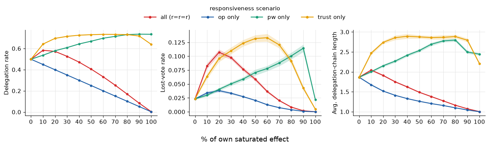
    

## Delegation cycles

Metrics (last 30 rounds of each run):

- **Cycles per round**: number of delegation cycles
- **Share of 2-cycles**: cycles with two members (i -> j, j -> i)
- **Feeding in (share)**: agents whose chain ends in a cycle without being part of it
- **Opinion-dist. ratio (2-cycles)**:

  $$\text{ratio} = \frac{\text{mean } |o_i - o_j| \text{ within 2-cycles}}{\text{mean } |o_i - o_{t(i)}| \text{ over all delegations } i \to t(i)}$$

  1 = members of a 2-cycle are as far apart as a typical delegation pair, < 1 = closer

    
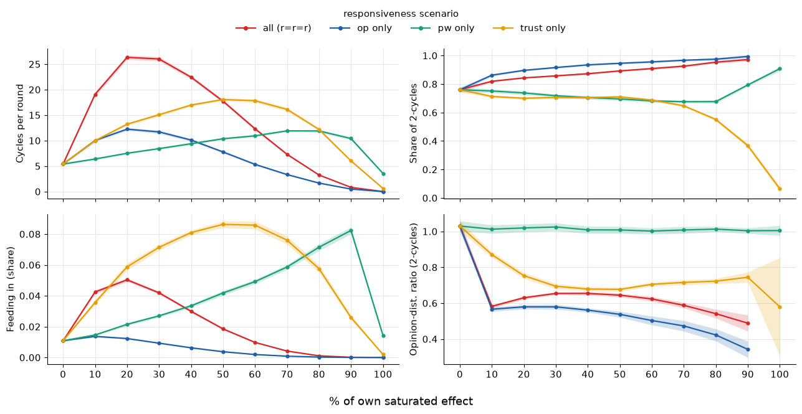
    

## Explanation: power

Metrics:

- **Downhill step**: delegation to a neighbour with less voting power than the delegator (power of the previous round)
- **Chains with / without downhill step**: share of resolved chains containing at least one / no downhill step
- **Chain length with / no downhill step**: average length of these two kinds of chains

    
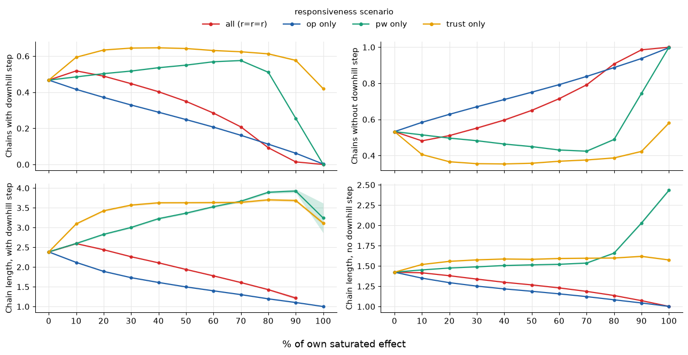
    

# RQ2: Quality of representation

Metric:

- **Avg. ideological drift (delegators)**: mean |o_i - o_R(i)| between a delegator's opinion and the vote cast for it (lost votes excluded)
- Random benchmark: a delegator with a random representative has drift 1/3

    
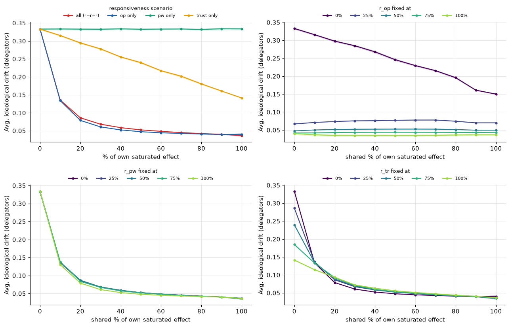
    

<table border="1" class="dataframe">
  <thead>
    <tr style="text-align: right;">
      <th></th>
      <th>line</th>
      <th>pct</th>
      <th>metric</th>
      <th>mean_val</th>
      <th>ci_lo</th>
      <th>ci_hi</th>
      <th>n_seeds</th>
      <th>sweep</th>
    </tr>
  </thead>
  <tbody>
    <tr>
      <th>0</th>
      <td>all (r=r=r)</td>
      <td>0</td>
      <td>Avg. ideological drift (delegators)</td>
      <td>0.333000</td>
      <td>0.330175</td>
      <td>0.335825</td>
      <td>25.0</td>
      <td>isolated</td>
    </tr>
    <tr>
      <th>1</th>
      <td>all (r=r=r)</td>
      <td>10</td>
      <td>Avg. ideological drift (delegators)</td>
      <td>0.135583</td>
      <td>0.134260</td>
      <td>0.136907</td>
      <td>25.0</td>
      <td>isolated</td>
    </tr>
    <tr>
      <th>2</th>
      <td>all (r=r=r)</td>
      <td>20</td>
      <td>Avg. ideological drift (delegators)</td>
      <td>0.086195</td>
      <td>0.084952</td>
      <td>0.087437</td>
      <td>25.0</td>
      <td>isolated</td>
    </tr>
    <tr>
      <th>3</th>
      <td>all (r=r=r)</td>
      <td>30</td>
      <td>Avg. ideological drift (delegators)</td>
      <td>0.068367</td>
      <td>0.067745</td>
      <td>0.068988</td>
      <td>25.0</td>
      <td>isolated</td>
    </tr>
    <tr>
      <th>4</th>
      <td>all (r=r=r)</td>
      <td>40</td>
      <td>Avg. ideological drift (delegators)</td>
      <td>0.058762</td>
      <td>0.058113</td>
      <td>0.059411</td>
      <td>25.0</td>
      <td>isolated</td>
    </tr>
    <tr>
      <th>...</th>
      <td>...</td>
      <td>...</td>
      <td>...</td>
      <td>...</td>
      <td>...</td>
      <td>...</td>
      <td>...</td>
      <td>...</td>
    </tr>
    <tr>
      <th>50</th>
      <td>75%</td>
      <td>60</td>
      <td>Avg. ideological drift (delegators)</td>
      <td>0.048852</td>
      <td>0.048159</td>
      <td>0.049545</td>
      <td>25.0</td>
      <td>r_op x r_pw (r_tr fixed)</td>
    </tr>
    <tr>
      <th>51</th>
      <td>75%</td>
      <td>70</td>
      <td>Avg. ideological drift (delegators)</td>
      <td>0.045089</td>
      <td>0.044590</td>
      <td>0.045589</td>
      <td>25.0</td>
      <td>r_op x r_pw (r_tr fixed)</td>
    </tr>
    <tr>
      <th>52</th>
      <td>75%</td>
      <td>80</td>
      <td>Avg. ideological drift (delegators)</td>
      <td>0.042295</td>
      <td>0.041629</td>
      <td>0.042962</td>
      <td>25.0</td>
      <td>r_op x r_pw (r_tr fixed)</td>
    </tr>
    <tr>
      <th>53</th>
      <td>75%</td>
      <td>90</td>
      <td>Avg. ideological drift (delegators)</td>
      <td>0.040003</td>
      <td>0.039254</td>
      <td>0.040752</td>
      <td>25.0</td>
      <td>r_op x r_pw (r_tr fixed)</td>
    </tr>
    <tr>
      <th>54</th>
      <td>75%</td>
      <td>100</td>
      <td>Avg. ideological drift (delegators)</td>
      <td>0.035910</td>
      <td>0.033040</td>
      <td>0.038780</td>
      <td>25.0</td>
      <td>r_op x r_pw (r_tr fixed)</td>
    </tr>
  </tbody>
</table>

209 rows × 8 columns

# Trust in this model

**Trust signal.** After a voting round, every delegator $i$ compares its own opinion $o_i$ with the vote $v$ that was cast for it (the opinion of its chain's root), $d = |o_i - v|$, and updates its trust in the neighbour it delegated to:

$$s = \begin{cases} 1 - d / \theta & d \leq \theta \\ -\,(d - \theta) / (1 - \theta) & d > \theta \end{cases}, \qquad \theta = 1/3, \qquad \text{lost vote: } s = -1$$

$$\tau \leftarrow (1 - \lambda)\,\tau + \lambda\,(1 + s)$$

- $s = 1$ for an exact match, $s = 0$ at $d = \theta$, $s = -1$ at the largest possible distance $d = 1$ (symmetric: the full range $[-1, 1]$ on both sides of $\theta$)
- Only the neighbour delegated to is updated; all other neighbours keep their trust (no forgetting)
- Attractiveness from trust: $a_{tr} = 2\,\sigma(r_{tr}(\tau - 1))$, 1 at neutral trust $\tau = 1$, between 0 and 2

**Why $\theta = 1/3$.** Opinions are uniform on $[0, 1]$ and independent of the network, so a neighbour picked at random is at expected distance

$$E\,|o_i - o_j| = \int_0^1\!\!\int_0^1 |x - y|\,dx\,dy = \frac{1}{3}$$

1/3 is the drift of a delegator who learns nothing. With $\theta = 1/3$ only delegates closer than a random neighbour gain trust and worse ones lose it, so the signal separates good from bad delegates (with $\theta = 0.5$, Report 24, even a random delegate gained trust on average).

In the figure: left, every pair of opinions is a point of the unit square; the pairs farther apart than 1/3 form two corner triangles with legs 2/3 (area 2/9 each), so 5/9 of random neighbours are within $	heta$. Right: the pairs at distance $d$ lie on two lines parallel to the diagonal whose length shrinks linearly in $d$, so $d$ has the triangular density $2(1 - d)$; its mean is the centroid of the triangle, 1/3 of the base.

    
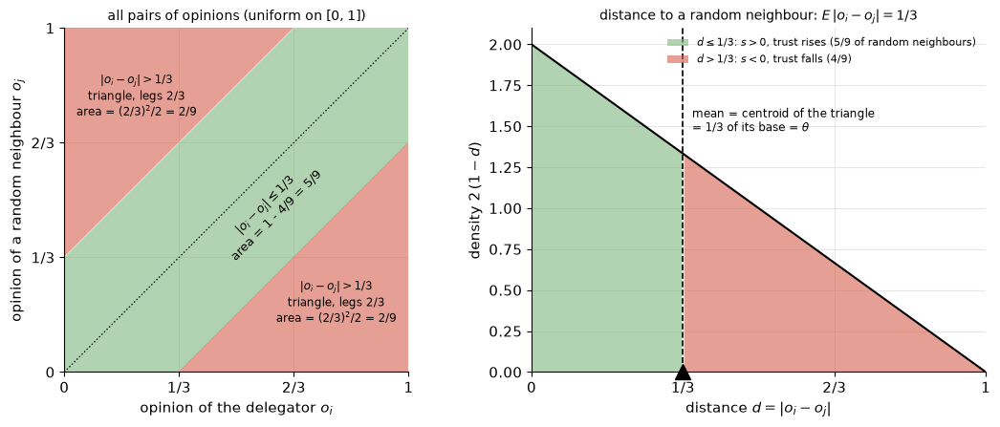
    

**Where the negative signals come from.** Trust only ($r_{op} = r_{pw} = 0$), the delegations of the last round and the signal each of them produces at the next voting round: positive ($|o_i - v| \leq \theta$), negative because the vote is too far away ($|o_i - v| > \theta$), or $s = -1$ because the vote was lost in a cycle (the delegator sits in a cycle or its chain runs into one). Bars: shares of all delegations; black line: share of the negative signals that come from lost votes.

**Trust attractiveness in classes.** Trust only, after the last round: the neighbours of an agent in five equal classes of $a_{tr}$ (mean over agents, so the bars of one level add up to K = 30). Neighbours never delegated to keep $\tau = 1$ and fall into the neutral class. Error bars: 95 % CI across seeds.

# RQ3: Concentration of voting power

Metrics:

- **Top-5 % voting-power share**: share of the cast votes held by the 5 % most powerful agents
- **Agents needed for 50 % of power**: smallest share of agents that together cast half of the votes
- Solid = Watts-Strogatz, dashed = Barabasi-Albert (same N, K, r values; % scale calibrated on WS)

    
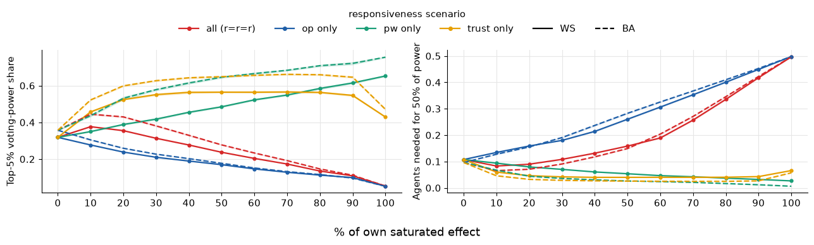
    

<table border="1" class="dataframe">
  <thead>
    <tr style="text-align: right;">
      <th></th>
      <th>responsiveness scenario</th>
      <th>pct</th>
      <th>metric</th>
      <th>mean_val</th>
      <th>ci_lo</th>
      <th>ci_hi</th>
      <th>n_seeds</th>
      <th>network</th>
    </tr>
  </thead>
  <tbody>
    <tr>
      <th>0</th>
      <td>all (r=r=r)</td>
      <td>0</td>
      <td>Top-5% voting-power share</td>
      <td>0.318559</td>
      <td>0.315478</td>
      <td>0.321640</td>
      <td>25.0</td>
      <td>ws</td>
    </tr>
    <tr>
      <th>1</th>
      <td>all (r=r=r)</td>
      <td>0</td>
      <td>Agents needed for 50% of power</td>
      <td>0.107400</td>
      <td>0.105911</td>
      <td>0.108889</td>
      <td>25.0</td>
      <td>ws</td>
    </tr>
    <tr>
      <th>2</th>
      <td>all (r=r=r)</td>
      <td>10</td>
      <td>Top-5% voting-power share</td>
      <td>0.376504</td>
      <td>0.373512</td>
      <td>0.379495</td>
      <td>25.0</td>
      <td>ws</td>
    </tr>
    <tr>
      <th>3</th>
      <td>all (r=r=r)</td>
      <td>10</td>
      <td>Agents needed for 50% of power</td>
      <td>0.082904</td>
      <td>0.081903</td>
      <td>0.083905</td>
      <td>25.0</td>
      <td>ws</td>
    </tr>
    <tr>
      <th>4</th>
      <td>all (r=r=r)</td>
      <td>20</td>
      <td>Top-5% voting-power share</td>
      <td>0.354934</td>
      <td>0.351699</td>
      <td>0.358168</td>
      <td>25.0</td>
      <td>ws</td>
    </tr>
    <tr>
      <th>...</th>
      <td>...</td>
      <td>...</td>
      <td>...</td>
      <td>...</td>
      <td>...</td>
      <td>...</td>
      <td>...</td>
      <td>...</td>
    </tr>
    <tr>
      <th>83</th>
      <td>trust only</td>
      <td>80</td>
      <td>Agents needed for 50% of power</td>
      <td>0.024728</td>
      <td>0.024124</td>
      <td>0.025332</td>
      <td>25.0</td>
      <td>ba</td>
    </tr>
    <tr>
      <th>84</th>
      <td>trust only</td>
      <td>90</td>
      <td>Top-5% voting-power share</td>
      <td>0.645794</td>
      <td>0.639695</td>
      <td>0.651893</td>
      <td>25.0</td>
      <td>ba</td>
    </tr>
    <tr>
      <th>85</th>
      <td>trust only</td>
      <td>90</td>
      <td>Agents needed for 50% of power</td>
      <td>0.026656</td>
      <td>0.025771</td>
      <td>0.027541</td>
      <td>25.0</td>
      <td>ba</td>
    </tr>
    <tr>
      <th>86</th>
      <td>trust only</td>
      <td>100</td>
      <td>Top-5% voting-power share</td>
      <td>0.470959</td>
      <td>0.464488</td>
      <td>0.477429</td>
      <td>25.0</td>
      <td>ba</td>
    </tr>
    <tr>
      <th>87</th>
      <td>trust only</td>
      <td>100</td>
      <td>Agents needed for 50% of power</td>
      <td>0.057200</td>
      <td>0.055681</td>
      <td>0.058719</td>
      <td>25.0</td>
      <td>ba</td>
    </tr>
  </tbody>
</table>

176 rows × 8 columns

# Variant A: sample mean first (trust only)
Trust settles slowly: an agent learns only about the neighbour it delegates to, and every signal moves $\tau$ by only $\lambda \approx 0.129$, so a neighbour stands out only after several experiences. Variant A changes the rate of the delegate's update:

$$\tau_{ij} \leftarrow (1 - \lambda_{ij})\,\tau_{ij} + \lambda_{ij}\,(1 + s), \qquad \lambda_{ij} = \max\!\left(\frac{1}{n_{ij}},\ \lambda\right)$$

with $n_{ij}$ the number of delegations of $i$ to $j$ so far (this one included). The first signal is taken in full ($\tau = 1 + s$), then $\tau$ is the mean of all signals, and from about 8 signals on the constant rate $\lambda$ takes over (sample average, then constant step size: Sutton & Barto 2018, Sec. 2.4-2.5). Everything else is unchanged (no forgetting, lost vote $s = -1$).

Trust only, same r values as the baseline (the % scale is calibrated for the baseline, so the % levels of A are approximate), A at $n_v$ = 2000 and 4000 against the baseline at 4000. Shaded: 95 % CI across seeds.

    
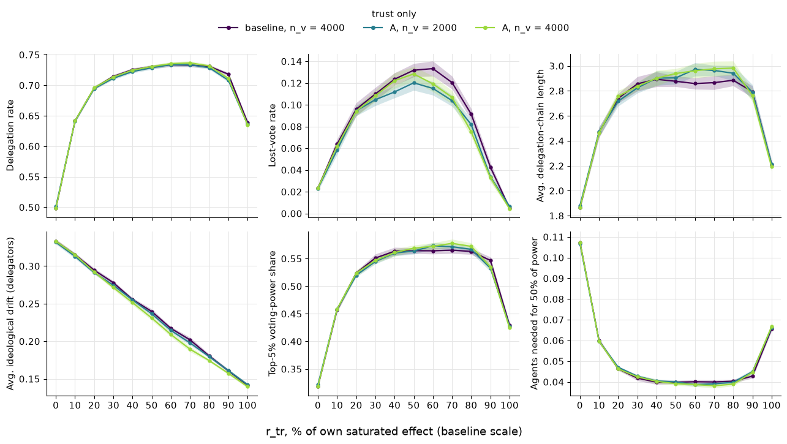
    

<table border="1" class="dataframe">
  <thead>
    <tr style="text-align: right;">
      <th></th>
      <th>trust only</th>
      <th>pct</th>
      <th>metric</th>
      <th>mean_val</th>
      <th>ci_lo</th>
      <th>ci_hi</th>
      <th>n_seeds</th>
    </tr>
  </thead>
  <tbody>
    <tr>
      <th>0</th>
      <td>A, n_v = 2000</td>
      <td>0</td>
      <td>Delegation rate</td>
      <td>0.500936</td>
      <td>0.498632</td>
      <td>0.503240</td>
      <td>25.0</td>
    </tr>
    <tr>
      <th>1</th>
      <td>A, n_v = 2000</td>
      <td>0</td>
      <td>Lost-vote rate</td>
      <td>0.023048</td>
      <td>0.020667</td>
      <td>0.025429</td>
      <td>25.0</td>
    </tr>
    <tr>
      <th>2</th>
      <td>A, n_v = 2000</td>
      <td>0</td>
      <td>Avg. delegation-chain length</td>
      <td>1.880675</td>
      <td>1.864935</td>
      <td>1.896414</td>
      <td>25.0</td>
    </tr>
    <tr>
      <th>3</th>
      <td>A, n_v = 2000</td>
      <td>0</td>
      <td>Avg. ideological drift (delegators)</td>
      <td>0.331803</td>
      <td>0.329040</td>
      <td>0.334566</td>
      <td>25.0</td>
    </tr>
    <tr>
      <th>4</th>
      <td>A, n_v = 2000</td>
      <td>0</td>
      <td>Top-5% voting-power share</td>
      <td>0.321203</td>
      <td>0.319010</td>
      <td>0.323396</td>
      <td>25.0</td>
    </tr>
    <tr>
      <th>...</th>
      <td>...</td>
      <td>...</td>
      <td>...</td>
      <td>...</td>
      <td>...</td>
      <td>...</td>
      <td>...</td>
    </tr>
    <tr>
      <th>193</th>
      <td>baseline, n_v = 4000</td>
      <td>100</td>
      <td>Lost-vote rate</td>
      <td>0.004816</td>
      <td>0.003755</td>
      <td>0.005877</td>
      <td>25.0</td>
    </tr>
    <tr>
      <th>194</th>
      <td>baseline, n_v = 4000</td>
      <td>100</td>
      <td>Avg. delegation-chain length</td>
      <td>2.209568</td>
      <td>2.179303</td>
      <td>2.239833</td>
      <td>25.0</td>
    </tr>
    <tr>
      <th>195</th>
      <td>baseline, n_v = 4000</td>
      <td>100</td>
      <td>Avg. ideological drift (delegators)</td>
      <td>0.141440</td>
      <td>0.139690</td>
      <td>0.143191</td>
      <td>25.0</td>
    </tr>
    <tr>
      <th>196</th>
      <td>baseline, n_v = 4000</td>
      <td>100</td>
      <td>Top-5% voting-power share</td>
      <td>0.429268</td>
      <td>0.424147</td>
      <td>0.434389</td>
      <td>25.0</td>
    </tr>
    <tr>
      <th>197</th>
      <td>baseline, n_v = 4000</td>
      <td>100</td>
      <td>Agents needed for 50% of power</td>
      <td>0.065656</td>
      <td>0.064388</td>
      <td>0.066924</td>
      <td>25.0</td>
    </tr>
  </tbody>
</table>

198 rows × 7 columns

Signal breakdown and trust attractiveness classes, baseline and A ($n_v$ = 4000), as in the trust section above.

# Presentation plots
The main results again, arranged for slides (isolated and combined sweeps, Watts-Strogatz unless stated, 95 % CI across seeds as bands, mostly narrower than the lines).

    
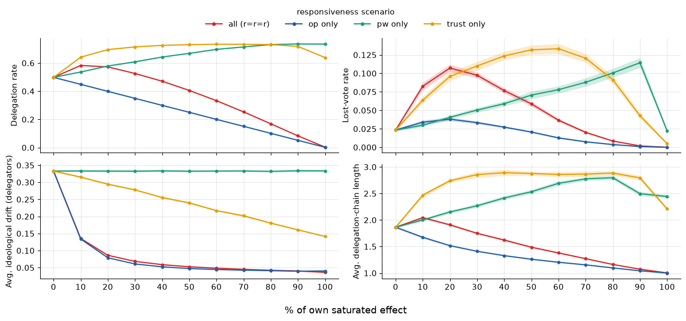
    

<table border="1" class="dataframe">
  <thead>
    <tr style="text-align: right;">
      <th></th>
      <th>responsiveness scenario</th>
      <th>pct</th>
      <th>metric</th>
      <th>mean_val</th>
      <th>ci_lo</th>
      <th>ci_hi</th>
      <th>n_seeds</th>
    </tr>
  </thead>
  <tbody>
    <tr>
      <th>0</th>
      <td>all (r=r=r)</td>
      <td>0</td>
      <td>Delegation rate</td>
      <td>0.498456</td>
      <td>0.495521</td>
      <td>0.501391</td>
      <td>25.0</td>
    </tr>
    <tr>
      <th>1</th>
      <td>all (r=r=r)</td>
      <td>0</td>
      <td>Lost-vote rate</td>
      <td>0.023376</td>
      <td>0.021778</td>
      <td>0.024974</td>
      <td>25.0</td>
    </tr>
    <tr>
      <th>2</th>
      <td>all (r=r=r)</td>
      <td>0</td>
      <td>Avg. ideological drift (delegators)</td>
      <td>0.333000</td>
      <td>0.330175</td>
      <td>0.335825</td>
      <td>25.0</td>
    </tr>
    <tr>
      <th>3</th>
      <td>all (r=r=r)</td>
      <td>0</td>
      <td>Avg. delegation-chain length</td>
      <td>1.864531</td>
      <td>1.846208</td>
      <td>1.882853</td>
      <td>25.0</td>
    </tr>
    <tr>
      <th>4</th>
      <td>all (r=r=r)</td>
      <td>10</td>
      <td>Delegation rate</td>
      <td>0.583048</td>
      <td>0.580513</td>
      <td>0.585583</td>
      <td>25.0</td>
    </tr>
    <tr>
      <th>...</th>
      <td>...</td>
      <td>...</td>
      <td>...</td>
      <td>...</td>
      <td>...</td>
      <td>...</td>
      <td>...</td>
    </tr>
    <tr>
      <th>171</th>
      <td>trust only</td>
      <td>90</td>
      <td>Avg. delegation-chain length</td>
      <td>2.793596</td>
      <td>2.746882</td>
      <td>2.840311</td>
      <td>25.0</td>
    </tr>
    <tr>
      <th>172</th>
      <td>trust only</td>
      <td>100</td>
      <td>Delegation rate</td>
      <td>0.639056</td>
      <td>0.635493</td>
      <td>0.642619</td>
      <td>25.0</td>
    </tr>
    <tr>
      <th>173</th>
      <td>trust only</td>
      <td>100</td>
      <td>Lost-vote rate</td>
      <td>0.004816</td>
      <td>0.003755</td>
      <td>0.005877</td>
      <td>25.0</td>
    </tr>
    <tr>
      <th>174</th>
      <td>trust only</td>
      <td>100</td>
      <td>Avg. ideological drift (delegators)</td>
      <td>0.141440</td>
      <td>0.139690</td>
      <td>0.143191</td>
      <td>25.0</td>
    </tr>
    <tr>
      <th>175</th>
      <td>trust only</td>
      <td>100</td>
      <td>Avg. delegation-chain length</td>
      <td>2.209568</td>
      <td>2.179303</td>
      <td>2.239833</td>
      <td>25.0</td>
    </tr>
  </tbody>
</table>

176 rows × 7 columns

    
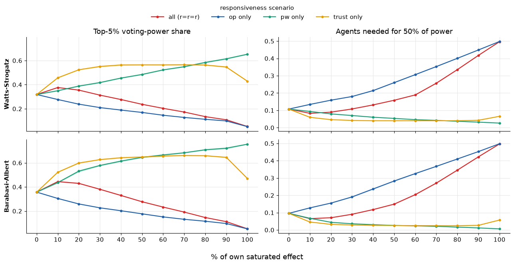
    

<table border="1" class="dataframe">
  <thead>
    <tr style="text-align: right;">
      <th></th>
      <th>responsiveness scenario</th>
      <th>pct</th>
      <th>metric</th>
      <th>mean_val</th>
      <th>ci_lo</th>
      <th>ci_hi</th>
      <th>n_seeds</th>
      <th>network</th>
    </tr>
  </thead>
  <tbody>
    <tr>
      <th>0</th>
      <td>all (r=r=r)</td>
      <td>0</td>
      <td>Top-5% voting-power share</td>
      <td>0.318559</td>
      <td>0.315478</td>
      <td>0.321640</td>
      <td>25.0</td>
      <td>Watts-Strogatz</td>
    </tr>
    <tr>
      <th>1</th>
      <td>all (r=r=r)</td>
      <td>0</td>
      <td>Agents needed for 50% of power</td>
      <td>0.107400</td>
      <td>0.105911</td>
      <td>0.108889</td>
      <td>25.0</td>
      <td>Watts-Strogatz</td>
    </tr>
    <tr>
      <th>2</th>
      <td>all (r=r=r)</td>
      <td>10</td>
      <td>Top-5% voting-power share</td>
      <td>0.376504</td>
      <td>0.373512</td>
      <td>0.379495</td>
      <td>25.0</td>
      <td>Watts-Strogatz</td>
    </tr>
    <tr>
      <th>3</th>
      <td>all (r=r=r)</td>
      <td>10</td>
      <td>Agents needed for 50% of power</td>
      <td>0.082904</td>
      <td>0.081903</td>
      <td>0.083905</td>
      <td>25.0</td>
      <td>Watts-Strogatz</td>
    </tr>
    <tr>
      <th>4</th>
      <td>all (r=r=r)</td>
      <td>20</td>
      <td>Top-5% voting-power share</td>
      <td>0.354934</td>
      <td>0.351699</td>
      <td>0.358168</td>
      <td>25.0</td>
      <td>Watts-Strogatz</td>
    </tr>
    <tr>
      <th>...</th>
      <td>...</td>
      <td>...</td>
      <td>...</td>
      <td>...</td>
      <td>...</td>
      <td>...</td>
      <td>...</td>
      <td>...</td>
    </tr>
    <tr>
      <th>171</th>
      <td>trust only</td>
      <td>80</td>
      <td>Agents needed for 50% of power</td>
      <td>0.024728</td>
      <td>0.024124</td>
      <td>0.025332</td>
      <td>25.0</td>
      <td>Barabasi-Albert</td>
    </tr>
    <tr>
      <th>172</th>
      <td>trust only</td>
      <td>90</td>
      <td>Top-5% voting-power share</td>
      <td>0.645794</td>
      <td>0.639695</td>
      <td>0.651893</td>
      <td>25.0</td>
      <td>Barabasi-Albert</td>
    </tr>
    <tr>
      <th>173</th>
      <td>trust only</td>
      <td>90</td>
      <td>Agents needed for 50% of power</td>
      <td>0.026656</td>
      <td>0.025771</td>
      <td>0.027541</td>
      <td>25.0</td>
      <td>Barabasi-Albert</td>
    </tr>
    <tr>
      <th>174</th>
      <td>trust only</td>
      <td>100</td>
      <td>Top-5% voting-power share</td>
      <td>0.470959</td>
      <td>0.464488</td>
      <td>0.477429</td>
      <td>25.0</td>
      <td>Barabasi-Albert</td>
    </tr>
    <tr>
      <th>175</th>
      <td>trust only</td>
      <td>100</td>
      <td>Agents needed for 50% of power</td>
      <td>0.057200</td>
      <td>0.055681</td>
      <td>0.058719</td>
      <td>25.0</td>
      <td>Barabasi-Albert</td>
    </tr>
  </tbody>
</table>

176 rows × 8 columns

**Delegation cycles and the lost-vote penalty.** Top left: trust only, lost-vote rate for three values of the lost-vote signal $s = -k_2$ (model: $k_2 = 1$). Up to about 50 % the penalty does not matter; the decline at high $r_{tr}$ only appears with the penalty, without it ($k_2 = 0$) lost votes keep rising. Bottom left (instead of feeding in): the delegation rate of trust only for the same three $k_2$, to compare with the lost votes. Other panels as in the cycle section. The attractiveness of the best neighbour (and of the chosen delegate) is kept as a table (`best_attractiveness`).

    C:\Users\AlexanderLitwinov\AppData\Local\Temp\ipykernel_3956\208965628.py:23: Pandas4Warning: Constructing a Categorical with a dtype and values containing non-null entries not in that dtype's categories is deprecated and will raise in a future version.
      s_pres["metric"] = pd.Categorical(s_pres["metric"].astype(str), categories=panels, ordered=True)
    

    
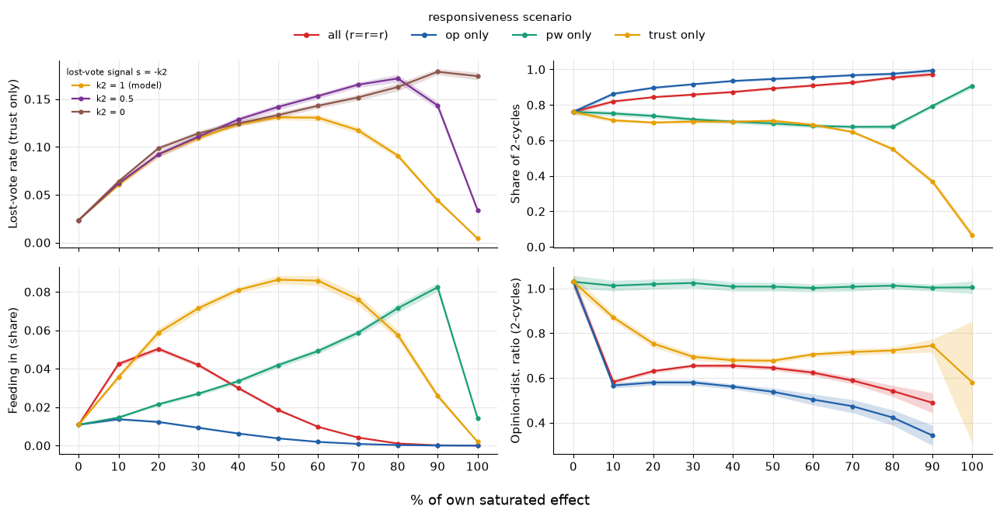
    

<table border="1" class="dataframe">
  <thead>
    <tr style="text-align: right;">
      <th></th>
      <th>k2</th>
      <th>pct</th>
      <th>metric</th>
      <th>mean_val</th>
      <th>ci_lo</th>
      <th>ci_hi</th>
      <th>n_seeds</th>
      <th>responsiveness scenario</th>
    </tr>
  </thead>
  <tbody>
    <tr>
      <th>0</th>
      <td>0.0</td>
      <td>0</td>
      <td>Lost-vote rate</td>
      <td>0.023525</td>
      <td>0.022743</td>
      <td>0.024307</td>
      <td>25.0</td>
      <td>trust only</td>
    </tr>
    <tr>
      <th>1</th>
      <td>0.0</td>
      <td>10</td>
      <td>Lost-vote rate</td>
      <td>0.063983</td>
      <td>0.062120</td>
      <td>0.065845</td>
      <td>25.0</td>
      <td>trust only</td>
    </tr>
    <tr>
      <th>2</th>
      <td>0.0</td>
      <td>20</td>
      <td>Lost-vote rate</td>
      <td>0.098576</td>
      <td>0.096114</td>
      <td>0.101038</td>
      <td>25.0</td>
      <td>trust only</td>
    </tr>
    <tr>
      <th>3</th>
      <td>0.0</td>
      <td>30</td>
      <td>Lost-vote rate</td>
      <td>0.114104</td>
      <td>0.111116</td>
      <td>0.117092</td>
      <td>25.0</td>
      <td>trust only</td>
    </tr>
    <tr>
      <th>4</th>
      <td>0.0</td>
      <td>40</td>
      <td>Lost-vote rate</td>
      <td>0.124544</td>
      <td>0.121251</td>
      <td>0.127837</td>
      <td>25.0</td>
      <td>trust only</td>
    </tr>
    <tr>
      <th>...</th>
      <td>...</td>
      <td>...</td>
      <td>...</td>
      <td>...</td>
      <td>...</td>
      <td>...</td>
      <td>...</td>
      <td>...</td>
    </tr>
    <tr>
      <th>160</th>
      <td>NaN</td>
      <td>90</td>
      <td>Feeding in (share)</td>
      <td>0.025891</td>
      <td>0.024223</td>
      <td>0.027558</td>
      <td>25.0</td>
      <td>trust only</td>
    </tr>
    <tr>
      <th>161</th>
      <td>NaN</td>
      <td>90</td>
      <td>Opinion-dist. ratio (2-cycles)</td>
      <td>0.744426</td>
      <td>0.715182</td>
      <td>0.773670</td>
      <td>25.0</td>
      <td>trust only</td>
    </tr>
    <tr>
      <th>162</th>
      <td>NaN</td>
      <td>100</td>
      <td>Share of 2-cycles</td>
      <td>0.064665</td>
      <td>0.044780</td>
      <td>0.084550</td>
      <td>25.0</td>
      <td>trust only</td>
    </tr>
    <tr>
      <th>163</th>
      <td>NaN</td>
      <td>100</td>
      <td>Feeding in (share)</td>
      <td>0.001960</td>
      <td>0.001654</td>
      <td>0.002266</td>
      <td>25.0</td>
      <td>trust only</td>
    </tr>
    <tr>
      <th>164</th>
      <td>NaN</td>
      <td>100</td>
      <td>Opinion-dist. ratio (2-cycles)</td>
      <td>0.579905</td>
      <td>0.306870</td>
      <td>0.852941</td>
      <td>19.0</td>
      <td>trust only</td>
    </tr>
  </tbody>
</table>

165 rows × 8 columns

**Mechanisms behind power and trust** (isolated sweeps, last 30 rounds):

- **Downhill steps**: share of delegations to a neighbour with less voting power than the delegator (power of the previous round). A cycle needs at least one step that does not go uphill, so without downhill steps only cycles between agents of equal power remain.
- **Votes lost per cycle**: lost votes (cycle members + agents feeding in) per cycle; large when cycles form at agents that carry big delegation trees.
- **Lost a vote at least once**: share of agents whose vote was lost in at least one of the last 30 rounds; near 1 means the cycles are transient and hit almost everybody once in a while.
- **Best neighbour class** (trust only, after the last round): share of agents whose most attractive neighbour is trusted ($A \geq 1.5$), neutral or distrusted ($A < 0.5$). $P_{self}$ depends only on this best neighbour.

## Trust explanation
How trust settles over time (trust only, $r_{op} = r_{pw} = 0$, K = 30, $T = n_v$). Left: delegation rate and drift of the delegators against the number of voting rounds (log2 scale), 95 % CI across seeds as bands. Right: distribution of the trust attractiveness $a_{tr}$ of all neighbours after the last round, for three $r_{tr}$ levels and three run lengths .

    
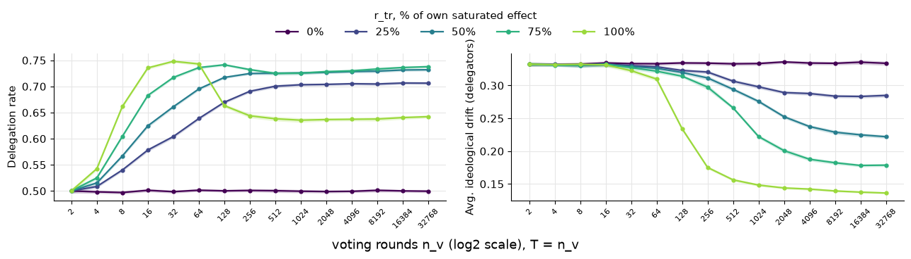
    

<table border="1" class="dataframe">
  <thead>
    <tr style="text-align: right;">
      <th></th>
      <th>r_tr</th>
      <th>nv</th>
      <th>metric</th>
      <th>mean_val</th>
      <th>ci_lo</th>
      <th>ci_hi</th>
      <th>n_seeds</th>
    </tr>
  </thead>
  <tbody>
    <tr>
      <th>0</th>
      <td>0%</td>
      <td>2</td>
      <td>Delegation rate</td>
      <td>0.500060</td>
      <td>0.495685</td>
      <td>0.504435</td>
      <td>25.0</td>
    </tr>
    <tr>
      <th>1</th>
      <td>0%</td>
      <td>2</td>
      <td>Avg. ideological drift (delegators)</td>
      <td>0.332478</td>
      <td>0.329537</td>
      <td>0.335418</td>
      <td>25.0</td>
    </tr>
    <tr>
      <th>2</th>
      <td>0%</td>
      <td>4</td>
      <td>Delegation rate</td>
      <td>0.498330</td>
      <td>0.495362</td>
      <td>0.501298</td>
      <td>25.0</td>
    </tr>
    <tr>
      <th>3</th>
      <td>0%</td>
      <td>4</td>
      <td>Avg. ideological drift (delegators)</td>
      <td>0.332035</td>
      <td>0.329604</td>
      <td>0.334465</td>
      <td>25.0</td>
    </tr>
    <tr>
      <th>4</th>
      <td>0%</td>
      <td>8</td>
      <td>Delegation rate</td>
      <td>0.497064</td>
      <td>0.494186</td>
      <td>0.499942</td>
      <td>25.0</td>
    </tr>
    <tr>
      <th>...</th>
      <td>...</td>
      <td>...</td>
      <td>...</td>
      <td>...</td>
      <td>...</td>
      <td>...</td>
      <td>...</td>
    </tr>
    <tr>
      <th>145</th>
      <td>75%</td>
      <td>8192</td>
      <td>Avg. ideological drift (delegators)</td>
      <td>0.182301</td>
      <td>0.179638</td>
      <td>0.184964</td>
      <td>25.0</td>
    </tr>
    <tr>
      <th>146</th>
      <td>75%</td>
      <td>16384</td>
      <td>Delegation rate</td>
      <td>0.736216</td>
      <td>0.733790</td>
      <td>0.738642</td>
      <td>25.0</td>
    </tr>
    <tr>
      <th>147</th>
      <td>75%</td>
      <td>16384</td>
      <td>Avg. ideological drift (delegators)</td>
      <td>0.178204</td>
      <td>0.175989</td>
      <td>0.180418</td>
      <td>25.0</td>
    </tr>
    <tr>
      <th>148</th>
      <td>75%</td>
      <td>32768</td>
      <td>Delegation rate</td>
      <td>0.737776</td>
      <td>0.735106</td>
      <td>0.740446</td>
      <td>25.0</td>
    </tr>
    <tr>
      <th>149</th>
      <td>75%</td>
      <td>32768</td>
      <td>Avg. ideological drift (delegators)</td>
      <td>0.178664</td>
      <td>0.176374</td>
      <td>0.180953</td>
      <td>25.0</td>
    </tr>
  </tbody>
</table>

150 rows × 7 columns

    
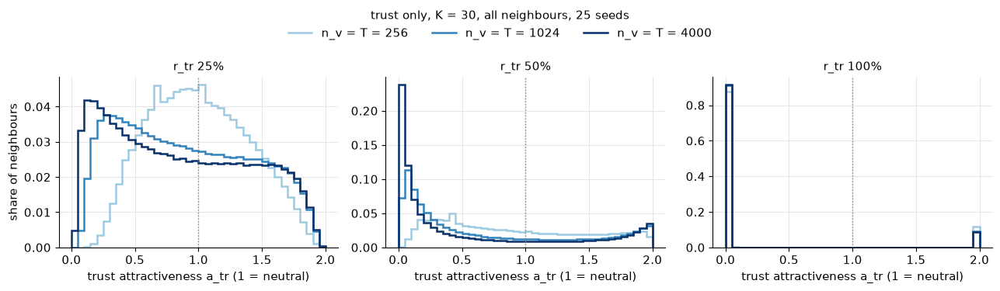
    

<table border="1" class="dataframe">
  <thead>
    <tr style="text-align: right;">
      <th></th>
      <th>pct</th>
      <th>nv</th>
      <th>bin_lo</th>
      <th>count</th>
      <th>share</th>
    </tr>
  </thead>
  <tbody>
    <tr>
      <th>0</th>
      <td>25</td>
      <td>256</td>
      <td>0.00</td>
      <td>0</td>
      <td>0.000000</td>
    </tr>
    <tr>
      <th>1</th>
      <td>25</td>
      <td>256</td>
      <td>0.05</td>
      <td>1</td>
      <td>0.000001</td>
    </tr>
    <tr>
      <th>2</th>
      <td>25</td>
      <td>256</td>
      <td>0.10</td>
      <td>92</td>
      <td>0.000123</td>
    </tr>
    <tr>
      <th>3</th>
      <td>25</td>
      <td>256</td>
      <td>0.15</td>
      <td>750</td>
      <td>0.001000</td>
    </tr>
    <tr>
      <th>4</th>
      <td>25</td>
      <td>256</td>
      <td>0.20</td>
      <td>2539</td>
      <td>0.003385</td>
    </tr>
    <tr>
      <th>...</th>
      <td>...</td>
      <td>...</td>
      <td>...</td>
      <td>...</td>
      <td>...</td>
    </tr>
    <tr>
      <th>355</th>
      <td>100</td>
      <td>4000</td>
      <td>1.75</td>
      <td>3</td>
      <td>0.000004</td>
    </tr>
    <tr>
      <th>356</th>
      <td>100</td>
      <td>4000</td>
      <td>1.80</td>
      <td>3</td>
      <td>0.000004</td>
    </tr>
    <tr>
      <th>357</th>
      <td>100</td>
      <td>4000</td>
      <td>1.85</td>
      <td>1</td>
      <td>0.000001</td>
    </tr>
    <tr>
      <th>358</th>
      <td>100</td>
      <td>4000</td>
      <td>1.90</td>
      <td>4</td>
      <td>0.000005</td>
    </tr>
    <tr>
      <th>359</th>
      <td>100</td>
      <td>4000</td>
      <td>1.95</td>
      <td>63833</td>
      <td>0.085111</td>
    </tr>
  </tbody>
</table>

360 rows × 5 columns

**Trust explanation with the lost-vote penalty.** The same two views for the lost-vote signal $s = -k_2$ with $k_2$ = 1 (model), 0.5 and 0 (colours as in the cycle plot). Top: trust only at $r_{tr}$ = 50 % and 100 %, delegation rate, lost-vote rate and drift of the delegators over $n_v = T$ (25 seeds, 95 % CI bands). Bottom: distribution of $a_{tr}$ after the last round, one row per $k_2$ .

    
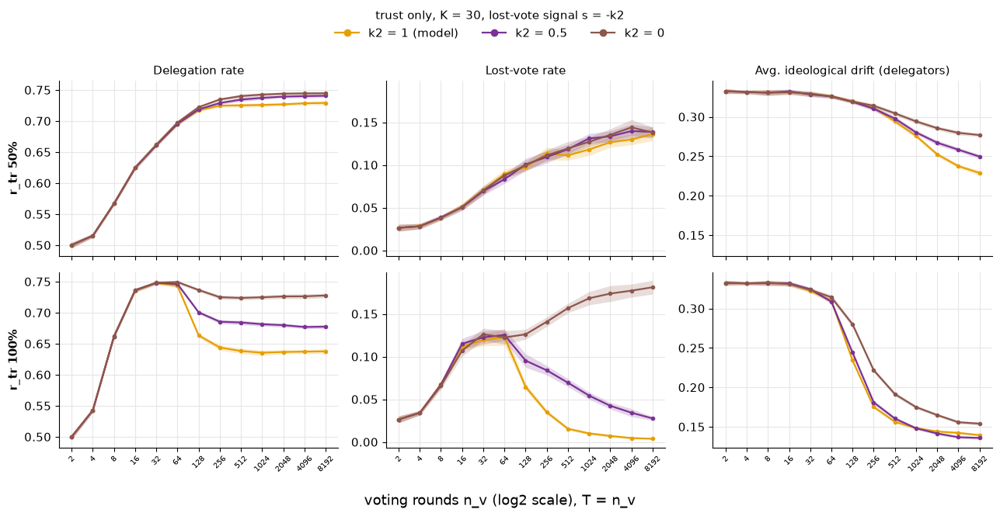
    

<table border="1" class="dataframe">
  <thead>
    <tr style="text-align: right;">
      <th></th>
      <th>pct</th>
      <th>k2</th>
      <th>nv</th>
      <th>metric</th>
      <th>mean_val</th>
      <th>ci_lo</th>
      <th>ci_hi</th>
      <th>n_seeds</th>
    </tr>
  </thead>
  <tbody>
    <tr>
      <th>0</th>
      <td>50</td>
      <td>0.0</td>
      <td>2</td>
      <td>Delegation rate</td>
      <td>0.500060</td>
      <td>0.495685</td>
      <td>0.504435</td>
      <td>25.0</td>
    </tr>
    <tr>
      <th>1</th>
      <td>50</td>
      <td>0.0</td>
      <td>2</td>
      <td>Lost-vote rate</td>
      <td>0.026420</td>
      <td>0.022426</td>
      <td>0.030414</td>
      <td>25.0</td>
    </tr>
    <tr>
      <th>2</th>
      <td>50</td>
      <td>0.0</td>
      <td>2</td>
      <td>Avg. ideological drift (delegators)</td>
      <td>0.332478</td>
      <td>0.329537</td>
      <td>0.335418</td>
      <td>25.0</td>
    </tr>
    <tr>
      <th>3</th>
      <td>50</td>
      <td>0.0</td>
      <td>4</td>
      <td>Delegation rate</td>
      <td>0.515370</td>
      <td>0.512376</td>
      <td>0.518364</td>
      <td>25.0</td>
    </tr>
    <tr>
      <th>4</th>
      <td>50</td>
      <td>0.0</td>
      <td>4</td>
      <td>Lost-vote rate</td>
      <td>0.028190</td>
      <td>0.025026</td>
      <td>0.031354</td>
      <td>25.0</td>
    </tr>
    <tr>
      <th>...</th>
      <td>...</td>
      <td>...</td>
      <td>...</td>
      <td>...</td>
      <td>...</td>
      <td>...</td>
      <td>...</td>
      <td>...</td>
    </tr>
    <tr>
      <th>229</th>
      <td>100</td>
      <td>1.0</td>
      <td>4096</td>
      <td>Lost-vote rate</td>
      <td>0.004608</td>
      <td>0.003491</td>
      <td>0.005725</td>
      <td>25.0</td>
    </tr>
    <tr>
      <th>230</th>
      <td>100</td>
      <td>1.0</td>
      <td>4096</td>
      <td>Avg. ideological drift (delegators)</td>
      <td>0.142221</td>
      <td>0.140315</td>
      <td>0.144127</td>
      <td>25.0</td>
    </tr>
    <tr>
      <th>231</th>
      <td>100</td>
      <td>1.0</td>
      <td>8192</td>
      <td>Delegation rate</td>
      <td>0.637648</td>
      <td>0.633627</td>
      <td>0.641669</td>
      <td>25.0</td>
    </tr>
    <tr>
      <th>232</th>
      <td>100</td>
      <td>1.0</td>
      <td>8192</td>
      <td>Lost-vote rate</td>
      <td>0.003768</td>
      <td>0.002938</td>
      <td>0.004598</td>
      <td>25.0</td>
    </tr>
    <tr>
      <th>233</th>
      <td>100</td>
      <td>1.0</td>
      <td>8192</td>
      <td>Avg. ideological drift (delegators)</td>
      <td>0.139380</td>
      <td>0.137845</td>
      <td>0.140915</td>
      <td>25.0</td>
    </tr>
  </tbody>
</table>

234 rows × 8 columns

    
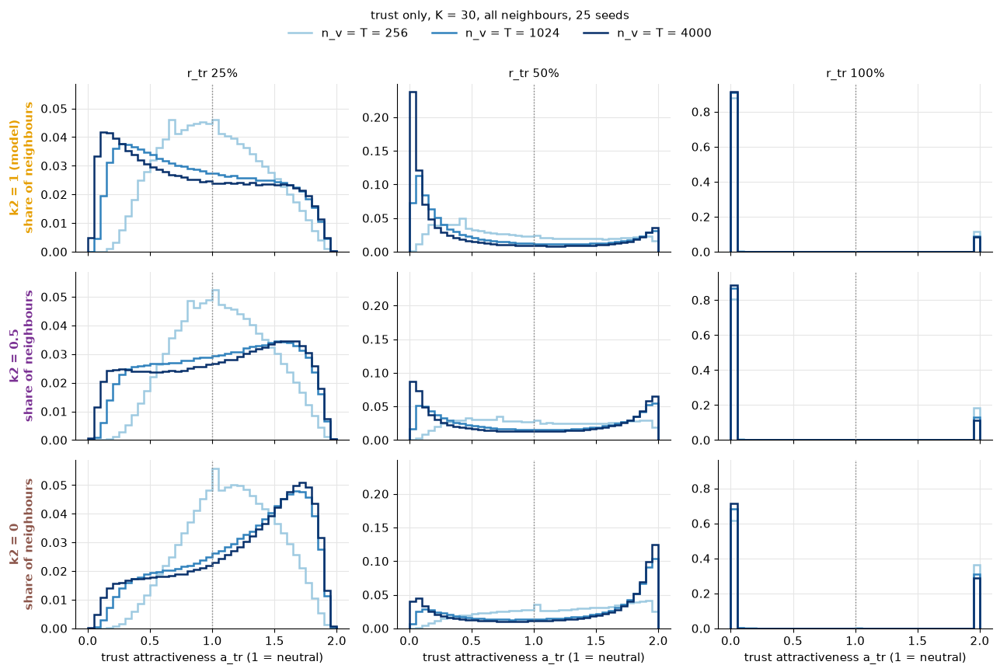
    

<table border="1" class="dataframe">
  <thead>
    <tr style="text-align: right;">
      <th></th>
      <th>k2</th>
      <th>pct</th>
      <th>nv</th>
      <th>bin_lo</th>
      <th>count</th>
      <th>share</th>
    </tr>
  </thead>
  <tbody>
    <tr>
      <th>0</th>
      <td>0.0</td>
      <td>25</td>
      <td>256</td>
      <td>0.00</td>
      <td>0</td>
      <td>0.000000</td>
    </tr>
    <tr>
      <th>1</th>
      <td>0.0</td>
      <td>25</td>
      <td>256</td>
      <td>0.05</td>
      <td>0</td>
      <td>0.000000</td>
    </tr>
    <tr>
      <th>2</th>
      <td>0.0</td>
      <td>25</td>
      <td>256</td>
      <td>0.10</td>
      <td>13</td>
      <td>0.000017</td>
    </tr>
    <tr>
      <th>3</th>
      <td>0.0</td>
      <td>25</td>
      <td>256</td>
      <td>0.15</td>
      <td>123</td>
      <td>0.000164</td>
    </tr>
    <tr>
      <th>4</th>
      <td>0.0</td>
      <td>25</td>
      <td>256</td>
      <td>0.20</td>
      <td>521</td>
      <td>0.000695</td>
    </tr>
    <tr>
      <th>...</th>
      <td>...</td>
      <td>...</td>
      <td>...</td>
      <td>...</td>
      <td>...</td>
      <td>...</td>
    </tr>
    <tr>
      <th>1075</th>
      <td>1.0</td>
      <td>100</td>
      <td>4000</td>
      <td>1.75</td>
      <td>3</td>
      <td>0.000004</td>
    </tr>
    <tr>
      <th>1076</th>
      <td>1.0</td>
      <td>100</td>
      <td>4000</td>
      <td>1.80</td>
      <td>3</td>
      <td>0.000004</td>
    </tr>
    <tr>
      <th>1077</th>
      <td>1.0</td>
      <td>100</td>
      <td>4000</td>
      <td>1.85</td>
      <td>1</td>
      <td>0.000001</td>
    </tr>
    <tr>
      <th>1078</th>
      <td>1.0</td>
      <td>100</td>
      <td>4000</td>
      <td>1.90</td>
      <td>4</td>
      <td>0.000005</td>
    </tr>
    <tr>
      <th>1079</th>
      <td>1.0</td>
      <td>100</td>
      <td>4000</td>
      <td>1.95</td>
      <td>63833</td>
      <td>0.085111</td>
    </tr>
  </tbody>
</table>

1080 rows × 6 columns

**Variant A over time.** Trust only at $r_{tr}$ = 25, 50, 75 and 100 %: baseline update against variant A (sample mean first, constant $\lambda$ from about 8 delegations on), each with the lost-vote signal $s = -k_2$, $k_2$ = 1 (model) and 0.5, up to $n_v$ = 16384. Colour: $k_2$ (as above), line style: update rule. 5 seeds (quick look), 95 % CI bands.

## Why trust is slow
Trust only, baseline update, K = 30.

**What trust needs.** $\tau_{ij}$ is a running average of the signals $i$ received when it delegated to $j$. It can only separate good from bad neighbours if the signal from $j$ says something stable about $j$. But the signal is $d = |o_i - v|$, and $v$ is the opinion of the **root** at the end of $j$'s chain, not $j$'s own opinion. $j$ itself delegates, and every agent draws its delegate anew in every round (proportional choice), so the root behind $j$ can change from round to round.

**Measurement** (figure `trust_stability`; last 50 rounds of each run, delegators that delegated in both of two consecutive rounds):

1. **Same delegate as in the round before.** At $r_{tr}$ 25 % and 50 % only 5 % and 9 % (at 4096 rounds), hardly above pure chance (1/K = 3 %, the value at $r_{tr}$ = 0). At 100 %: 49 %.
2. **Same delegate, also the same root?** Even when $i$ keeps $j$, the vote behind $j$ comes from the same root only in about 9 % of the cases at 25-50 % (100 %: 43 %; at $r_{tr}$ = 0 it is 26 % because half of the agents vote directly, so $j$ is often the root itself). All together, only 1-2 % of the delegators at 25-50 % get their vote from the same root as in the round before (100 %: 25 %).
3. **Delegation stability** (model metric, last 5 rounds): share of **all** agents whose choice is the same as in the round before, i.e. they vote directly again or delegate to the same neighbour again. At $r_{tr}$ = 0: 0.26, pure chance ($0.5 \cdot 0.5$ direct twice $+ \; 0.5 \cdot 0.5 / K$ same delegate). At 25 % and 50 % it is **below** chance (0.11-0.12 at 4096 rounds): more agents delegate (about 70 %), so fewer vote directly twice, and those who delegate switch almost every round. At 100 %: 0.43.

**Why this makes trust slow.** At medium $r_{tr}$ each signal about $j$ is a fresh draw from "some root somewhere behind $j$". A single signal is therefore very noisy: the vote behind an unchanged delegate jumps by 0.24-0.27 per round, close to the 1/3 of a completely random opinion (100 %: 0.08). $\tau$ needs many such draws before it reflects $j$'s average, and that average itself moves, because the roots behind $j$ depend on how all other agents currently trust their neighbours. Trust can only settle once the whole network has settled, a slow collective process. Exploration is not the bottleneck: at 25-50 % every neighbour has been tried 8+ times by about 1000 rounds (contacts measurement). At 100 % (and with the greedy choice, `trust_speed` section 8) agents stick to their best neighbour, the chains stay the same, the signals are consistent, and trust settles within a few hundred rounds.

A rough lower bound for "every neighbour known" if learning were the only limit: $K \cdot h / \text{delegation rate} = 30 \cdot 5 / 0.73 \approx 200$ rounds ($h$ = 5 experiences per neighbour, at most one per round). At 100 % trust settles close to that bound; at 25-50 % it keeps changing for thousands of rounds.

**Trust attractiveness after 1000 rounds** (figure `trust_attractiveness_1000`; trust only, $T = n_v$ = 1000, 25 seeds). Bars: $a_{tr}$ over all neighbours of all agents; line: the best neighbour per agent (what $P_{self}$ depends on). 1 = neutral (never delegated to, or signals that cancel out).

**Attractiveness of every dimension and combined, after 1000 rounds** (figure `attractiveness_1000`; isolated and combined sweeps at 25 / 50 / 75 %, $T = n_v$ = 1000, 25 seeds). Rows: opinion only ($a_{op} \leq 1$), power only ($a_{pw} < 2$), trust only ($a_{tr} < 2$), all three combined ($A = a_{op} a_{pw} a_{tr} < 4$). Bars: all neighbours; line: best neighbour per agent.

## Runtime

<table border="1" class="dataframe">
  <thead>
    <tr style="text-align: right;">
      <th></th>
      <th>kind</th>
      <th>step</th>
      <th>status</th>
      <th>runs</th>
      <th>seconds</th>
      <th>minutes</th>
    </tr>
  </thead>
  <tbody>
    <tr>
      <th>0</th>
      <td>simulation sweep</td>
      <td>r25_part1_main</td>
      <td>loaded</td>
      <td>5225.0</td>
      <td>4102.2</td>
      <td>68.37</td>
    </tr>
    <tr>
      <th>1</th>
      <td>simulation sweep</td>
      <td>r25_part1_mechanisms</td>
      <td>loaded</td>
      <td>5225.0</td>
      <td>4018.1</td>
      <td>66.97</td>
    </tr>
    <tr>
      <th>2</th>
      <td>simulation sweep</td>
      <td>r25_trust_signals</td>
      <td>loaded</td>
      <td>550.0</td>
      <td>538.0</td>
      <td>8.97</td>
    </tr>
    <tr>
      <th>3</th>
      <td>simulation sweep</td>
      <td>r25_trust_classes</td>
      <td>loaded</td>
      <td>200.0</td>
      <td>256.0</td>
      <td>4.27</td>
    </tr>
    <tr>
      <th>4</th>
      <td>simulation sweep</td>
      <td>r25_part1_ba</td>
      <td>loaded</td>
      <td>1100.0</td>
      <td>961.0</td>
      <td>16.02</td>
    </tr>
    <tr>
      <th>5</th>
      <td>simulation sweep</td>
      <td>r25_variant_a</td>
      <td>loaded</td>
      <td>550.0</td>
      <td>450.8</td>
      <td>7.51</td>
    </tr>
    <tr>
      <th>6</th>
      <td>simulation sweep</td>
      <td>r25_best_attractiveness</td>
      <td>loaded</td>
      <td>1100.0</td>
      <td>1057.9</td>
      <td>17.63</td>
    </tr>
    <tr>
      <th>7</th>
      <td>simulation sweep</td>
      <td>k2_check_mech</td>
      <td>loaded</td>
      <td>825.0</td>
      <td>741.4</td>
      <td>12.36</td>
    </tr>
    <tr>
      <th>8</th>
      <td>simulation sweep</td>
      <td>r25_trust_nv</td>
      <td>loaded</td>
      <td>1625.0</td>
      <td>509.8</td>
      <td>8.50</td>
    </tr>
    <tr>
      <th>9</th>
      <td>simulation sweep</td>
      <td>r25_trust_nv_long</td>
      <td>loaded</td>
      <td>250.0</td>
      <td>1457.7</td>
      <td>24.29</td>
    </tr>
    <tr>
      <th>10</th>
      <td>simulation sweep</td>
      <td>r25_trust_hist</td>
      <td>loaded</td>
      <td>225.0</td>
      <td>122.7</td>
      <td>2.04</td>
    </tr>
    <tr>
      <th>11</th>
      <td>simulation sweep</td>
      <td>r25_trust_nv_k2</td>
      <td>loaded</td>
      <td>1950.0</td>
      <td>737.8</td>
      <td>12.30</td>
    </tr>
    <tr>
      <th>12</th>
      <td>simulation sweep</td>
      <td>r25_trust_hist_k2</td>
      <td>loaded</td>
      <td>675.0</td>
      <td>366.6</td>
      <td>6.11</td>
    </tr>
    <tr>
      <th>13</th>
      <td>simulation sweep</td>
      <td>r25_vote_change</td>
      <td>loaded</td>
      <td>500.0</td>
      <td>314.2</td>
      <td>5.24</td>
    </tr>
    <tr>
      <th>14</th>
      <td>simulation sweep</td>
      <td>r25_trust_contacts</td>
      <td>loaded</td>
      <td>225.0</td>
      <td>128.0</td>
      <td>2.13</td>
    </tr>
    <tr>
      <th>15</th>
      <td>notebook section</td>
      <td>simulation: standard metrics (last 5 rounds)</td>
      <td>NaN</td>
      <td>NaN</td>
      <td>0.1</td>
      <td>0.00</td>
    </tr>
    <tr>
      <th>16</th>
      <td>notebook section</td>
      <td>simulation: cycles and mechanisms (last 30 rou...</td>
      <td>NaN</td>
      <td>NaN</td>
      <td>0.1</td>
      <td>0.00</td>
    </tr>
    <tr>
      <th>17</th>
      <td>notebook section</td>
      <td>simulation: trust signal breakdown</td>
      <td>NaN</td>
      <td>NaN</td>
      <td>0.0</td>
      <td>0.00</td>
    </tr>
    <tr>
      <th>18</th>
      <td>notebook section</td>
      <td>simulation: trust attractiveness classes</td>
      <td>NaN</td>
      <td>NaN</td>
      <td>0.0</td>
      <td>0.00</td>
    </tr>
    <tr>
      <th>19</th>
      <td>notebook section</td>
      <td>simulation: Barabasi-Albert, isolated and comb...</td>
      <td>NaN</td>
      <td>NaN</td>
      <td>0.0</td>
      <td>0.00</td>
    </tr>
    <tr>
      <th>20</th>
      <td>notebook section</td>
      <td>simulation: variant A, trust only</td>
      <td>NaN</td>
      <td>NaN</td>
      <td>0.0</td>
      <td>0.00</td>
    </tr>
    <tr>
      <th>21</th>
      <td>notebook section</td>
      <td>simulation: attractiveness of the best neighbo...</td>
      <td>NaN</td>
      <td>NaN</td>
      <td>0.0</td>
      <td>0.00</td>
    </tr>
    <tr>
      <th>22</th>
      <td>notebook section</td>
      <td>simulation: lost-vote penalty k2, trust only</td>
      <td>NaN</td>
      <td>NaN</td>
      <td>0.0</td>
      <td>0.00</td>
    </tr>
    <tr>
      <th>23</th>
      <td>notebook section</td>
      <td>simulation: trust only over n_v</td>
      <td>NaN</td>
      <td>NaN</td>
      <td>0.0</td>
      <td>0.00</td>
    </tr>
    <tr>
      <th>24</th>
      <td>notebook section</td>
      <td>simulation: trust only over n_v, 16384 and 32768</td>
      <td>NaN</td>
      <td>NaN</td>
      <td>0.0</td>
      <td>0.00</td>
    </tr>
    <tr>
      <th>25</th>
      <td>notebook section</td>
      <td>simulation: trust attractiveness distributions</td>
      <td>NaN</td>
      <td>NaN</td>
      <td>0.0</td>
      <td>0.00</td>
    </tr>
    <tr>
      <th>26</th>
      <td>notebook section</td>
      <td>simulation: trust only over n_v, lost-vote pen...</td>
      <td>NaN</td>
      <td>NaN</td>
      <td>0.0</td>
      <td>0.00</td>
    </tr>
    <tr>
      <th>27</th>
      <td>notebook section</td>
      <td>simulation: trust attractiveness distributions...</td>
      <td>NaN</td>
      <td>NaN</td>
      <td>0.0</td>
      <td>0.00</td>
    </tr>
    <tr>
      <th>28</th>
      <td>notebook section</td>
      <td>simulation: round-to-round change of the vote ...</td>
      <td>NaN</td>
      <td>NaN</td>
      <td>0.0</td>
      <td>0.00</td>
    </tr>
    <tr>
      <th>29</th>
      <td>notebook section</td>
      <td>simulation: contacts per neighbour</td>
      <td>NaN</td>
      <td>NaN</td>
      <td>0.0</td>
      <td>0.00</td>
    </tr>
    <tr>
      <th>30</th>
      <td>total</td>
      <td>whole notebook</td>
      <td>None</td>
      <td>None</td>
      <td>16.8</td>
      <td>0.28</td>
    </tr>
  </tbody>
</table>

