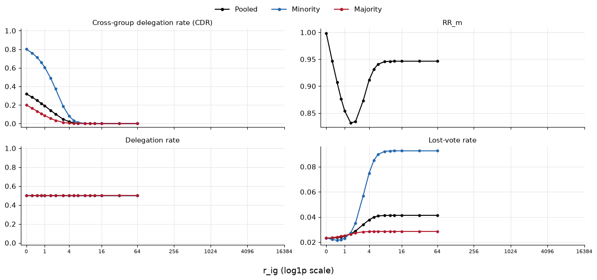
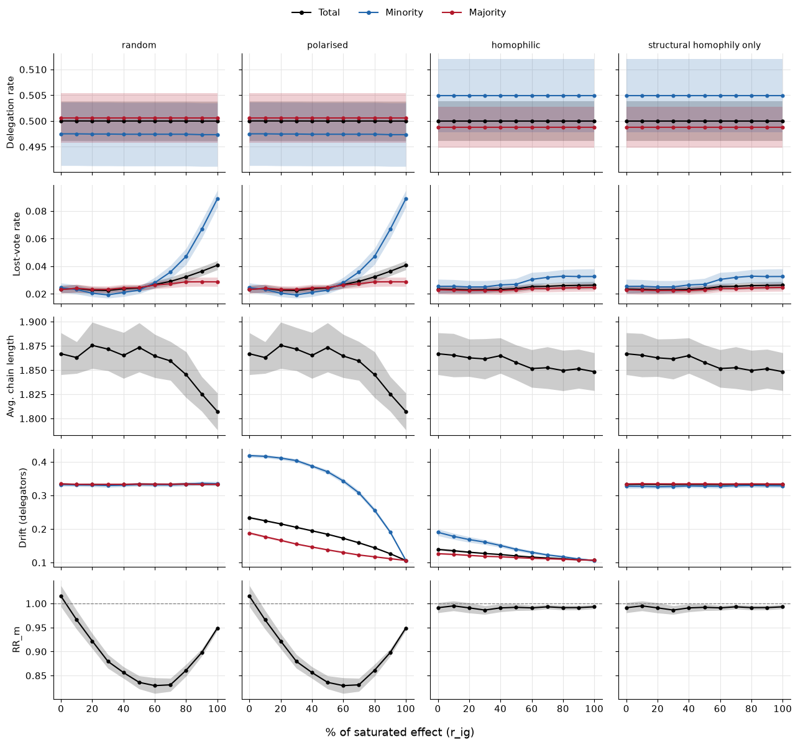
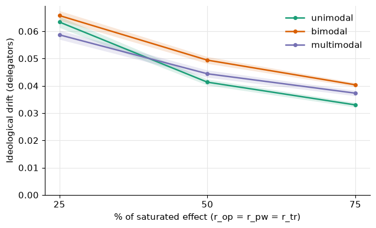
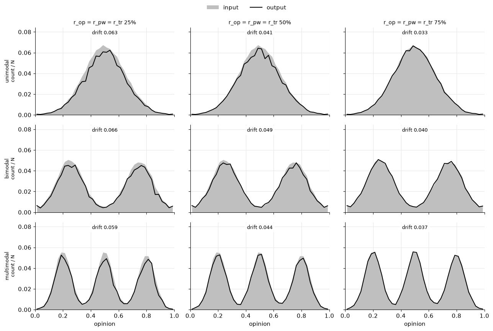

# Report 26 -- Part II: standard metrics and opinion distributions

| setting | value |
|---|---|
| network | Watts-Strogatz, N = 1000, K = 30 |
| run length | T = n_v = 1000 ($\Delta t$ = 1) |
| groups | 20 % minority, drawn at random |
| in-group term | $a_{ig} = \exp(-r_{ig}(1 - \delta_{same}))$, multiplied onto $A = a_{op}\,a_{pw}\,a_{tr}$ |
| background | only $r_{ig}$ active ($r_{op} = r_{pw} = r_{tr} = 0$) |
| Part I settings | carried over from Report 25 ($\lambda$, trust signal $\theta$ = 1/3, % -> r table) |
| seeds | 25 (r_ig calibration: 1000); shaded bands: 95 % CI of the mean across seeds |

Output: `output/report26/{figures,tables}/<folder>/<name>`, the figures of Sections 3-5 also to `Thesis/figures/part2/`.

<table border="1" class="dataframe">
  <thead>
    <tr style="text-align: right;">
      <th></th>
      <th>setting</th>
      <th>value</th>
    </tr>
  </thead>
  <tbody>
    <tr>
      <th>0</th>
      <td>N</td>
      <td>1000</td>
    </tr>
    <tr>
      <th>1</th>
      <td>K</td>
      <td>30</td>
    </tr>
    <tr>
      <th>2</th>
      <td>T</td>
      <td>1000</td>
    </tr>
    <tr>
      <th>3</th>
      <td>n_voting_rounds</td>
      <td>1000</td>
    </tr>
    <tr>
      <th>4</th>
      <td>c</td>
      <td>0.5</td>
    </tr>
    <tr>
      <th>5</th>
      <td>lambda</td>
      <td>0.1294</td>
    </tr>
    <tr>
      <th>6</th>
      <td>theta</td>
      <td>0.3333</td>
    </tr>
    <tr>
      <th>7</th>
      <td>minority share</td>
      <td>0.2</td>
    </tr>
    <tr>
      <th>8</th>
      <td>seeds</td>
      <td>1000</td>
    </tr>
    <tr>
      <th>9</th>
      <td>network</td>
      <td>ws</td>
    </tr>
    <tr>
      <th>10</th>
      <td>p_rewire</td>
      <td>0.05</td>
    </tr>
  </tbody>
</table>

## r_ig calibration

As Report 23: random condition, only $r_{ig}$ active, $r_{ig}$ swept on its own. 100 % is where the cross-group delegation rate (CDR, share of all delegations that go to the other group) has flattened out; the % levels in between are read off the CDR curve by value (x % = x % of the CDR drop from $r_{ig}$ = 0 to the ceiling).

    

    

<table border="1" class="dataframe">
  <thead>
    <tr style="text-align: right;">
      <th></th>
      <th>r_ig</th>
      <th>mean_val</th>
      <th>ci_lo</th>
      <th>ci_hi</th>
      <th>remaining</th>
    </tr>
  </thead>
  <tbody>
    <tr>
      <th>0</th>
      <td>0.00</td>
      <td>0.3203</td>
      <td>0.3197</td>
      <td>0.3209</td>
      <td>1.0000</td>
    </tr>
    <tr>
      <th>4</th>
      <td>0.25</td>
      <td>0.2834</td>
      <td>0.2829</td>
      <td>0.2840</td>
      <td>0.8849</td>
    </tr>
    <tr>
      <th>8</th>
      <td>0.50</td>
      <td>0.2495</td>
      <td>0.2490</td>
      <td>0.2500</td>
      <td>0.7789</td>
    </tr>
    <tr>
      <th>12</th>
      <td>0.75</td>
      <td>0.2184</td>
      <td>0.2179</td>
      <td>0.2189</td>
      <td>0.6819</td>
    </tr>
    <tr>
      <th>16</th>
      <td>1.00</td>
      <td>0.1903</td>
      <td>0.1899</td>
      <td>0.1908</td>
      <td>0.5943</td>
    </tr>
    <tr>
      <th>20</th>
      <td>1.50</td>
      <td>0.1416</td>
      <td>0.1412</td>
      <td>0.1420</td>
      <td>0.4421</td>
    </tr>
    <tr>
      <th>24</th>
      <td>2.00</td>
      <td>0.1021</td>
      <td>0.1017</td>
      <td>0.1025</td>
      <td>0.3188</td>
    </tr>
    <tr>
      <th>28</th>
      <td>3.00</td>
      <td>0.0475</td>
      <td>0.0472</td>
      <td>0.0478</td>
      <td>0.1484</td>
    </tr>
    <tr>
      <th>32</th>
      <td>4.00</td>
      <td>0.0199</td>
      <td>0.0197</td>
      <td>0.0201</td>
      <td>0.0622</td>
    </tr>
    <tr>
      <th>36</th>
      <td>5.00</td>
      <td>0.0078</td>
      <td>0.0077</td>
      <td>0.0079</td>
      <td>0.0242</td>
    </tr>
    <tr>
      <th>40</th>
      <td>6.00</td>
      <td>0.0029</td>
      <td>0.0028</td>
      <td>0.0030</td>
      <td>0.0091</td>
    </tr>
    <tr>
      <th>44</th>
      <td>8.00</td>
      <td>0.0004</td>
      <td>0.0004</td>
      <td>0.0004</td>
      <td>0.0012</td>
    </tr>
    <tr>
      <th>48</th>
      <td>10.00</td>
      <td>0.0001</td>
      <td>0.0000</td>
      <td>0.0001</td>
      <td>0.0002</td>
    </tr>
    <tr>
      <th>52</th>
      <td>12.00</td>
      <td>0.0000</td>
      <td>0.0000</td>
      <td>0.0000</td>
      <td>0.0000</td>
    </tr>
    <tr>
      <th>56</th>
      <td>16.00</td>
      <td>0.0000</td>
      <td>0.0000</td>
      <td>0.0000</td>
      <td>0.0000</td>
    </tr>
    <tr>
      <th>60</th>
      <td>32.00</td>
      <td>0.0000</td>
      <td>0.0000</td>
      <td>0.0000</td>
      <td>0.0000</td>
    </tr>
    <tr>
      <th>64</th>
      <td>64.00</td>
      <td>0.0000</td>
      <td>0.0000</td>
      <td>0.0000</td>
      <td>0.0000</td>
    </tr>
  </tbody>
</table>

<table border="1" class="dataframe">
  <thead>
    <tr style="text-align: right;">
      <th></th>
      <th>pct</th>
      <th>r_ig</th>
    </tr>
  </thead>
  <tbody>
    <tr>
      <th>0</th>
      <td>0</td>
      <td>0.000</td>
    </tr>
    <tr>
      <th>1</th>
      <td>10</td>
      <td>0.217</td>
    </tr>
    <tr>
      <th>2</th>
      <td>20</td>
      <td>0.450</td>
    </tr>
    <tr>
      <th>3</th>
      <td>30</td>
      <td>0.702</td>
    </tr>
    <tr>
      <th>4</th>
      <td>40</td>
      <td>0.982</td>
    </tr>
    <tr>
      <th>5</th>
      <td>50</td>
      <td>1.308</td>
    </tr>
    <tr>
      <th>6</th>
      <td>60</td>
      <td>1.668</td>
    </tr>
    <tr>
      <th>7</th>
      <td>70</td>
      <td>2.105</td>
    </tr>
    <tr>
      <th>8</th>
      <td>80</td>
      <td>2.691</td>
    </tr>
    <tr>
      <th>9</th>
      <td>90</td>
      <td>3.548</td>
    </tr>
    <tr>
      <th>10</th>
      <td>100</td>
      <td>8.000</td>
    </tr>
  </tbody>
</table>

## 3. Conditions

| condition | opinions | network |
|---|---|---|
| random | all ~ U[0, 1], independent of the group | no shuffle |
| polarised | minority ~ Beta(5, 15), majority ~ Beta(15, 5) | no shuffle |
| homophilic | as polarised | group-homophily shuffle |
| structural homophily only | all ~ U[0, 1] | group-homophily shuffle |

Opinions are drawn once per seed and fixed for the whole run (the shuffle moves them with their agents). Group-homophily shuffle as in Report 23 (target "max"). All runs: only $r_{ig}$ active, $r_{ig}$ at 0 to 100 % of its saturated effect. Each run records the metrics of the last 5 rounds (Section 4).

Table: realised group assortativity of the network and mean number of same-group neighbours per minority / majority agent (over seeds).

**Group-homophily shuffle** (`liquid/groups.py`; R: `shuffle_group_homophily`)

The network topology remains fixed, and 20 % of agents are randomly assigned to the minority group. The algorithm repeatedly picks one minority agent $i$ and one majority agent $j$ that each have at least one neighbour from the other group, and proposes to swap them: $i$ and $j$ trade places, taking their group membership and opinion with them, so the edges stay the same but different agents sit on them.

The swap is scored by the change in the number of cross-group edges $E$ (edges between a minority and a majority agent):

$$\Delta E = E_{\mathrm{after}} - E_{\mathrm{before}}$$

- $\Delta E < 0$: the swap separates the groups more
- $\Delta E > 0$: the swap mixes them more

A proposed swap is accepted with probability

$$P(\mathrm{accept}) = \min\left(1,\ e^{-\Delta E\, t(s)}\right), \qquad t(s) = 0.5 \cdot 10^{\,s/S},$$

where $s$ is the current step and $S = 400\,000$ is the step budget.

- $\Delta E \le 0$: $e^{-\Delta E\, t} \ge 1$, so the swap is always accepted
- $\Delta E > 0$: accepted only by chance, with probability $e^{-\Delta E\, t}$
- $t(s)$ grows from 0.5 at the start to 5 at the end (factor 10 over the run), so **the later the step, the stricter the decision**: for $\Delta E = +1$ the acceptance probability is $e^{-0.5} \approx 0.61$ at the start, $e^{-1.58} \approx 0.21$ halfway and $e^{-5} \approx 0.007$ at the end
- Early on, swaps that briefly mix the groups are still allowed, which helps the search escape local dead ends; later almost only improving swaps get through (simulated annealing)

The algorithm stops when the target assortativity is reached (checked every 100 steps) or when the step budget is used up. The target **max** is set to 1, i.e. complete group separation. This may be unattainable for a given network, and the finite search does not guarantee that the highest attainable assortativity is found.

**Group assortativity** (`liquid/groups.py`; `igraph::assortativity` on the binary minority label): the correlation of the group label at the two ends of an edge. Let $x_i = 1$ for minority and $x_i = 0$ for majority agents, and count every edge from both ends. Then

$$r = \frac{\overline{x_u x_v} - \bar{x}^{\,2}}{\bar{x}\,(1 - \bar{x})}$$

- $\bar{x}$: share of edge ends at minority agents (≈ 0.2 at 20 % minority with similar degrees)
- $\overline{x_u x_v}$: share of edge ends whose edge connects two minority agents
- $\bar{x}^{\,2}$: what $\overline{x_u x_v}$ would be under random mixing, so the numerator measures the excess of minority-minority edges over chance
- $\bar{x}(1 - \bar{x})$: the variance of the label, scales $r$ so that complete separation gives exactly 1

Example with $\bar{x} = 0.2$: random mixing gives $\overline{x_u x_v} = 0.04$ and $r = 0$; complete separation gives $\overline{x_u x_v} = 0.2$ and $r = (0.2 - 0.04)/(0.2 \cdot 0.8) = 1$. Negative values mean fewer same-group edges than by chance.

In short: the shuffle reduces cross-group edges through increasingly strict probabilistic swaps, and $r$ measures how much more often agents are linked to their own group than chance would predict.

<table border="1" class="dataframe">
  <thead>
    <tr>
      <th></th>
      <th colspan="3" halign="left">realised_assortativity</th>
      <th colspan="3" halign="left">own_nbrs_minority</th>
      <th colspan="3" halign="left">own_nbrs_majority</th>
    </tr>
    <tr>
      <th></th>
      <th>mean</th>
      <th>min</th>
      <th>max</th>
      <th>mean</th>
      <th>min</th>
      <th>max</th>
      <th>mean</th>
      <th>min</th>
      <th>max</th>
    </tr>
    <tr>
      <th>condition</th>
      <th></th>
      <th></th>
      <th></th>
      <th></th>
      <th></th>
      <th></th>
      <th></th>
      <th></th>
      <th></th>
    </tr>
  </thead>
  <tbody>
    <tr>
      <th>random</th>
      <td>-0.002</td>
      <td>-0.016</td>
      <td>0.010</td>
      <td>5.944</td>
      <td>5.56</td>
      <td>6.24</td>
      <td>23.985</td>
      <td>23.888</td>
      <td>24.075</td>
    </tr>
    <tr>
      <th>polarised</th>
      <td>-0.002</td>
      <td>-0.016</td>
      <td>0.010</td>
      <td>5.944</td>
      <td>5.56</td>
      <td>6.24</td>
      <td>23.985</td>
      <td>23.888</td>
      <td>24.075</td>
    </tr>
    <tr>
      <th>homophilic</th>
      <td>0.815</td>
      <td>0.763</td>
      <td>0.903</td>
      <td>25.530</td>
      <td>24.24</td>
      <td>27.64</td>
      <td>28.903</td>
      <td>28.548</td>
      <td>29.432</td>
    </tr>
    <tr>
      <th>structural homophily only</th>
      <td>0.815</td>
      <td>0.763</td>
      <td>0.903</td>
      <td>25.530</td>
      <td>24.24</td>
      <td>27.64</td>
      <td>28.903</td>
      <td>28.548</td>
      <td>29.432</td>
    </tr>
  </tbody>
</table>

## 4. Standard metrics

Mean of the last 5 rounds, total, minority and majority (chain length and RR_m total only):

- **Delegation rate**: share of agents that delegate
- **Lost-vote rate**: share of agents whose vote is lost (on a cycle or feeding into one)
- **Avg. chain length**: delegation steps to the root, delegators with a resolved chain
- **Drift**: mean $|o_i - o_{R(i)}|$ over the represented delegators only (no direct voters, no lost votes). From the simulation's drift over all represented agents, as in Part I: drift $\cdot$ (1 - lost-vote rate) / (delegation rate - lost-vote rate), per group with that group's rates
- **RR_m**: minority share of the cast voting power / its population share (0.2)

    

    

<table border="1" class="dataframe">
  <thead>
    <tr style="text-align: right;">
      <th></th>
      <th>condition</th>
      <th>rig_pct</th>
      <th>group</th>
      <th>metric</th>
      <th>mean_val</th>
      <th>ci_lo</th>
      <th>ci_hi</th>
      <th>n_seeds</th>
    </tr>
  </thead>
  <tbody>
    <tr>
      <th>0</th>
      <td>random</td>
      <td>0</td>
      <td>Majority</td>
      <td>Delegation rate</td>
      <td>0.500650</td>
      <td>0.495829</td>
      <td>0.505471</td>
      <td>25.0</td>
    </tr>
    <tr>
      <th>1</th>
      <td>random</td>
      <td>0</td>
      <td>Majority</td>
      <td>Lost-vote rate</td>
      <td>0.023200</td>
      <td>0.020501</td>
      <td>0.025899</td>
      <td>25.0</td>
    </tr>
    <tr>
      <th>2</th>
      <td>random</td>
      <td>0</td>
      <td>Majority</td>
      <td>Avg. chain length</td>
      <td>NaN</td>
      <td>NaN</td>
      <td>NaN</td>
      <td>0.0</td>
    </tr>
    <tr>
      <th>3</th>
      <td>random</td>
      <td>0</td>
      <td>Majority</td>
      <td>Drift (delegators)</td>
      <td>0.334334</td>
      <td>0.331562</td>
      <td>0.337106</td>
      <td>25.0</td>
    </tr>
    <tr>
      <th>4</th>
      <td>random</td>
      <td>0</td>
      <td>Majority</td>
      <td>RR_m</td>
      <td>NaN</td>
      <td>NaN</td>
      <td>NaN</td>
      <td>0.0</td>
    </tr>
    <tr>
      <th>...</th>
      <td>...</td>
      <td>...</td>
      <td>...</td>
      <td>...</td>
      <td>...</td>
      <td>...</td>
      <td>...</td>
      <td>...</td>
    </tr>
    <tr>
      <th>655</th>
      <td>structural homophily only</td>
      <td>100</td>
      <td>Total</td>
      <td>Delegation rate</td>
      <td>0.500024</td>
      <td>0.496184</td>
      <td>0.503865</td>
      <td>25.0</td>
    </tr>
    <tr>
      <th>656</th>
      <td>structural homophily only</td>
      <td>100</td>
      <td>Total</td>
      <td>Lost-vote rate</td>
      <td>0.026288</td>
      <td>0.023568</td>
      <td>0.029008</td>
      <td>25.0</td>
    </tr>
    <tr>
      <th>657</th>
      <td>structural homophily only</td>
      <td>100</td>
      <td>Total</td>
      <td>Avg. chain length</td>
      <td>1.848388</td>
      <td>1.828852</td>
      <td>1.867924</td>
      <td>25.0</td>
    </tr>
    <tr>
      <th>658</th>
      <td>structural homophily only</td>
      <td>100</td>
      <td>Total</td>
      <td>Drift (delegators)</td>
      <td>0.333002</td>
      <td>0.329773</td>
      <td>0.336231</td>
      <td>25.0</td>
    </tr>
    <tr>
      <th>659</th>
      <td>structural homophily only</td>
      <td>100</td>
      <td>Total</td>
      <td>RR_m</td>
      <td>0.993119</td>
      <td>0.988818</td>
      <td>0.997421</td>
      <td>25.0</td>
    </tr>
  </tbody>
</table>

660 rows × 8 columns

## Table: all measures at r_ig = 0 / 50 / 100 %

Mean over seeds. Drift columns: represented delegators only. Last 5 rounds.

<table border="1" class="dataframe">
  <thead>
    <tr>
      <th>condition</th>
      <th colspan="3" halign="left">random</th>
      <th colspan="3" halign="left">polarised</th>
      <th colspan="3" halign="left">homophilic</th>
      <th colspan="3" halign="left">structural homophily only</th>
    </tr>
    <tr>
      <th>rig_pct</th>
      <th>0</th>
      <th>50</th>
      <th>100</th>
      <th>0</th>
      <th>50</th>
      <th>100</th>
      <th>0</th>
      <th>50</th>
      <th>100</th>
      <th>0</th>
      <th>50</th>
      <th>100</th>
    </tr>
  </thead>
  <tbody>
    <tr>
      <th>delegation_rate</th>
      <td>0.500</td>
      <td>0.500</td>
      <td>0.500</td>
      <td>0.500</td>
      <td>0.500</td>
      <td>0.500</td>
      <td>0.500</td>
      <td>0.500</td>
      <td>0.500</td>
      <td>0.500</td>
      <td>0.500</td>
      <td>0.500</td>
    </tr>
    <tr>
      <th>minority_delegation_rate</th>
      <td>0.498</td>
      <td>0.497</td>
      <td>0.497</td>
      <td>0.498</td>
      <td>0.497</td>
      <td>0.497</td>
      <td>0.505</td>
      <td>0.505</td>
      <td>0.505</td>
      <td>0.505</td>
      <td>0.505</td>
      <td>0.505</td>
    </tr>
    <tr>
      <th>majority_delegation_rate</th>
      <td>0.501</td>
      <td>0.501</td>
      <td>0.501</td>
      <td>0.501</td>
      <td>0.501</td>
      <td>0.501</td>
      <td>0.499</td>
      <td>0.499</td>
      <td>0.499</td>
      <td>0.499</td>
      <td>0.499</td>
      <td>0.499</td>
    </tr>
    <tr>
      <th>lost_vote_rate</th>
      <td>0.023</td>
      <td>0.024</td>
      <td>0.041</td>
      <td>0.023</td>
      <td>0.024</td>
      <td>0.041</td>
      <td>0.023</td>
      <td>0.024</td>
      <td>0.026</td>
      <td>0.023</td>
      <td>0.024</td>
      <td>0.026</td>
    </tr>
    <tr>
      <th>minority_lost_vote_rate</th>
      <td>0.025</td>
      <td>0.023</td>
      <td>0.089</td>
      <td>0.025</td>
      <td>0.023</td>
      <td>0.089</td>
      <td>0.025</td>
      <td>0.027</td>
      <td>0.033</td>
      <td>0.025</td>
      <td>0.027</td>
      <td>0.033</td>
    </tr>
    <tr>
      <th>majority_lost_vote_rate</th>
      <td>0.023</td>
      <td>0.025</td>
      <td>0.029</td>
      <td>0.023</td>
      <td>0.025</td>
      <td>0.029</td>
      <td>0.023</td>
      <td>0.023</td>
      <td>0.025</td>
      <td>0.023</td>
      <td>0.023</td>
      <td>0.025</td>
    </tr>
    <tr>
      <th>chain_length</th>
      <td>1.867</td>
      <td>1.873</td>
      <td>1.807</td>
      <td>1.867</td>
      <td>1.873</td>
      <td>1.807</td>
      <td>1.867</td>
      <td>1.858</td>
      <td>1.848</td>
      <td>1.867</td>
      <td>1.858</td>
      <td>1.848</td>
    </tr>
    <tr>
      <th>drift_delegators</th>
      <td>0.334</td>
      <td>0.334</td>
      <td>0.334</td>
      <td>0.234</td>
      <td>0.184</td>
      <td>0.107</td>
      <td>0.139</td>
      <td>0.120</td>
      <td>0.107</td>
      <td>0.333</td>
      <td>0.333</td>
      <td>0.333</td>
    </tr>
    <tr>
      <th>minority_drift_delegators</th>
      <td>0.332</td>
      <td>0.333</td>
      <td>0.335</td>
      <td>0.419</td>
      <td>0.371</td>
      <td>0.107</td>
      <td>0.190</td>
      <td>0.140</td>
      <td>0.106</td>
      <td>0.327</td>
      <td>0.328</td>
      <td>0.329</td>
    </tr>
    <tr>
      <th>majority_drift_delegators</th>
      <td>0.334</td>
      <td>0.334</td>
      <td>0.333</td>
      <td>0.188</td>
      <td>0.138</td>
      <td>0.106</td>
      <td>0.127</td>
      <td>0.115</td>
      <td>0.107</td>
      <td>0.334</td>
      <td>0.334</td>
      <td>0.334</td>
    </tr>
    <tr>
      <th>RR_m</th>
      <td>1.015</td>
      <td>0.836</td>
      <td>0.949</td>
      <td>1.015</td>
      <td>0.836</td>
      <td>0.949</td>
      <td>0.991</td>
      <td>0.992</td>
      <td>0.993</td>
      <td>0.991</td>
      <td>0.992</td>
      <td>0.993</td>
    </tr>
  </tbody>
</table>

## 5. Opinion distributions

Same network and run length. All agents in one pool: results are not split by group, and the group term is off ($r_{ig}$ = 0).

| distribution | opinions |
|---|---|
| unimodal | $N(0.5, 0.15^2)$ |
| bimodal | equal mix of $N(0.25, 0.10^2)$ and $N(0.75, 0.10^2)$ |
| multimodal | equal mix of $N(0.2, 0.06^2)$, $N(0.5, 0.06^2)$ and $N(0.8, 0.06^2)$ |

Values outside (0, 1) are set to 0.001 or 0.999. Opinions are drawn once per seed and fixed for the whole run.

All three Part I mechanisms are active at the same strength, $r_{op}$, $r_{pw}$ and $r_{tr}$ at 25 / 50 / 75 % of their saturated effect (Part I table, values between its 10 % steps interpolated). The table was calibrated on uniform opinions, so the same % level need not mean the same effect here.

**Drift**: mean $|o_i - o_{R(i)}|$ over the represented delegators, final state.

    N=1000 K=30 ws {'minority_share': 0.2, 'opinion_split': None, 'target_homophily': None, 'beta_a': None, 'beta_b': None, 'opinion_dist': 1.0}: 75 runs in 33.2 s
    

    N=1000 K=30 ws {'minority_share': 0.2, 'opinion_split': None, 'target_homophily': None, 'beta_a': None, 'beta_b': None, 'opinion_dist': 2.0}: 75 runs in 32.8 s
    

    N=1000 K=30 ws {'minority_share': 0.2, 'opinion_split': None, 'target_homophily': None, 'beta_a': None, 'beta_b': None, 'opinion_dist': 3.0}: 75 runs in 32.6 s
    

    

    

<table border="1" class="dataframe">
  <thead>
    <tr>
      <th></th>
      <th colspan="3" halign="left">drift</th>
      <th colspan="3" halign="left">lost</th>
    </tr>
    <tr>
      <th>r_pct</th>
      <th>25</th>
      <th>50</th>
      <th>75</th>
      <th>25</th>
      <th>50</th>
      <th>75</th>
    </tr>
    <tr>
      <th>distribution</th>
      <th></th>
      <th></th>
      <th></th>
      <th></th>
      <th></th>
      <th></th>
    </tr>
  </thead>
  <tbody>
    <tr>
      <th>unimodal</th>
      <td>0.063</td>
      <td>0.041</td>
      <td>0.033</td>
      <td>0.115</td>
      <td>0.083</td>
      <td>0.021</td>
    </tr>
    <tr>
      <th>bimodal</th>
      <td>0.066</td>
      <td>0.049</td>
      <td>0.040</td>
      <td>0.102</td>
      <td>0.065</td>
      <td>0.012</td>
    </tr>
    <tr>
      <th>multimodal</th>
      <td>0.059</td>
      <td>0.044</td>
      <td>0.037</td>
      <td>0.114</td>
      <td>0.068</td>
      <td>0.014</td>
    </tr>
  </tbody>
</table>

## Runtime

<table border="1" class="dataframe">
  <thead>
    <tr style="text-align: right;">
      <th></th>
      <th>kind</th>
      <th>step</th>
      <th>status</th>
      <th>runs</th>
      <th>seconds</th>
      <th>minutes</th>
    </tr>
  </thead>
  <tbody>
    <tr>
      <th>0</th>
      <td>simulation sweep</td>
      <td>r26_rig_calibration</td>
      <td>loaded</td>
      <td>17000.0</td>
      <td>4181.4</td>
      <td>69.69</td>
    </tr>
    <tr>
      <th>1</th>
      <td>simulation sweep</td>
      <td>r26_main</td>
      <td>loaded</td>
      <td>1100.0</td>
      <td>292.6</td>
      <td>4.88</td>
    </tr>
    <tr>
      <th>2</th>
      <td>simulation sweep</td>
      <td>r26_distributions</td>
      <td>computed</td>
      <td>225.0</td>
      <td>98.6</td>
      <td>1.64</td>
    </tr>
    <tr>
      <th>3</th>
      <td>notebook section</td>
      <td>simulation: r_ig calibration</td>
      <td>NaN</td>
      <td>NaN</td>
      <td>0.3</td>
      <td>0.01</td>
    </tr>
    <tr>
      <th>4</th>
      <td>notebook section</td>
      <td>simulation: four conditions, r_ig sweep</td>
      <td>NaN</td>
      <td>NaN</td>
      <td>0.5</td>
      <td>0.01</td>
    </tr>
    <tr>
      <th>5</th>
      <td>notebook section</td>
      <td>simulation: opinion distributions</td>
      <td>NaN</td>
      <td>NaN</td>
      <td>98.9</td>
      <td>1.65</td>
    </tr>
    <tr>
      <th>6</th>
      <td>total</td>
      <td>whole notebook</td>
      <td>None</td>
      <td>None</td>
      <td>104.9</td>
      <td>1.75</td>
    </tr>
  </tbody>
</table>

## Input and output distributions

Final state, r_op = r_pw = r_tr at 25 / 50 / 75 %.

- **Input** (grey area): opinions $o_i$ of all agents
- **Output** (black line): for every represented agent $i$ the opinion of its root $o_{R(i)}$ (direct voters: $o_i$); lost votes contribute nothing
- Both as count per bin / N (40 bins on [0, 1], drawn at the bin centres), mean over seeds
- Panel text: drift over the represented delegators, mean over seeds

    

    

<table border="1" class="dataframe">
  <thead>
    <tr style="text-align: right;">
      <th></th>
      <th>distribution</th>
      <th>r_pct</th>
      <th>bin_lo</th>
      <th>h_input</th>
      <th>h_output</th>
    </tr>
  </thead>
  <tbody>
    <tr>
      <th>0</th>
      <td>unimodal</td>
      <td>25</td>
      <td>0.000</td>
      <td>0.00056</td>
      <td>0.00064</td>
    </tr>
    <tr>
      <th>1</th>
      <td>unimodal</td>
      <td>25</td>
      <td>0.025</td>
      <td>0.00044</td>
      <td>0.00044</td>
    </tr>
    <tr>
      <th>2</th>
      <td>unimodal</td>
      <td>25</td>
      <td>0.050</td>
      <td>0.00096</td>
      <td>0.00092</td>
    </tr>
    <tr>
      <th>3</th>
      <td>unimodal</td>
      <td>25</td>
      <td>0.075</td>
      <td>0.00176</td>
      <td>0.00164</td>
    </tr>
    <tr>
      <th>4</th>
      <td>unimodal</td>
      <td>25</td>
      <td>0.100</td>
      <td>0.00236</td>
      <td>0.00200</td>
    </tr>
    <tr>
      <th>...</th>
      <td>...</td>
      <td>...</td>
      <td>...</td>
      <td>...</td>
      <td>...</td>
    </tr>
    <tr>
      <th>355</th>
      <td>multimodal</td>
      <td>75</td>
      <td>0.875</td>
      <td>0.01812</td>
      <td>0.01680</td>
    </tr>
    <tr>
      <th>356</th>
      <td>multimodal</td>
      <td>75</td>
      <td>0.900</td>
      <td>0.01052</td>
      <td>0.00996</td>
    </tr>
    <tr>
      <th>357</th>
      <td>multimodal</td>
      <td>75</td>
      <td>0.925</td>
      <td>0.00356</td>
      <td>0.00344</td>
    </tr>
    <tr>
      <th>358</th>
      <td>multimodal</td>
      <td>75</td>
      <td>0.950</td>
      <td>0.00140</td>
      <td>0.00140</td>
    </tr>
    <tr>
      <th>359</th>
      <td>multimodal</td>
      <td>75</td>
      <td>0.975</td>
      <td>0.00060</td>
      <td>0.00060</td>
    </tr>
  </tbody>
</table>

360 rows × 5 columns

