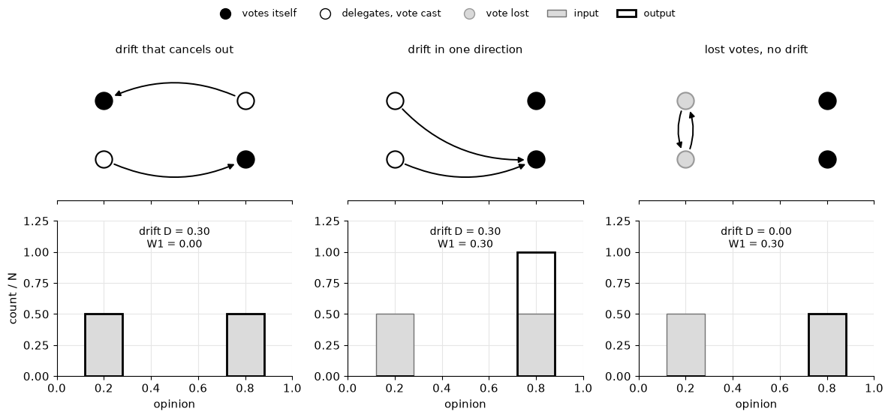
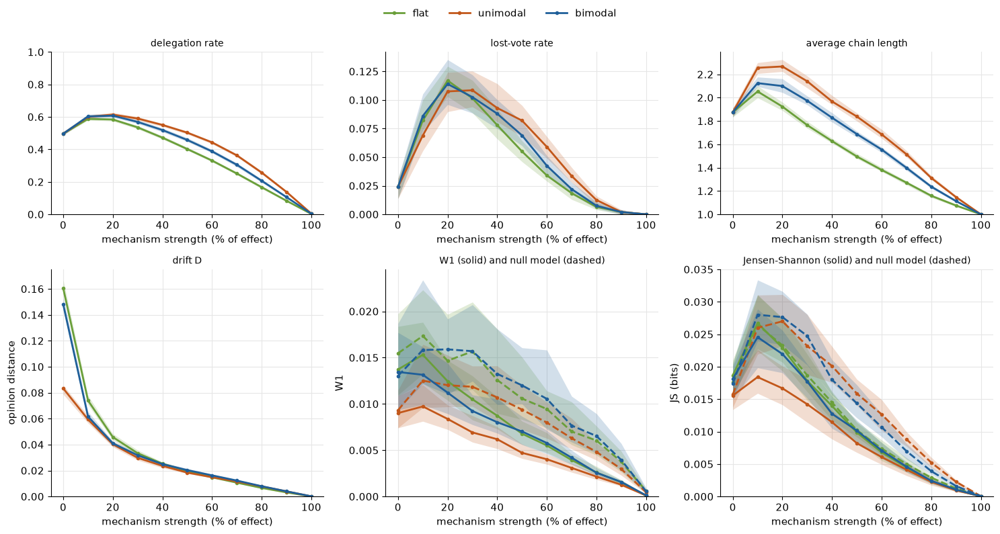
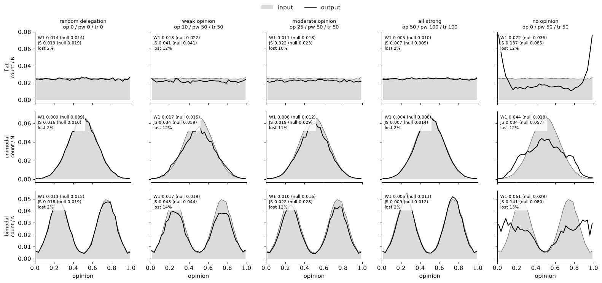
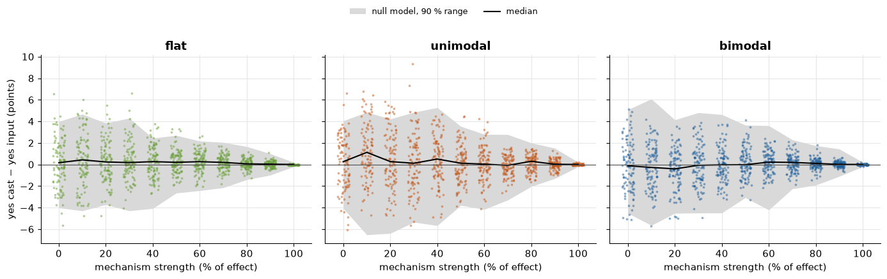
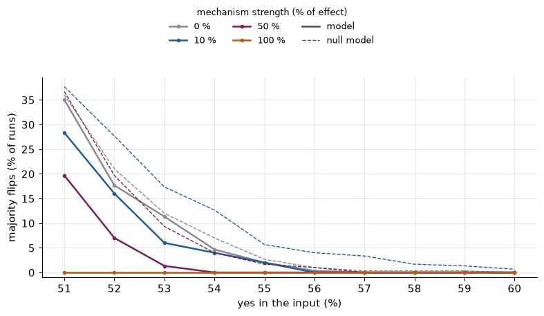

# Report 27 -- Part II: does the delegated outcome reproduce the input?

| setting | value |
|---|---|
| network | Watts-Strogatz, N = 1000, K = 30, 5 % rewiring |
| issues T |  1000 |
| mechanisms | $r_{op} = r_{pw} = r_{tr}$ |
| seeds | 100 |

# 1. Input and output in theory

We compare what the population thinks (the **input**) with what is actually cast under liquid democracy (the **output**). Under direct democracy the two are identical.

**Input.** The opinions $o_1, \dots, o_N \in [0, 1]$ of all agents, with distribution $P_{in}$.

**Output.** The vote of agent $i$ is cast by the end of its delegation chain, its *root* $R(i)$, with the root's opinion $o_{R(i)}$. Direct voters are their own root, votes whose chain ends in a cycle are lost. With $C$ the set of agents whose vote is cast, $P_{out}$ is the distribution of the opinions $o_{R(i)}$, $i \in C$.

**One number: the Wasserstein distance**  The Wasserstein distance is the minimal cost of transforming one distribution into another, where moving a share of the votes by a distance $d$ costs that share times $d$. Here it is the smallest average distance by which the cast votes would have to be shifted along the opinion scale to reproduce the opinions of the population. In one dimension it equals the area between the two cumulative distribution functions,

$$W_1(P_{in}, P_{out}) = \int_0^1 |F_{in}(x) - F_{out}(x)|\, dx,$$

where $F(x)$ is the share of votes with an opinion of at most $x$. $W_1$ is measured in units of opinion: $W_1 = 0.01$ means that the votes would have to move by 0.01, or 1 % of the scale, on average. It needs no binning and bounds the shift of the mean opinion, $|\bar o_{out} - \bar o_{in}| \le W_1$.

- The Wasserstein distance $W_1$ measures how far the cast votes would have to be moved along the opinion scale, on average, so that their distribution matches the opinions of the population. It is zero if the two distributions are identical and grows both with the share of votes that are displaced and with the distance by which they are displaced.

**A second number: the Jensen-Shannon divergence**  $W_1$ weighs every shift by how far it goes. The Jensen-Shannon divergence ignores distances and only compares the shapes of the two distributions. With both as histograms over the same bins $b$ and $M = \frac{1}{2}(P_{in} + P_{out})$ their average,

$$JS(P_{in}, P_{out}) = \tfrac{1}{2}\, KL(P_{in} \,\|\, M) + \tfrac{1}{2}\, KL(P_{out} \,\|\, M), \qquad KL(P \,\|\, Q) = \sum_b p_b \log_2 \frac{p_b}{q_b}.$$

It is a symmetric version of the Kullback-Leibler divergence that stays finite when a bin is empty, and lies between 0 (identical histograms) and 1 (no overlap). It depends on the bins (here 40 over $[0, 1]$) and is above 0 even for two samples of the same distribution, so it is read against the null model as well.

**Why two numbers.** Both are zero when the cast votes reproduce the input, but they look at different things. $W_1$ counts *how far* the votes are moved: shifting a share of the votes to the other end of the scale costs much more than shifting it slightly, so $W_1$ measures a systematic displacement of the result and bounds the shift of the mean. JS counts only *how much* of the two histograms no longer overlaps: a share moved into the neighbouring bin and the same share moved across the whole scale give the same value, and shifts within a bin are not seen at all. JS therefore reacts to a change in shape, for example votes piling up on a few root opinions while the opinions in between lose their votes, even when the votes moved only a little and $W_1$ stays small. A high $W_1$ means the result is shifted; a high JS with a small $W_1$ means the votes stay close to where they were but are concentrated on fewer opinions.

**Drift:** Part I measured the *average ideological drift* $D = \frac{1}{|C|} \sum_{i \in C} |o_i - o_{R(i)}|$, here over all cast votes with direct voters counting as zero. Drift is about individuals, $W_1$ about the result as a whole. Drift in opposite directions cancels out, and lost votes only matter if they come more from some opinions than from others. Since $D$ is one way of moving the input onto the output and $W_1$ the cheapest,

$$W_1(P_{in}, P_{out}) \le \underbrace{W_1(P_{in}, P_{in}^{C})}_{\text{lost votes}} + \underbrace{D}_{\text{drift}},$$

with $P_{in}^{C}$ the own opinions of the agents in $C$. The figure shows the three cases with four agents (two at 0.2, two at 0.8).

**Null model.** Even random delegation gives $W_1 > 0$: a few roots cast many votes, so the output is lumpier than the input. The null model keeps the delegation structure (same roots, same vote weights, same lost votes) but shuffles the opinions over the agents, so its $W_1$ is the distortion from bundling alone. $W_1$ above the null means roots with certain opinions are favoured; below the null means delegators pick roots close to themselves, better than chance.

- The null model keeps the delegation structure of each run (the same roots, vote weights and lost votes) but assigns the opinions to the agents at random. If $W_1$ exceeds its null value, the distortion stems from who is chosen as a representative; if not, it is explained by the bundling of votes alone.

    

    

# 2. Simulation and null model

One run per distribution, mechanism strength and seed. Three input distributions:

- **flat**: $U[0, 1]$
- **unimodal**: $N(0.5, 0.15^2)$
- **bimodal**: two camps, equal mix of $N(0.25, 0.10^2)$ and $N(0.75, 0.10^2)$

**Null model** (Section 1): same delegations, opinions permuted over the agents. If $W_1$ is not above the null, the distortion comes from bundling votes, not from who is chosen as a delegate.

| quantity | meaning |
|---|---|
| `delegating` | share of agents who delegate (the x axis mixes strength and this share, Figure 2 shows it) |
| `lost` | share of agents whose vote ends in a cycle |
| `drift` | average ideological drift $D$ over the cast votes |
| `w1` | $W_1(P_{in}, P_{out})$, **the main number** |
| `w1_null` | $W_1$ of the null model |
| `js`, `js_null` | Jensen-Shannon divergence of the model and of the null model |
| `w1_lost` | $W_1(P_{in}, P_{in}^C)$: what the lost votes alone change (one sentence in the text) |

# 3. Input against output

**Figure 2: one number per run.** Lines: median over seeds, bands: middle 50 %. Colour: distribution.

- *Top*: share of agents who delegate, lost-vote rate and average chain length. The strength axis also changes how much is delegated, so a falling $W_1$ partly reflects less delegation
- *Bottom*: drift $D$ over the cast votes, $W_1$ and the Jensen-Shannon divergence, each against the null model (dashed)

    

    

**Figure 3: five combinations of the three mechanisms.** The diagonal above raises all three mechanisms together. Part I showed that the extremes lie off the diagonal, where opinion is weak and power and trust are strong. Grey: input, black: output (mean over seeds), with the median $W_1$ and Jensen-Shannon divergence (each with its null model) and the lost-vote rate.

| combination | op / pw / tr | why |
|---|---|---|
| random delegation | 0 / 0 / 0 | reference: bundling only |
| weak opinion | 10 / 50 / 50 | power and trust at 50 %, a little opinion responsiveness |
| moderate opinion | 25 / 50 / 50 | the same with more opinion responsiveness |
| all strong | 50 / 100 / 100 | power and trust at full strength, opinion at half |
| no opinion | 0 / 50 / 50 | power and trust at 50 %, no opinion responsiveness |

    

    

# 4. Example Run

**The question.** A yes / no decision on a value: an agent says yes if its opinion is at least $\tau$. Per seed, $\tau$ is chosen so that exactly $50\,\% + m$ of all agents say yes (direct democracy). The delegations do not depend on the issue, so the final state of each run applies to every $\tau$.

**What is measured**, per run and margin $m$:

- **Gap**: yes share among the cast votes minus yes share of the input, in points. Mean over seeds: bias; standard deviation: swing
- **Flip**: no majority for yes among the cast votes ($\le 50\,\%$), although the input has $50\,\% + m$
- The same for the null model

For scale: 1000 voters drawn at random from a population with 60 % yes vary with a standard deviation of $\sqrt{0.6 \cdot 0.4 / 1000} \approx 1.5$ points.

**Figure 4: the gap at 60 / 40.** One dot per seed, black: median. Grey band: 90 % range of the null model.

    

    

**Gap and flips.** Per distribution and strength over $n$ seeds: mean and standard deviation of the gap at 60 / 40, and the share of runs (in %) in which the majority flips at 60 / 40, 55 / 45 and 51 / 49.

**Figure 5: from which majority on is the result safe?** Share of runs in which the majority flips, against the yes share of the input. Pooled over the three distributions (per distribution: table `flip_by_margin`). Solid: model, dashed: null model, colour: strength.

    

    

## Literature

- Lin, J. (1991). Divergence measures based on the Shannon entropy. *IEEE Transactions on Information Theory* 37(1), 145–151.
- Vallender, S. S. (1973). Calculation of the Wasserstein distance between probability distributions on the line. *Theory of Probability and Its Applications* 18(4), 784–786.

## Runtime
