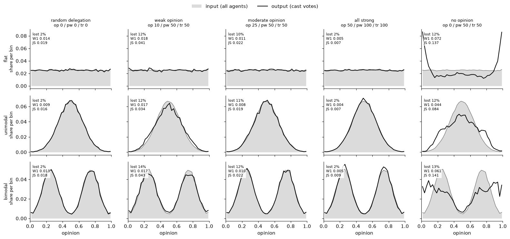
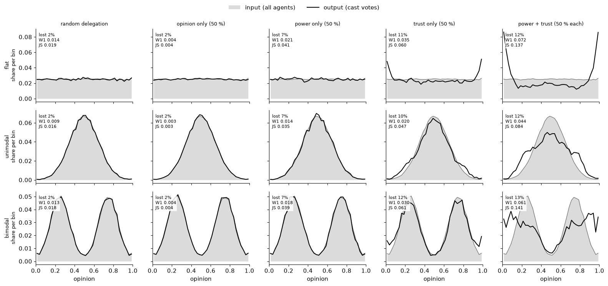
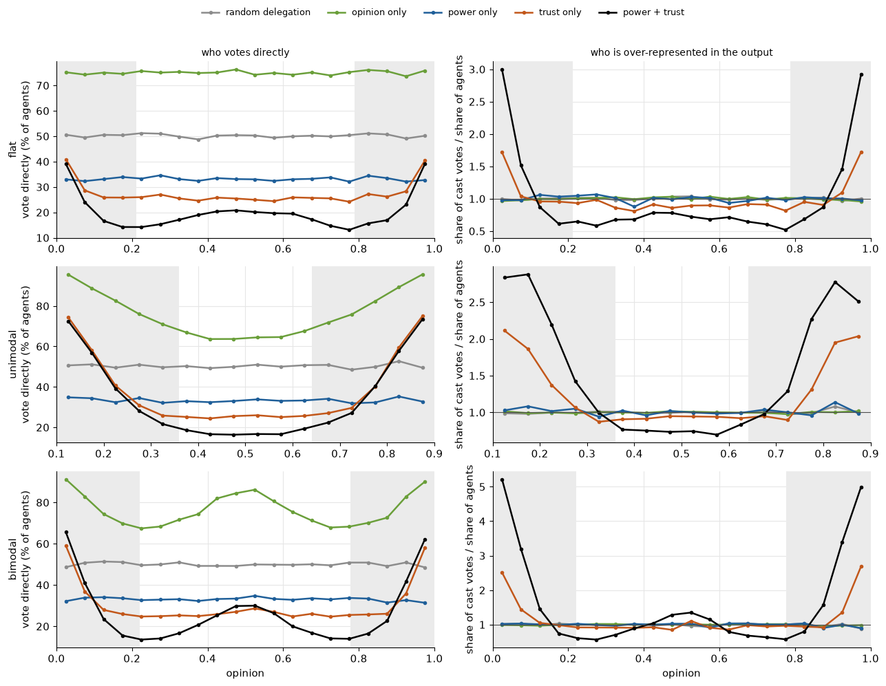
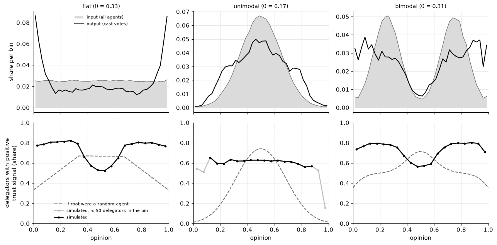
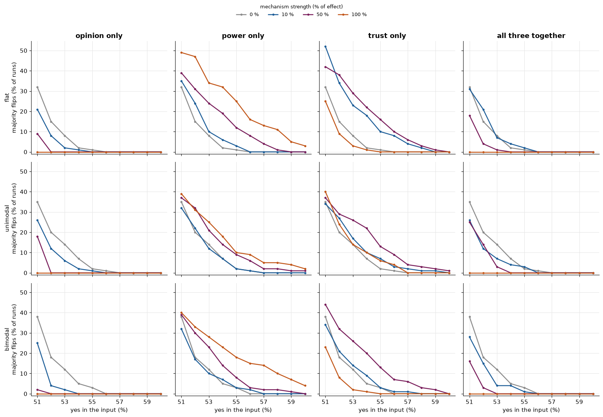

# Report 28 -- Part II

| setting | value |
|---|---|
| network | Watts-Strogatz, N = 1000, K = 30, 5 % rewiring |
| issues T | 1000 |
| inputs | flat $U[0,1]$, unimodal $N(0.5, 0.15^2)$, bimodal (equal mix of $N(0.25, 0.10^2)$ and $N(0.75, 0.10^2)$) |
| seeds | 100 per setting |

# 1. Input and output

**Figure 1.** Input (grey) and output (black).

    

    

# 2. Each mechanism alone

## The trust function

After each issue a delegator $i$ compares its own opinion $o_i$ with the vote cast for it, $v_i$ (the opinion of its root):

$$s_i = \begin{cases} +1 & |o_i - v_i| < \theta \\ -1 & \text{otherwise} \end{cases}, \qquad \theta = E|o_j - o_k| \text{ (mean distance between two agents of the input)}$$

## Check: opinion, power and trust one at a time

Each mechanism at 50 %, the other two at 0 %; random delegation (all 0 %) as reference, and power and trust together at 50 % each.

**Figure 2.** Input (grey) and output (black).

    

    

**Figure 3.** Grey band: opinions where the expected trust signal is negative, $E|o - X| > \theta$ for a random agent $X$ of the input.

    

    

<table border="1" class="dataframe">
  <thead>
    <tr style="text-align: right;">
      <th></th>
      <th>theta</th>
      <th>expected signal positive between</th>
    </tr>
    <tr>
      <th>input</th>
      <th></th>
      <th></th>
    </tr>
  </thead>
  <tbody>
    <tr>
      <th>flat</th>
      <td>0.333</td>
      <td>0.21 and 0.79</td>
    </tr>
    <tr>
      <th>unimodal</th>
      <td>0.169</td>
      <td>0.36 and 0.64</td>
    </tr>
    <tr>
      <th>bimodal</th>
      <td>0.306</td>
      <td>0.22 and 0.78</td>
    </tr>
  </tbody>
</table>

**Figure 4: why the centre votes directly (power + trust, 50 % each, 100 seeds).** Top: input (grey) and output (black). Bottom: share of delegators with a positive trust signal; dashed: expected if the root were a random agent of the input; light grey: bins with fewer than 50 delegators.

    

    

## Why trust deviates

- **Trust only**: the choice of the delegate ignores its opinion, but the trust signal does not. Agents in the **centre** are more often within $\theta$ of a random agent: mostly positive signals, they keep delegating. Agents at the **edges** (grey band) are more often further away: negative signals, they vote themselves. The centre gives its votes away, the edges keep theirs, so the output has more weight at the edges than the input.

- **Power + trust**: the same pattern, but stronger. The edge agents who vote themselves also collect delegations, because power bundles votes on them, so their weight rises further.

- **The hump in the centre** (flat and bimodal, Figure 4): once the votes sit at both edges, roots are no longer random agents. An agent at 0.5 is further than $\theta$ from both groups of roots, gets negative signals and votes itself more often than its neighbours. In the unimodal input the edges hold too few agents, the roots stay in the centre and there is no hump.

# 3. Majority flips

**How the yes share is set.** 

1. Yes/no question: an agent says yes if its opinion is $\geq \tau$.
2. $\tau$ is the $(50 - m)$ % quantile of the opinions in the run, so exactly $50\,\% + m$ of all agents say yes ($m = 1, \dots, 10$). Example unimodal: 51 / 49 $\Rightarrow \tau \approx 0.496$, 60 / 40 $\Rightarrow \tau \approx 0.46$.
3. Output: every cast vote counts with the opinion of its root; lost votes drop out. Yes share = share of cast votes with root opinion $\geq \tau$.
4. **Flip**: yes has at most 50 % among the cast votes although the input has $50\,\% + m$.

**Figure 5: which mechanism makes the majority flip?** Rows: input distribution.

    

    

