Results – Effect of Responsiveness on Liquid Democracy Outcomes (RQ1-3)
================
2026-09-25

## Fixed inputs

**N = 1000, K = 60, T = 80 (40 voting rounds, Δt = 2), c = 0.5, forget
rate = 50% over 5 voting rounds.**

**50 seeds per cell** (raised from an initial 1-seed
structural-validation pass once the plots/folders checked out).

| pct |     r_op |  r_pw |   r_tr |
|----:|---------:|------:|-------:|
|   0 |     0.00 |  0.00 |   0.00 |
|  10 |    13.17 |  0.05 |   2.09 |
|  20 |    28.85 |  0.10 |   3.99 |
|  30 |    48.58 |  0.15 |   6.79 |
|  40 |    72.89 |  0.20 |   9.76 |
|  50 |   109.53 |  0.32 |  12.86 |
|  60 |   166.16 |  0.51 |  15.97 |
|  70 |   243.11 |  1.07 |  22.97 |
|  80 |   429.31 |  3.04 |  30.01 |
|  90 |   910.23 |  6.59 |  48.68 |
| 100 | 16384.00 | 64.00 | 128.00 |

r needed to reach a given % of each dimension’s own saturated effect
(Report_22 Sec. 6) – everything below is expressed in these percentages,
not raw r

## Extreme behaviour: single-dial vs. isolated dimensions, 0-100%

Before the paired sweep below, a wider look across the full 0-100% range
of each dimension’s own saturated effect (Report_22’s calibration) –
fixed at N=1000, K=60 – showing every metric used in RQ1-3 below, to see
where each one saturates rather than assuming the range used in the
paired sweep already captures the full picture. Four scenarios: **all**
($r_{op},r_{pw},r_{tr}$ all at the same %, each translated via
`R_PCT_LOOKUP`) and each dimension **isolated** in turn (one dimension
at that %, the other two at 0) – so the joint effect and each
mechanism’s own isolated effect are visible side by side. Split into one
plot per RQ below (same grid/data as a single combined plot would use)
so every plot in this report saves into exactly one RQ folder.

------------------------------------------------------------------------

## Shared design: paired sweep, third dimension held fixed

Same sweep grid for all three RQs. For each pair of responsiveness
dimensions, both are varied *together* in **percentage** terms (same
shared % of each dimension’s own saturated effect, translated to that
dimension’s own r via `R_PCT_LOOKUP` – op/pw/tr saturate at wildly
different raw r, so a shared raw value no longer means the same thing
across dimensions) across $\{10,20,...,100\}\%$, while the third
dimension is held fixed at one of 3 percentage levels
($0\%, 50\%, 100\%$) – shown as 3 coloured lines in the same plot.
Repeating this for each of the 3 possible pairs gives 3 plots per RQ (as
many metrics as that RQ needs, faceted), covering all three
responsiveness dimensions:

- $r_{op}, r_{pw}$ varied together $\in \{10,...,100\}\%$,
  $r_{tr} \in \{0,50,100\}\%$ (fixed)
- $r_{op}, r_{tr}$ varied together $\in \{10,...,100\}\%$,
  $r_{pw} \in \{0,50,100\}\%$ (fixed)
- $r_{pw}, r_{tr}$ varied together $\in \{10,...,100\}\%$,
  $r_{op} \in \{0,50,100\}\%$ (fixed)

------------------------------------------------------------------------

# Simulation grid (answers RQ1, RQ2 and RQ3 at once)

------------------------------------------------------------------------

# RQ1: delegation behaviour

Metrics: delegation rate, lost-vote rate, delegation stability (share of
agents keeping the same delegation target as the previous round –
`history_flickerness` from `simulate_liquid_democracy()`, NA on round 1;
see `Network.R`’s `history_stability[t]` computation for the exact
per-round definition), and average delegation-chain length.

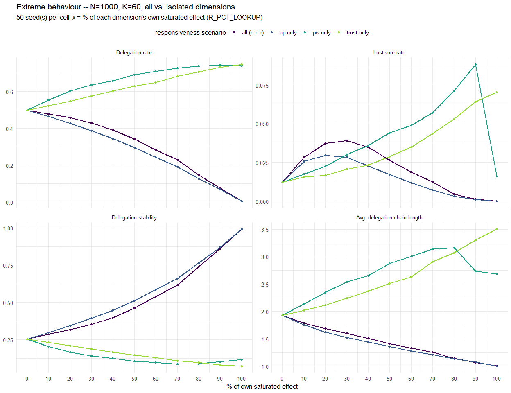<!-- --><!-- -->

<!-- -->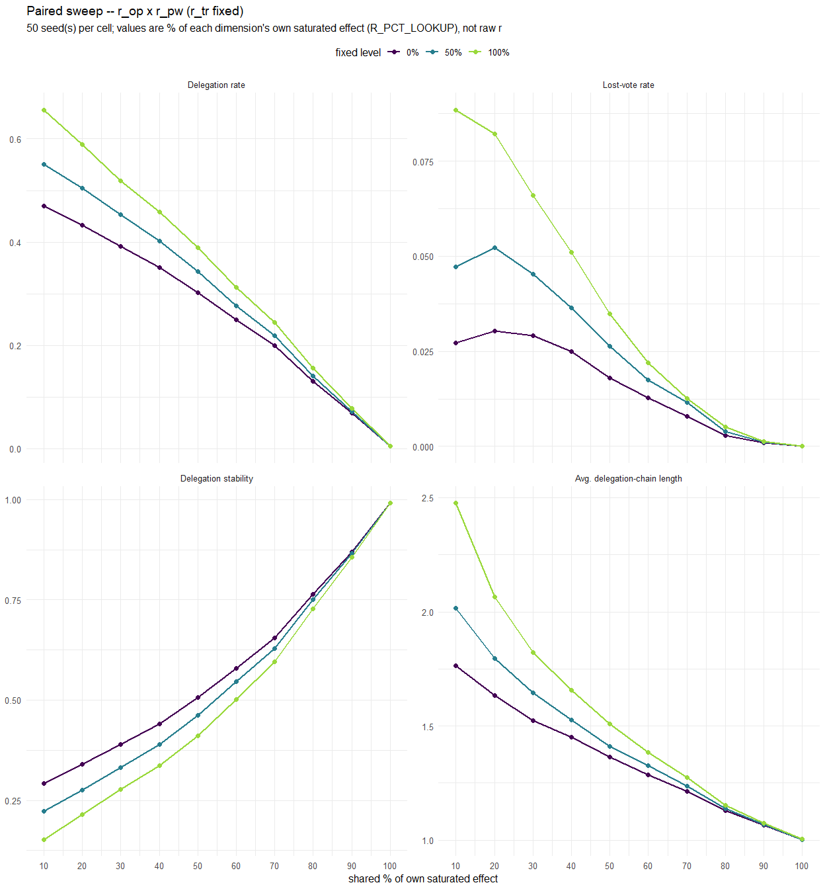<!-- -->

<!-- -->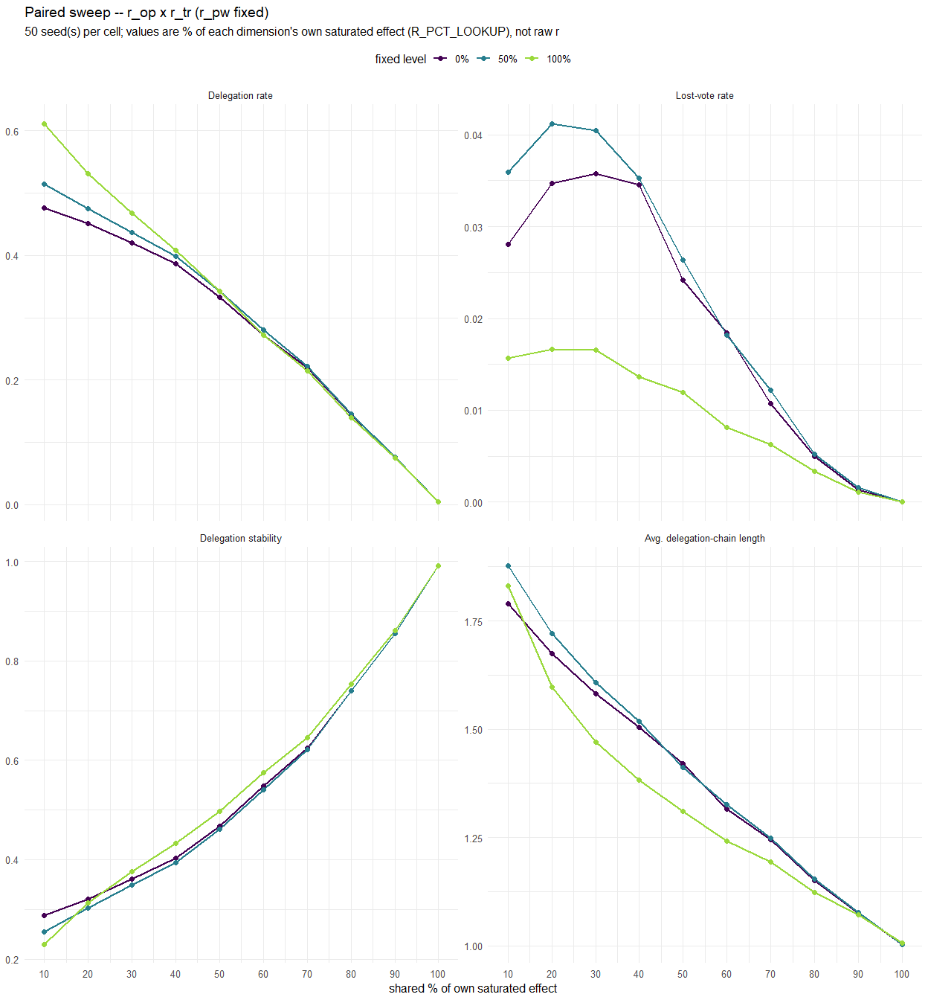<!-- -->

<!-- -->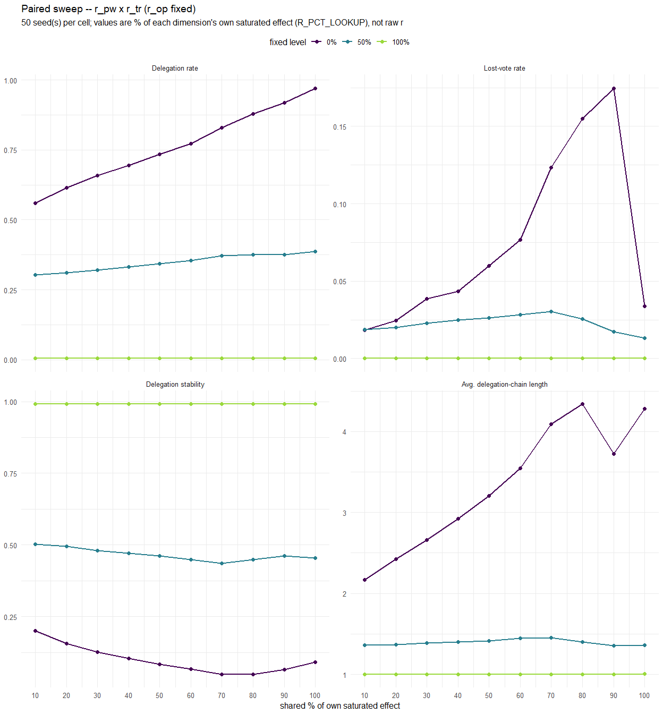<!-- -->

## Chain-length distribution across seeds

The paired-sweep plots above show only the mean across 50 seeds per grid
cell – the violin plots below show the full per-seed distribution of
chain length at each grid point, so spread/skew/outliers the mean alone
hides are visible.

<!-- -->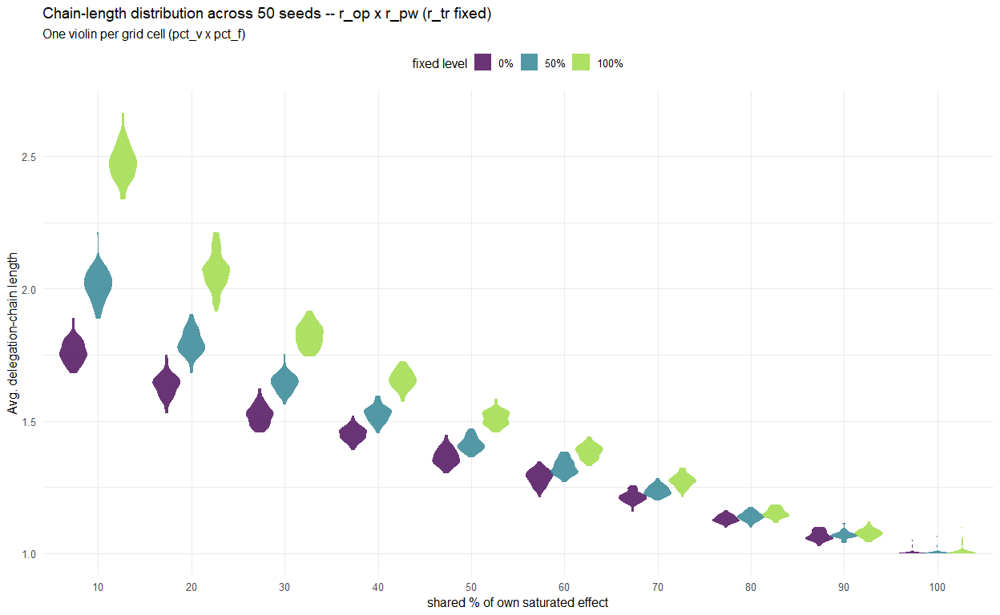<!-- -->

<!-- -->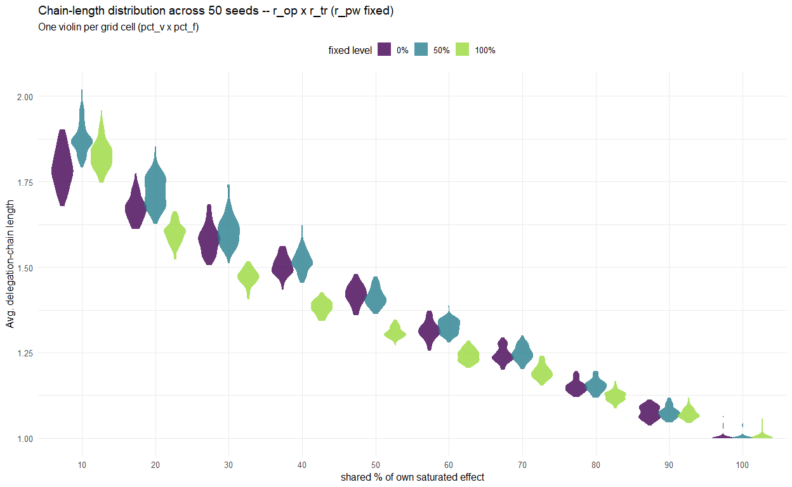<!-- -->

<!-- -->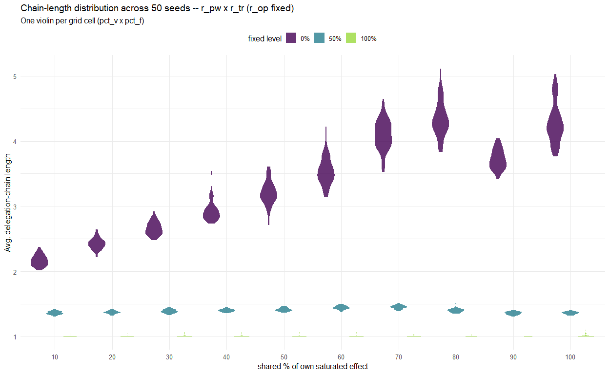<!-- -->

## Distribution summary – all RQ1 metrics

Min/max and quartiles alongside the mean, across every individual (pair,
pct_v, pct_f, seed) run in the paired sweep – not just the grid-cell
averages the plots above show, so the extreme cases seen anywhere across
the whole RQ1 sweep are visible in one place.

| metric                       |   Min |    Q1 | Median |  Mean |    Q3 |   Max |    SD |
|:-----------------------------|------:|------:|-------:|------:|------:|------:|------:|
| Delegation rate              | 0.001 | 0.130 |  0.331 | 0.321 | 0.460 | 0.979 | 0.237 |
| Lost-vote rate               | 0.000 | 0.003 |  0.018 | 0.025 | 0.033 | 0.280 | 0.032 |
| Delegation stability         | 0.038 | 0.329 |  0.477 | 0.541 | 0.766 | 0.997 | 0.289 |
| Avg. delegation-chain length | 1.000 | 1.115 |  1.375 | 1.570 | 1.647 | 5.112 | 0.732 |

RQ1 distribution summary across the full paired sweep (all pct_v x pct_f
x pair combinations, 50 seeds each)

## Answering RQ1

*(Fill in once the plots above reflect the real simulation run – this is
a scaffold, not a pre-written conclusion.)*

- **Ideological responsiveness ($r_{op}$):** …
- **Competence/power responsiveness ($r_{pw}$):** …
- **Trust responsiveness ($r_{tr}$):** …
- **Interactions between dimensions:** …
- **Overall answer to RQ1:** …

------------------------------------------------------------------------

# RQ2: quality of political representation

Metric: average ideological drift (`avg_drift`) – the mean distance
between an agent’s own opinion and the opinion of the agent who
ultimately casts a vote on its behalf.

Expected: $r_{op}$ reduces drift (dissimilar neighbours become less
attractive delegates); $r_{pw}$ increases drift (powerful delegates stay
attractive even when ideologically distant); $r_{tr}$ reduces drift,
same mechanism as $r_{op}$. Because attractiveness is multiplicative,
the joint $r_{op} \times r_{pw}$ effect is expected to favour the
opinion term (net drift reduction), not a simple additive combination of
the two individual effects.

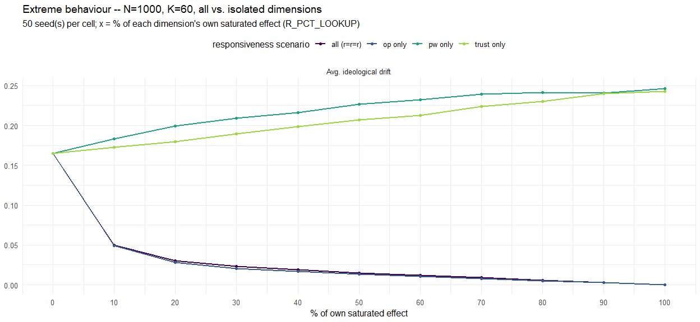<!-- --><!-- -->

<!-- -->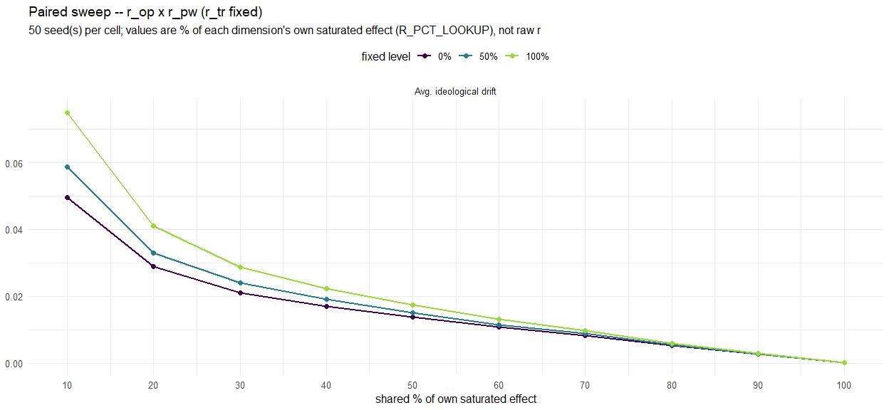<!-- -->

<!-- -->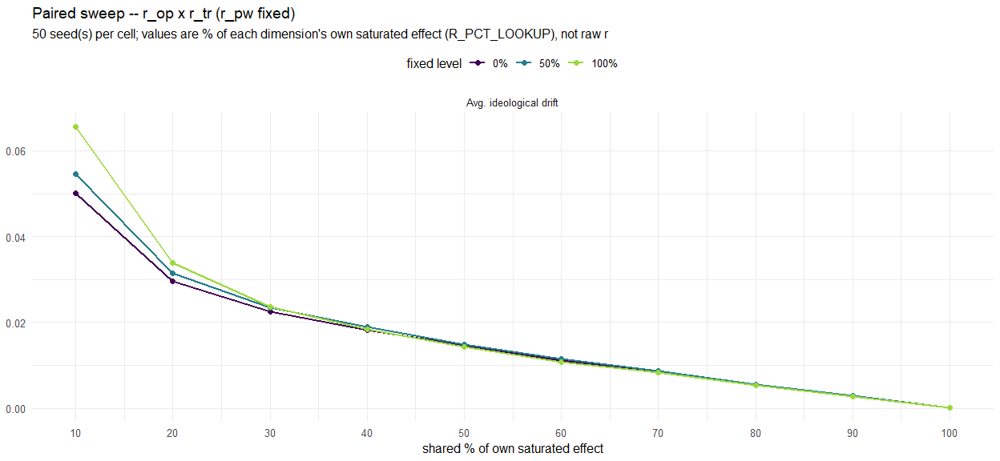<!-- -->

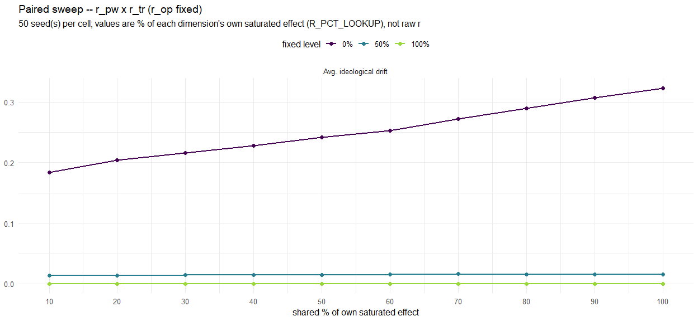<!-- --><!-- -->

## Answering RQ2

*(Fill in once the plots above reflect the real simulation run – this is
a scaffold, not a pre-written conclusion.)*

- **Ideological responsiveness ($r_{op}$):** …
- **Competence/power responsiveness ($r_{pw}$):** …
- **Trust responsiveness ($r_{tr}$):** …
- **Joint $r_{op} \times r_{pw}$ effect (opinion term expected to
  dominate):** …
- **Overall answer to RQ2:** …

------------------------------------------------------------------------

# RQ3: concentration of voting power

Metrics: voting-power share held by the top 5% of agents
(`top5_power_share`) and the fraction of agents needed to collectively
hold 50% of total voting power (`share_50pct`).

Expected: $r_{op}$ lowers concentration (more agents vote directly);
$r_{pw}$ raises concentration (rich-get-richer – already-powerful agents
become more attractive delegates). For the joint $r_{op} \times r_{pw}$
effect: as in RQ2, low opinion-based attractiveness is expected to
constrain how much high voting power can raise a neighbour’s overall
attractiveness – so increasing both together should yield *lower*
concentration than high $r_{pw}$ alone.

<!-- -->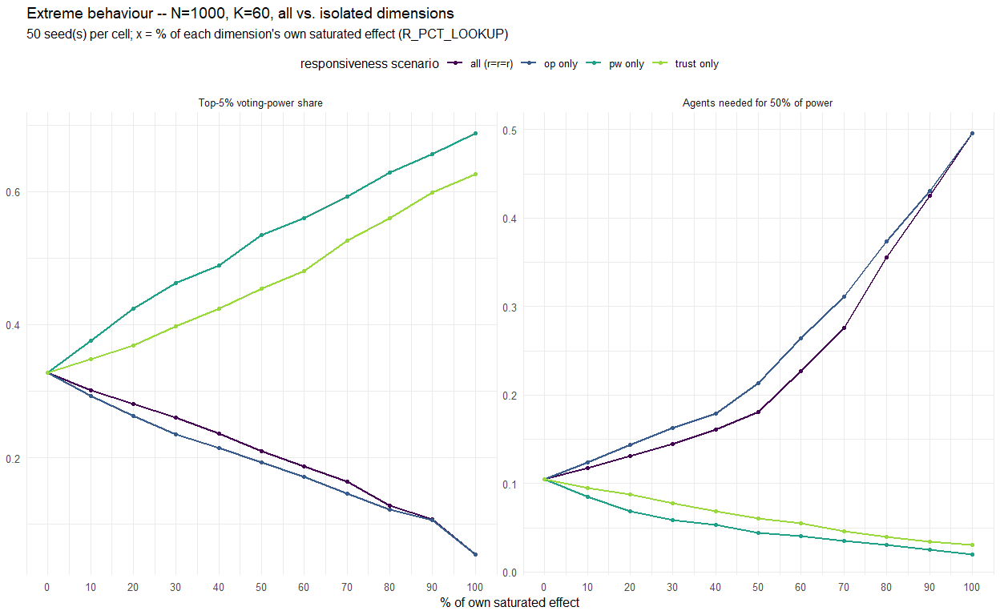<!-- -->

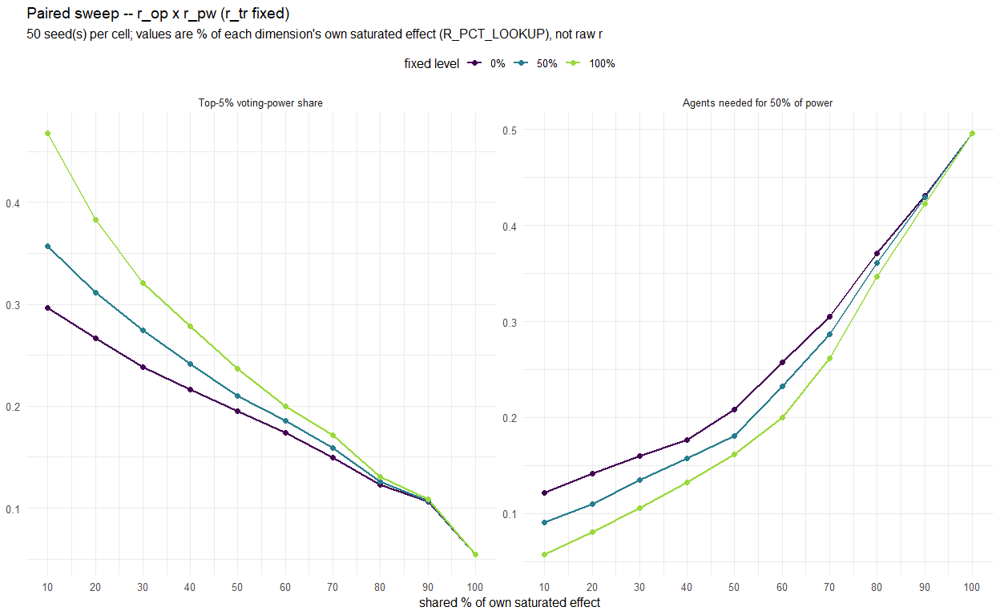<!-- --><!-- -->

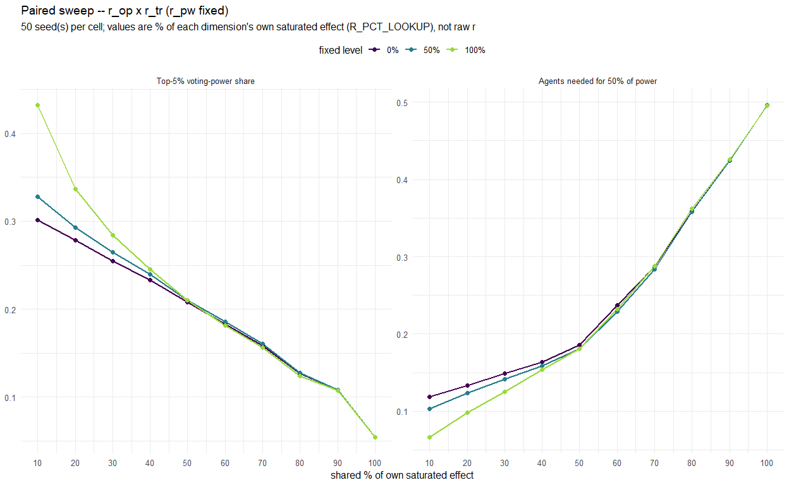<!-- --><!-- -->

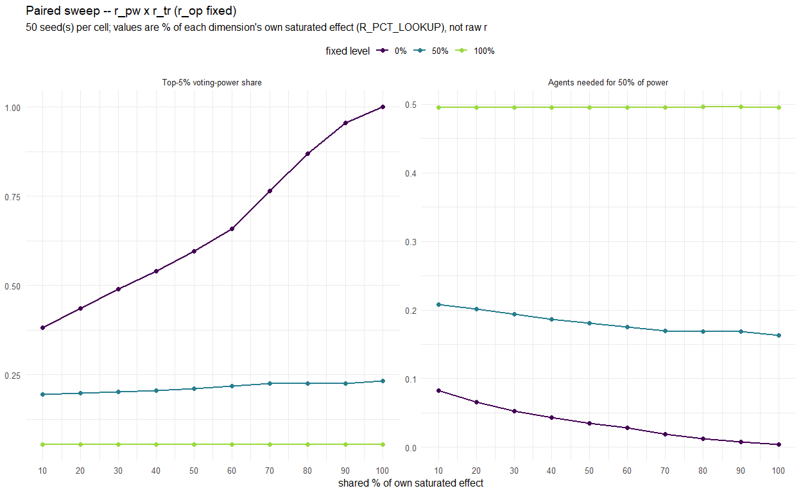<!-- --><!-- -->

## Answering RQ3

*(Fill in once the plots above reflect the real simulation run – this is
a scaffold, not a pre-written conclusion.)*

- **Ideological responsiveness ($r_{op}$):** …
- **Competence/power responsiveness ($r_{pw}$):** …
- **Joint $r_{op} \times r_{pw}$ effect (opinion term expected to
  constrain concentration):** …
- **Overall answer to RQ3:** …

------------------------------------------------------------------------

# Lost votes: cycle mechanics

A closer look at *how* votes actually get lost – not just the lost-vote
*rate* (RQ1 above), but the underlying cycle mechanism: how many agents
are caught in a cycle at any given moment, what size those cycles are,
and how quickly an individual agent escapes one once caught. Uses
`Network.R`’s `lost_agent_ids` (per-round, which specific agent ids have
a lost/NA vote – added for this section; `cycle_breakdown`, used
elsewhere, only has per-round *counts* by cycle length, not agent
identity, so it can’t answer “is agent i still lost next round”).

Run at the fully calibrated model (r_op=r_pw=r_tr=100% of each one’s own
saturated effect, r_ig=0 – no group dimension here), N/K/T as in “Fixed
inputs” above, over a steady-state window (last 30 of 80 rounds), 20
seeds.

## How many agents are stuck in a cycle, and how big are the cycles?

| cycle_length | mean_n_agents | mean_pct_of_pop |
|-------------:|--------------:|----------------:|

Average number of agents (out of N=1000) stuck in a cycle of each size,
at a random steady-state round (last 30 of 80 rounds, 20 seeds)

    ## 
    ## **Total: on average 0.0 agents (0.00% of the population) are lost to a cycle of some size at any given steady-state round.**

<!-- -->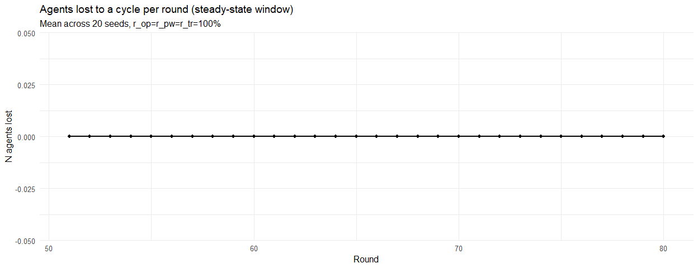<!-- -->

## Round-to-round recovery: was a lost vote still lost next round?

For every pair of consecutive rounds in the steady-state window: of the
agents whose vote was lost at round $t$, what share are *not* lost at
round $t+1$ (i.e. recovered)?

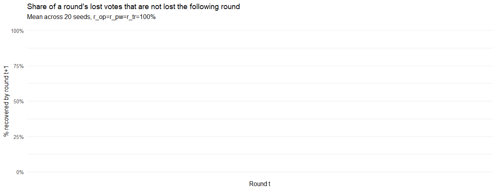<!-- --><!-- -->

**On average, NaN% of agents whose vote is lost to a cycle in a given
round are no longer lost the very next round**, averaged across the
steady-state window (last 30 rounds) and 20 seeds.

## Summary

*(Fill in once the plots/table above reflect the real simulation run.)*

- **Typical cycle size:** …
- **Share of the population affected at any moment:** …
- **Round-to-round recovery rate:** …
- **Implication for the lost-vote rate seen in RQ1:** …
