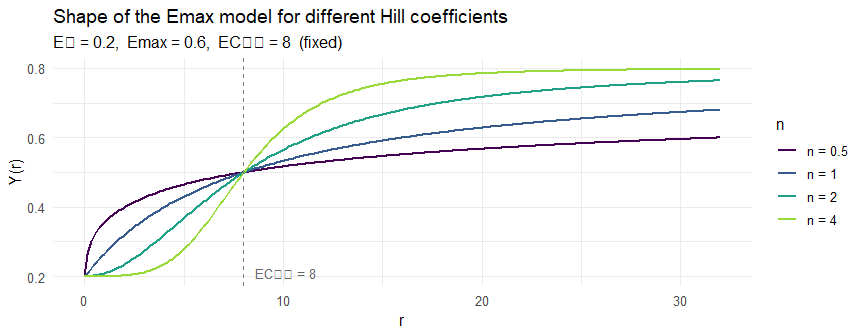

Statistical Methods — Saturation Analysis (RQ1)
================
2026-06-18

- [Overview](#overview)
- [1 GAM — Flexible Curve Fit](#1-gam--flexible-curve-fit)
  - [Why a GAM?](#why-a-gam)
  - [Model](#model)
  - [How the smooth is estimated](#how-the-smooth-is-estimated)
  - [What the GAM answers](#what-the-gam-answers)
- [2 Derivative — Saturation Point
  $r^*$](#2-derivative--saturation-point-r)
  - [Marginal effect per doubling](#marginal-effect-per-doubling)
  - [Definition of $r^*$](#definition-of-r)
- [3 Emax Model — Interpretable
  Parameters](#3-emax-model--interpretable-parameters)
  - [Why a second model?](#why-a-second-model)
  - [Model equation](#model-equation)
  - [EC$_{90}$: the practical simulation
    boundary](#ec_90-the-practical-simulation-boundary)
  - [Fitting and model selection](#fitting-and-model-selection)
- [4 Convergence Check](#4-convergence-check)
- [5 Notation](#5-notation)
- [6 Key References](#6-key-references)

# Overview

The goal of RQ1 is to find, for each responsiveness parameter $r$, the
range beyond which further increases in $r$ produce negligible changes
in the network metrics. This is a **saturation** problem: the effect of
$r$ is expected to grow fast at first and then flatten out.

The analysis has four steps:

1.  **GAM** — fit a flexible curve to see the shape without assumptions
2.  **Derivative** — find $r^*$, the point where the slope drops to 5%
    of its peak
3.  **Emax model** — fit an interpretable saturation curve and extract
    EC$_{50}$, EC$_{90}$
4.  **Convergence check** — confirm that $r^*$ and EC$_{90}$ agree

------------------------------------------------------------------------

# 1 GAM — Flexible Curve Fit

## Why a GAM?

We know the simulation produces saturation in principle (all outputs are
bounded), but we do not know the exact curve shape from the algorithm
alone. The emergent behaviour depends on network topology, delegation
dynamics, and feedback — so the shape must be read from the data. A
**Generalised Additive Model (GAM)** fits the curve flexibly, without
assuming it is, say, a straight line or a specific S-curve.

## Model

$$\boxed{Y_i \;=\; f(\log_2 r_i) + \varepsilon_i, \qquad
\varepsilon_i \sim \mathcal{N}(0,\,\sigma^2)}$$

$Y_i$ is the metric value at parameter setting $r_i$ (averaged over
seeds). $f(\cdot)$ is an unknown smooth function estimated from data.

**Why $\log_2 r$?** The simulation sweeps $r$ over doublings
$\{1, 2, 4, 8, \ldots, 128\}$. On the log₂-scale these are equally
spaced, so each step carries the same information. On the original scale
they are wildly unequal ($r=1$ to $r=2$ is the same absolute gap as
$r=64$ to $r=65$, but a very different relative change).

## How the smooth is estimated

$f$ is built from $K=6$ piecewise-cubic polynomial pieces joined
smoothly at interior knots. A **penalty on curvature** prevents
overfitting:

$$\text{penalised fit} \;=\; \text{fit to data} \;-\; \lambda \int[f''(x)]^2\,dx$$

The penalty weight $\lambda$ is chosen automatically by **REML**
(Restricted Maximum Likelihood), which balances fidelity to the data
against smoothness. The result is characterised by its **effective
degrees of freedom (edf)**: edf $\approx 1$ means the fit is nearly a
straight line; edf $\approx 4$ means a comfortably curved fit.

## What the GAM answers

- Is the relationship **monotone**? (If not, the Emax model in Step 3 is
  invalid.)
- Does the curve **level off** before $r = 128$? (If not, the simulated
  range is too narrow.)
- Is the shape **sigmoidal** (slow start, fast middle, plateau) or
  purely **concave** (fast start, smooth plateau)? This determines the
  Hill coefficient in Step 3.

------------------------------------------------------------------------

# 2 Derivative — Saturation Point $r^*$

## Marginal effect per doubling

Differentiating with respect to $\log_2 r$ gives the marginal effect of
**one doubling of $r$**:

$$\frac{dY}{d(\log_2 r)} \;=\; f'(\log_2 r)$$

This is the most natural measure here, because the simulation grid is
itself a doubling sequence.

## Definition of $r^*$

$$\boxed{r^* = \min\!\left\{ r > 0 \;\Big|\;
  |f'(\log_2 r)| \;<\; 0.05 \cdot \max_{r'} |f'(\log_2 r')|\right\}}$$

Beyond $r^*$, each further doubling of $r$ changes $Y$ by **less than 5%
of the maximum change** seen anywhere in the grid — effectively
negligible.

The 5% threshold is scale-free (relative to the peak slope), applies
equally to all metrics, and is intentionally conservative. The full
derivative curve with 95% confidence bands is always shown in the
figures, so a reader can apply a different threshold if needed.

**Confidence bands** are derived from the posterior covariance of the
GAM coefficients via the delta method: $\mathrm{se}[f'(x_0)] =
\sqrt{\mathbf{x}_0^{\prime\top} \mathrm{Cov}(\hat{\boldsymbol{\beta}})\,
\mathbf{x}_0'}$, where $\mathbf{x}_0'$ is the vector of basis-function
derivatives at $x_0$.

------------------------------------------------------------------------

# 3 Emax Model — Interpretable Parameters

## Why a second model?

The GAM and its derivative answer *where* saturation occurs, but not
*how strong* the effect is or *how fast* it saturates. The **Emax
model** encodes the same curve in four interpretable numbers.

## Model equation

$$\boxed{Y(r) \;=\; E_0 \;+\; E_{\max} \cdot \frac{r^n}{\mathrm{EC}_{50}^n + r^n}}$$

<!-- -->

| Parameter | Meaning |
|----|----|
| $E_0$ | Value of $Y$ at $r = 0$ (network without responsiveness) |
| $E_{\max}$ | Additional change from $r=0$ to $r \to \infty$ (can be negative) |
| $\mathrm{EC}_{50}$ | The $r$ at which half of $E_{\max}$ is reached |
| $n$ | Steepness: $n=1$ → smooth concave (Michaelis-Menten); $n>1$ → sigmoidal |

**Why $E_0 \neq 0$?** Standard Hill / Michaelis-Menten equations force
$Y(0)=0$. That is wrong here — at $r=0$ there is already a delegation
network with its own structure. Fixing $E_0 = 0$ would systematically
distort all other parameters.

## EC$_{90}$: the practical simulation boundary

Setting $Y(r) = E_0 + 0.9\,E_{\max}$ and solving:

$$\mathrm{EC}_{90} \;=\; \mathrm{EC}_{50} \cdot 9^{1/n}$$

Beyond $\mathrm{EC}_{90}$, less than 10% of the total effect remains.
Simulating $r > \mathrm{EC}_{90}$ therefore adds very little scientific
value.

## Fitting and model selection

Parameters are estimated by **nonlinear least squares** (minimise the
sum of squared residuals). Two variants are compared:

- **Michaelis-Menten** ($n = 1$, 3 parameters)
- **Hill** (free $n$, 4 parameters)

The simpler model is kept unless the Hill fit is clearly better:
$\Delta\mathrm{AIC} = \mathrm{AIC}(\text{Hill}) - \mathrm{AIC}(\text{MM}) < -2$.

**Confidence intervals** for $\mathrm{EC}_{50}$ use **profile
likelihood**: the parameter is scanned over a grid while re-optimising
all others, and the CI is the range where the log-likelihood drops by
less than 1.92. This is more reliable than the standard Wald interval
when sample sizes are small (here: 9 $r$-values, 3–4 parameters).

------------------------------------------------------------------------

# 4 Convergence Check

Steps 2 and 3 use completely different methods to estimate where
saturation ends:

|  | Step 2 | Step 3 |
|----|----|----|
| Approach | Non-parametric (GAM slope) | Parametric (Emax model) |
| Output | $r^*$ | $\mathrm{EC}_{90}$ |
| Requires functional form? | No | Yes |

If both agree, the conclusion about the simulation range is **robust to
the choice of model**. The relative divergence is:

$$\delta \;=\; \frac{\mathrm{EC}_{90} - r^*}{r^*} \times 100\%$$

A value $|\delta| < 30\%$ is considered good agreement (both methods
point to the same order-of-magnitude boundary).

------------------------------------------------------------------------

# 5 Notation

| Symbol | Meaning |
|----|----|
| $r$ | Responsiveness parameter ($r_\text{op}$, $r_\text{pw}$, or $\gamma$) |
| $Y$ | Network metric (delegation rate, chain length, etc.) |
| $f(\cdot)$ | GAM smooth function |
| $\lambda$ | GAM smoothing parameter (auto-selected by REML) |
| $E_0,\,E_{\max},\,\mathrm{EC}_{50},\,n$ | Emax model parameters |
| $\mathrm{EC}_{90}$ | $r$ at which 90% of $E_{\max}$ is reached $= \mathrm{EC}_{50}\cdot 9^{1/n}$ |
| $r^*$ | Practical saturation point from GAM derivative (5% threshold) |
| $\delta$ | Relative divergence between $\mathrm{EC}_{90}$ and $r^*$ |

------------------------------------------------------------------------

# 6 Key References

- Wood, S. N. (2017). *Generalized Additive Models: An Introduction with
  R* (2nd ed.). Chapman & Hall/CRC.
- Holford & Sheiner (1981). Understanding the dose-effect relationship.
  *Clinical Pharmacokinetics*, 6(6), 429–453. — original Emax /
  EC$_{50}$ paper.
- Ritz et al. (2015). Dose-response analysis using R. *PLOS ONE*,
  10(12), e0146021.
