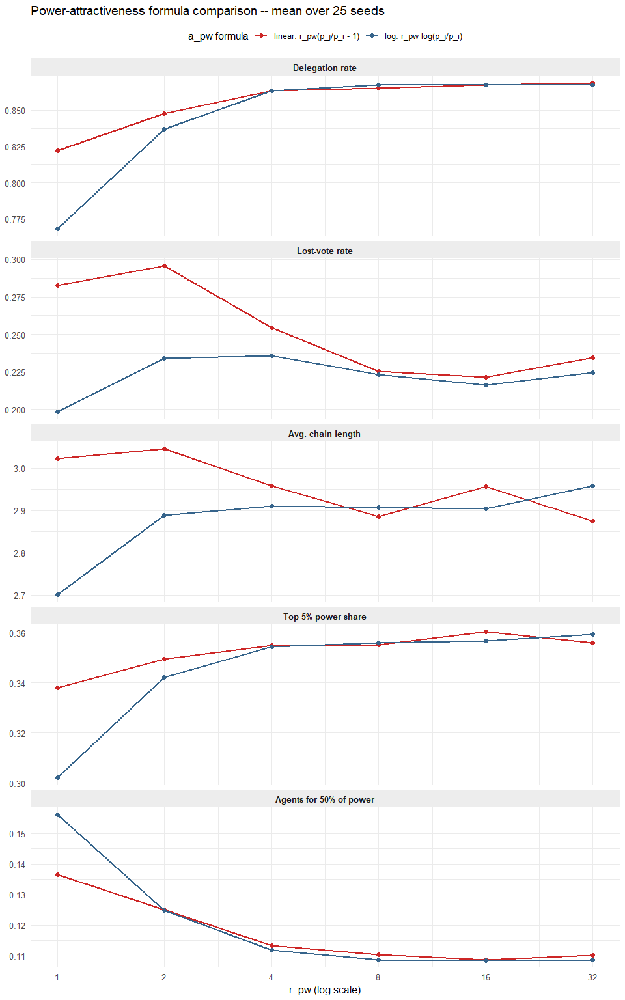

Testing Power: Linear-Ratio vs. Log-Ratio Power Attractiveness
================
2026-08-21

## Model parameters

- N = 500, k = 14 (Watts-Strogatz, p_rewire = 0.05), T = 20 rounds
- r_op = 0 (isolates the power term); r_pw in {1, 2, 4, 8, 16, 32}
- self-reliance c = 0.5, decision model = gaussian_mobius (Mobius
  self-vote curve)
- trust / in-group inactive; 25 seeds per r_pw value per formula

<!-- -->
